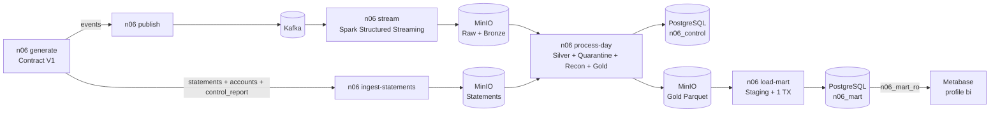

# N06 — Pipeline dữ liệu lớn cho giao dịch ngân hàng mô phỏng

Tiểu luận môn Dữ liệu lớn. Kafka → Spark Structured Streaming → MinIO (Raw/Bronze/Silver/Gold) → PostgreSQL mart → Metabase; Airflow điều phối theo ngày nghiệp vụ.

Trạng thái: khung repository. Cách cài đặt và chạy sẽ được bổ sung theo từng milestone (xem `PROGRESS.md`).

## Đọc theo thứ tự

1. `docs/spec.md` — đặc tả triển khai bản 1.2 (bắt buộc).
2. `docs/TASKS.md` — phân rã task, người sở hữu, mẫu giao việc cho agent.
3. `CLAUDE.md` — quy tắc cho coding agent (người cũng nên đọc).
4. `PROGRESS.md` — tiến độ hiện tại.
5. `docs/adr/` — các quyết định đã chốt.

## Cấu trúc

```text
.
├── CLAUDE.md                 quy tắc cho agent
├── PROGRESS.md               tiến độ task và milestone
├── contracts/                hợp đồng dữ liệu 1.0.0 — không sửa
│   └── N06_INPUT_CONTRACT_V1/{schemas,config,fixtures,tools}
├── config/                   cấu hình và profile, không có secret
├── infra/                    Docker Compose, Dockerfile, init script
├── src/n06/
│   ├── domain/  generator/  producer/  ingestion/          (A — Mạnh)
│   ├── spark_jobs/  quality/  reconciliation/  storage/    (B — Quang)
│   └── warehouse/  observability/                          (C — Quý)
├── sql/{migrations,dashboard_queries}/
├── dags/                     Airflow (P1)
├── tests/
│   ├── unit/  integration/  e2e/
│   ├── harness/              oracle đọc ground truth — src/ không được import
│   └── fixtures/             fixture bổ sung cho test
├── scripts/                  check_rules.py, stop_hook.sh
├── reports/                  kết quả benchmark do `n06 benchmark` sinh
├── docs/{spec.md,TASKS.md,adr/,architecture.md,runbook.md,benchmark-method.md}
├── .github/                  CI, CODEOWNERS, mẫu PR
└── .claude/                  Stop hook, subagent spec-reviewer (Claude Code)
```

Mỗi thư mục có `README.md` riêng ghi mục đích, người sở hữu, mục đặc tả liên quan và quy tắc.

## Cài đặt

Yêu cầu Python 3.11 (theo `docs/adr/0001-bo-phien-ban.md`). Từ một clone sạch, cài đặt toàn bộ môi trường và công cụ dev bằng một lệnh:

```bash
uv sync --extra dev
```

*(Hoặc nếu đã kích hoạt sẵn môi trường ảo Python 3.11: `pip install -e ".[dev]"`).*

## CLI (`n06`)

Sau khi cài đặt gói (`uv sync --extra dev` hoặc `pip install -e ".[dev]"`), toàn bộ thao tác vận hành đi qua lệnh `n06`:

```bash
# Xem danh sách lệnh và bảng mã thoát
n06 --help

# Sinh file .env cục bộ từ .env.example với secret ngẫu nhiên an toàn (không lộ secret ra màn hình),
# rồi tạo bucket object store của profile (object_store.bucket; chạy lại an toàn, không đổi gì).
n06 init-local --profile demo
n06 init-local --profile demo --require-buckets   # thoát mã 14 nếu bucket chưa sẵn sàng
n06 init-local --profile demo --skip-buckets      # chỉ sinh .env

# Kiểm tra toàn diện cấu hình, Python 3.11, CPU/RAM/disk, Docker, 4 service (kafka, minio, postgres, spark)
# và bucket object store của profile (báo đúng tên bucket thiếu)
n06 doctor --profile demo
n06 doctor --profile demo --json
```

**Chuỗi lệnh trên máy mới** (đây là thứ tự đã chạy thực tế; MinIO chưa chạy ở bước 1 nên không tạo được bucket):

```bash
n06 init-local --profile demo                      # 1. lần 1: sinh .env; bucket "unreachable" (thoát 0 kèm cảnh báo)
docker compose --profile core up -d --wait         # 2. khởi động hạ tầng
n06 init-local --profile demo --require-buckets    # 3. lần 2: giữ nguyên .env, tạo bucket; thoát 14 nếu chưa sẵn sàng
n06 doctor --profile demo                          # 4. kiểm tra toàn bộ, gồm bucket
```

Chạy `doctor` khi MinIO đã chạy mà bucket chưa được tạo sẽ báo `bucket.<tên>` thiếu với mã `14`; chạy lại bước 3 là đủ. Kịch bản nghiệm thu mẫu trong đặc tả liệt kê `doctor` trước `init-local` (Phần I, mục 12) và không có bước `compose up`; trên máy mới hãy dùng chuỗi ở trên.

**Giới hạn chưa kiểm của bước tạo bucket:** chỉ hỗ trợ path-style (`object_store.path_style_access = true`, kiểu virtual-hosted bị từ chối bằng lỗi cấu hình); chưa thử endpoint `https`; mới thử region `us-east-1` và `eu-west-1` trên MinIO thật (region lấy từ cấu hình và dùng để ký; chưa thử region nào khác và chưa thử trên AWS S3 thật).

### Bảng mã thoát (`ExitCode`) của `n06`

| Mã thoát | Tên mã | Ý nghĩa |
|---|---|---|
| `0` | `OK` | Mọi kiểm tra hoặc thao tác thành công |
| `2` | `CLI_USAGE_ERROR` | Sai cú pháp dòng lệnh hoặc tham số CLI không hợp lệ |
| `10` | `CONFIG_ERROR` | Lỗi thiếu biến môi trường bắt buộc, thiếu `.env`, hoặc cấu hình `config/*.toml` sai |
| `11` | `PYTHON_ENV_ERROR` | Phiên bản Python không thuộc nhánh `3.11.x` theo `ADR-0001` |
| `12` | `RESOURCE_ERROR` | Tài nguyên máy chủ thấp hơn ngưỡng tối thiểu (`CPU >= 2 cores`, `RAM >= 4.0 GiB`, `Disk trống >= 5.0 GiB`) |
| `13` | `DOCKER_ERROR` | Thiếu Docker CLI, thiếu plugin `docker compose`, hoặc Docker daemon chưa chạy |
| `14` | `SERVICE_ERROR` | Một hoặc nhiều service (`kafka`, `minio`, `postgres`, `spark`) đang tắt, `unhealthy`, hoặc không mở port; bucket object store thiếu hoặc bị từ chối (`doctor`); `init-local` không tạo được bucket |
| `15` | `KAFKA_DELIVERY_ERROR` | Lỗi giao nhận Kafka khi `publish` (không retry được) |
| `16` | `CAPACITY_ERROR` | Từ chối vì không đủ dung lượng ổ đĩa, không xác định được ổ chứa dữ liệu, hoặc vượt `limits.max_transactions` |

### Giới hạn quy mô theo dung lượng máy (CFG-scale-guard)

Mục `[limits]` trong `config/default.toml` (ghi đè bằng `N06__LIMITS__...`): `max_transactions` (không đặt thì không giới hạn thêm), `min_free_disk_gb_reserve`, `generator_bytes_per_tx` (số đo thật, nguồn ở `docs/measurements/generator-bytes-per-tx.md`), `pipeline_bytes_per_tx` (**chưa đo**, nên không đặt) và `disk_probe_path`. Ước lượng cần = số giao dịch × byte mỗi giao dịch đã biết + reserve; không đủ chỗ hoặc vượt trần thì `n06 generate` thoát mã `16` trước khi ghi, và `n06 doctor [--transactions N]` báo FAIL mã `16`.

Khuyến nghị cho máy phát triển này (lúc ghi: ổ D còn khoảng 44 GB, reserve 8 GB): đặt `N06__LIMITS__MAX_TRANSACTIONS=1000000` trong `.env` (file này bị gitignore và **chưa được đặt sẵn**; mặc định `max_transactions` không đặt, nên `doctor` in `max_transactions: không đặt`). Riêng bước sinh 5.000.000 giao dịch cần khoảng 28 GB (20 GB dữ liệu + 8 GB reserve), nay vừa đủ chỗ; nhưng phần pipeline (Kafka, MinIO, Postgres) **chưa đo** nên chưa thể kết luận 5.000.000 chạy được, và trần 1.000.000 sẽ từ chối mức đó. Chỉ nâng trần sau khi đo `pipeline_bytes_per_tx` và đặt giá trị đó vào cấu hình. Nếu 5.000.000 không chạy được, theo đặc tả báo mức cao nhất chạy được và nguyên nhân.

Vì `pipeline_bytes_per_tx` chưa đặt, `n06 doctor` luôn ra trạng thái `PASS_WITH_WARNINGS` (mã thoát 0, JSON `status` là `PASS_WITH_WARNINGS`, hạng mục `capacity.limits` có `warning: true`) cho tới khi có số đo pipeline; script chỉ nhìn mã thoát sẽ coi đó là PASS.

### Giới hạn tài nguyên máy thực tế (Milestone M0)

- **Tối thiểu để chạy profile `demo` / `test` (`n06 doctor` kiểm tra):** `>= 2 CPU cores`, `>= 4.0 GiB RAM`, `>= 5.0 GiB` ổ đĩa trống, Python `3.11.x`, Docker Engine + Compose v2.
- **Khuyến nghị khi chạy profile `benchmark` (1.000.000+ giao dịch):** `>= 4 CPU cores`, `>= 8.0 GiB RAM` khả dụng cho WSL2/Docker; tắt Airflow và Metabase (`airflow_enabled = false`, `metabase_enabled = false` trong `config/benchmark.toml`) để dành RAM cho Spark và Kafka.

## Sơ đồ kiến trúc tổng quan



## Tài liệu chi tiết (T53)

- **Từ điển dữ liệu:** [`docs/data-dictionary.md`](docs/data-dictionary.md)
- **Kịch bản demo cho giảng viên (5 kịch bản):** [`docs/demo-scenarios.md`](docs/demo-scenarios.md)
- **Báo cáo kiểm thử (trung thực PASS / NOT_RUN):** [`docs/test-report.md`](docs/test-report.md)
- **Truy vấn dashboard & hướng dẫn Metabase thủ công:** [`sql/dashboard_queries/README.md`](sql/dashboard_queries/README.md)

## Kiểm tra hiện có

```bash
python contracts/N06_INPUT_CONTRACT_V1/tools/verify_contract.py   # 14/14 PASS
python scripts/check_rules.py                                      # quy tắc cứng
ruff check .                                                       # lint
ruff format --check .                                              # kiểm tra định dạng
pytest tests/unit -q                                               # unit test
bash scripts/smoke.sh                                              # smoke test S3A + Kafka
```

## Thiết lập GitHub (làm một lần)

1. Sửa `.github/CODEOWNERS`, thay `<github-A>`, `<github-B>`, `<github-C>` bằng tài khoản thật.
2. Settings → Branches → bảo vệ `main`: bắt buộc PR, bắt buộc check `ci / checks` xanh, bắt buộc review từ code owner.
3. Tạo nhãn `contract-change` cho PR được phép sửa `contracts/` hoặc `tests/fixtures/`.
4. Commit đầu tiên chứa `contracts/` nên chạy với `N06_ALLOW_CONTRACT_CHANGE=1` nếu chạy `check_rules.py` cục bộ.

