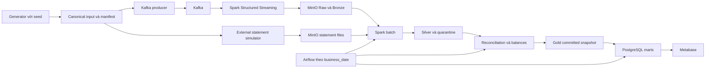

# N06 — Đặc tả triển khai hoàn chỉnh giao cho AI coding agent

**Bản hợp nhất 1.2 — một file tự chứa.** Tài liệu này thay thế bản 1.0 và 1.1. Có đầy đủ nội dung triển khai, schema, cấu hình, fixture, đáp án và công cụ kiểm tra bên trong; không cần gói ZIP cũ hoặc PDF để hiểu yêu cầu triển khai.

## Thay đổi so với bản 1.1

1. **Tuổi sai lệch ở P0 không phụ thuộc trạng thái:** bản 1.1 đưa “tuổi sai lệch chưa xử lý” vào dashboard P0 nhưng `first_seen_at` lại là P1, trong khi P0 tính mỗi snapshot độc lập từ đầu nên không giữ được trạng thái giữa các lần chạy. Bản 1.2 định nghĩa `discrepancy_age_seconds = as_of_time − anchor_event_time` (Phần I, mục 7.3 và 9); `first_seen_at` giữ nguyên ở P1.
2. **Chốt mốc “đầu ngày kế tiếp” trong bảng fault** là 00:00 theo `Asia/Ho_Chi_Minh`, cùng mốc với cutoff (Phần II, mục 5.3). Bản 1.1 không ghi múi giờ ở bảng này.
3. **Kafka key:** Phần II, mục 4 ghi rõ `transaction_id` là giá trị **mặc định**; chiến lược key là cấu hình runtime, khớp Phần II, mục 1.16 và thí nghiệm E6.
4. **Thêm fixture `control_report.json`** cho bộ nghiệm thu, có giá trị tính tay độc lập, nằm trong source manifest; quy tắc tạo dòng của control report được chốt (Phần II, mục 4). Script kiểm tra có **14 nhóm kiểm tra** (thêm đối chiếu control report).
5. **Thêm E8 — baseline đơn node (P1):** cùng Silver Parquet, cùng truy vấn, so Spark với DuckDB để báo cáo trả lời được câu hỏi “khi nào cần Spark” (Phần I, mục 14).

Phiên bản hợp đồng dữ liệu vẫn là `1.0.0`. Mục 2 và 3 ở trên là làm rõ cách diễn đạt đã có ở chỗ khác trong hợp đồng (Phần II, mục 1.10 và 1.16), không đổi kiểu, enum, ID hay đáp án; mục 4 thêm một fixture tuân theo schema đã có. Nếu nhóm đã có mã sinh `available_at` theo cách hiểu UTC dựa trên bản 1.1, phải sửa lại cho khớp mục 2 và chạy lại golden/fixture test.

## Thay đổi của bản 1.1 so với bản 1.0

1. **Bám đề cương:** thêm bảng truy vết từ từng mục đề cương đã duyệt tới sản phẩm và bằng chứng (Phần I, mục 0.2); gắn mọi hạng mục với ba câu hỏi nghiên cứu.
2. **Phân tầng P0/P1/P2** (Phần I, mục 1) và sắp lại milestone M0–M7: lõi và benchmark lõi làm trước, tăng cường làm sau.
3. **Benchmark thành ma trận cố định E1–E7** có giả thuyết, biến, chỉ số và bằng chứng (Phần I, mục 14).
4. **Sửa đo độ trễ:** dùng Kafka record timestamp, không dùng `emitted_at` mô phỏng.
5. **Thêm skew và tốc độ phát:** chế độ `HOT_ACCOUNT_V1`, chiến lược Kafka key và tham số events/giây.
6. **Chốt các điểm generator còn bỏ ngỏ:** `emitted_at`, cách chia file sao kê, ground truth theo `as_of_time`; thêm golden vector cho `draw()` và UUIDv5.
7. **Thống nhất manifest và control report**; quy định partition Silver/Gold theo `business_date`.
8. **Đơn giản hóa giao thức commit:** một thiết kế P0 duy nhất cho streaming Raw/Bronze và batch; khóa, tiêm lỗi từng điểm, lịch sử đối soát chuyển sang P2.
9. **Chốt hai quyết định trước đây để agent tự chọn:** cách Airflow gọi Spark và quy tắc chọn bộ phiên bản.
10. Gộp hai prompt giao việc thành một. Script kiểm tra gói có 13 nhóm kiểm tra (thêm golden vector).

Từ thời điểm bắt đầu code, mọi thay đổi hợp đồng theo quy tắc version ở Phần II, mục 10.

## Cách đọc và triển khai

1. **Phần I — Kế hoạch triển khai:** mục tiêu, bảng bám đề cương, mức ưu tiên, kiến trúc, quy tắc mã, milestone, kiểm thử và benchmark.
2. **Phần II — Hợp đồng dữ liệu đầu vào:** quy tắc chi tiết đã chốt, generator, dữ liệu lỗi, cutoff và cổng bắt buộc trước pipeline.
3. **Phần III — Các tệp nhúng đầy đủ:** nội dung chính xác của schema/config/fixture và script kiểm tra. Đây là tài nguyên để ghi thành file, không phải yêu cầu viết tất cả logic ứng dụng trong một file.

Thứ tự thực hiện: đọc Phần I và II → khôi phục tài nguyên Phần III → kiểm chứng dữ liệu → triển khai M0/M1 và cổng hợp đồng → thực hiện M2–M5 (P0) → M6 (P1) → M7 (P2 nếu còn thời gian). Chỉ viết pipeline sau khi cổng dữ liệu đạt.

**Quy tắc tránh hiểu nhầm:** các quy tắc chi tiết ở Phần II cụ thể hóa kiến trúc Phần I; schema và fixture ở Phần III phải được giữ nhất quán với chúng. Nếu phát hiện mâu thuẫn thực sự, ghi rõ vấn đề và giải quyết trước khi sửa hợp đồng. Không tự chọn một cách hiểu thuận tiện, không đổi đáp án để làm test pass. Credential/endpoint/path/tài nguyên triển khai lấy từ config; literal trong fixture chỉ dùng cho nghiệm thu.

Tên file/thư mục được nhắc trong tài liệu là **đường dẫn logic mà agent sẽ tạo trong repository**, không phải file đính kèm còn thiếu. Các đường dẫn `schemas/`, `config/`, `fixtures/`, `tools/` ở Phần II có gốc `N06_INPUT_CONTRACT_V1/` sau khi khôi phục. Có thể chuyển vào cấu trúc repository đích nếu cập nhật đường dẫn và vẫn kiểm chứng được checksum/fixture.

## Prompt dùng trực tiếp

> Hãy đọc toàn bộ file này, bao gồm Phần I, II và các tài nguyên ở Phần III. Trước khi code, đọc hướng dẫn repository và kiểm tra môi trường thực tế. Tự khôi phục các file nhúng theo đường dẫn được ghi, giữ nguyên UTF-8 và LF để checksum đúng; hoàn thành cổng hợp đồng dữ liệu trước khi code pipeline. Triển khai theo milestone và theo mức ưu tiên: xong toàn bộ P0 có kiểm thử rồi mới sang P1, xong P1 rồi mới sang P2. Tự giải quyết lựa chọn kỹ thuật thông thường và ghi giả định vào ADR; chỉ hỏi khi thiếu thông tin thực sự ngăn cản triển khai, không yêu cầu gửi thêm file vì nội dung đã có đầy đủ ở đây. Không hardcode cấu hình triển khai, không dùng ground truth trong pipeline, không dừng ở skeleton/pseudocode, không dùng TODO/pass thay nghiệp vụ lõi, không giả số đo. Mỗi milestone phải có đường chạy và bằng chứng kiểm thử; báo trung thực phần đã chạy và chưa chạy. Nếu môi trường không chạy được dịch vụ, vẫn hoàn thành mã và bộ kiểm thử khả thi, ghi rõ kiểm tra nào chưa chạy và cách tái hiện. Nếu đọc file qua công cụ bị cắt đầu ra, tiếp tục đọc các đoạn sau đến hết, không suy đoán phần bị cắt.

---

## Phần I — Kế hoạch triển khai

### 0. Cách sử dụng tài liệu

Đây là đặc tả triển khai cho đề tài **“Thiết kế và xây dựng hệ thống Core Banking tích hợp đường ống dữ liệu phục vụ đối soát và phân tích tài chính”** trong đề cương N06.pdf (6 trang) đã được duyệt.

Mục tiêu là tạo một repository có thể cài đặt, chạy demo, kiểm thử và thu thập số liệu thực nghiệm. Trọng tâm là Data Engineering theo hướng dữ liệu lớn; phần ngân hàng là mô phỏng có quy tắc. Không mở rộng thành hệ thống ngân hàng hoàn chỉnh.

Các công nghệ và định hướng tổng thể bám theo đề cương. Những quy tắc chi tiết về tiền, phiên bản dữ liệu, đối soát, commit và kiểm thử dưới đây là **quyết định thiết kế để hiện thực hóa các phần đề cương chưa chi tiết**, không phải nội dung được trích nguyên từ PDF. Ghi lại các quyết định này trong ADR và dùng nhất quán.

**Hợp đồng đầu vào bắt buộc nằm ở Phần II của chính tài liệu này.** Schema, cấu hình, fixture và công cụ kiểm tra được nhúng đầy đủ tại Phần III. Hoàn thành cổng kiểm chứng dữ liệu tại Phần II, mục 9 trước khi bắt đầu M2; không sửa expected để làm code pass. Prompt giao việc nằm ở đầu tài liệu.

#### 0.1. Ba câu hỏi nghiên cứu của đề cương và phần trả lời

| Câu hỏi nghiên cứu (đề cương 1.2) | Trả lời bằng | Bằng chứng trong báo cáo |
|---|---|---|
| (i) Thiết kế partition và xử lý song song ảnh hưởng thế nào đến thời gian chạy? | Thí nghiệm E1–E7; E8 đặt kết quả cạnh một baseline đơn node (mục 14) | Bảng số đo, biểu đồ, ảnh/chỉ số Spark UI, lý giải bằng lý thuyết chương 1 |
| (ii) Pipeline phát hiện bản ghi thiếu, lặp, lệch tiền và đến muộn ra sao? | Quy tắc đối soát (mục 7), fixture nghiệm thu, profile lỗi | Kết quả theo từng khóa so với đáp án; bảng nhầm lẫn theo trạng thái |
| (iii) Sau lỗi hoặc phát lại, số liệu phân tích có tái lập được không? | Cơ chế commit (mục 8), kiểm thử chạy lại và khởi động lại | Semantic hash không đổi; số khóa và tổng tiền không tăng sau restart/rerun |

Báo cáo và phần vấn đáp bám theo ba câu hỏi này. Câu (i) là phần thể hiện rõ nhất tính chất môn Dữ liệu lớn nên không được làm sau cùng hoặc làm cho có: benchmark lõi E1–E5 thuộc P0.

#### 0.2. Bảng bám đề cương đã duyệt

Mỗi mục đề cương phải có sản phẩm trong repository và bằng chứng đưa vào báo cáo. Không thêm hạng mục ngoài bảng khi P0/P1 chưa xong.

| Mục đề cương | Sản phẩm trong repository | Bằng chứng cho báo cáo | Mức |
|---|---|---|---|
| 1.3 Phạm vi và dữ liệu thử nghiệm | Generator có seed, ba mức tải cấu hình được | Input manifest, số bản ghi theo entity ở từng mức | P0 |
| 1.4.1 Đặc trưng dữ liệu lớn | Volume: E1. Velocity: tốc độ phát của producer (E2). Variety: sự kiện JSON qua Kafka, file sao kê JSONL, bản ghi lỗi/phiên bản lạ. Veracity: quarantine và đối soát. Value: mart và dashboard | Mỗi đặc trưng một phép đo hoặc một kết quả cụ thể; ghi rõ giới hạn của dữ liệu mô phỏng trên một máy | P0 |
| 1.4.2 Kafka và xử lý luồng | Producer, topic/partition/key cấu hình được, streaming query có checkpoint | E2, E6 (lệch tải theo khóa), kiểm thử phát lại | P0, E6 là P1 |
| 1.4.3 Spark và lưu trữ phân tán | Job PySpark, Parquet phân vùng theo `business_date` | E3, E4, E5, E7; chỉ số shuffle/task từ event log | P0, E7 là P1 |
| 1.4.4 Đối soát và mô hình phân tích | Module đối soát, số dư, fact/dimension đúng độ hạt | Fixture nghiệm thu, kiểm thử không nhân đôi tiền | P0 |
| 2.1 Yêu cầu chức năng | Toàn bộ luồng generator → mart | Kịch bản demo từ clean clone | P0 |
| 2.2 Phi chức năng và phép đo | Bảng run/quality/metrics; truy vết qua `transaction_id`, `event_id`, `source_batch_id` | Số đo thời gian, throughput, độ trễ, dung lượng, CPU/RAM | P0 |
| 2.3 Kiến trúc tổng thể | Docker Compose và sơ đồ | Sơ đồ kiến trúc khớp mã thực tế | P0 |
| 2.4 Dữ liệu nguồn và hợp đồng sự kiện | `contracts/` (Phần II, III) | Data dictionary | P0 |
| 2.5 Tầng dữ liệu và phân vùng | Raw/Bronze/Silver/Gold trên MinIO | Cây thư mục, số file, kích thước theo tầng | P0 |
| 2.6 Quy tắc đối soát và dữ liệu đến muộn | Mục 7; ba snapshot theo `as_of_time` | PENDING → trạng thái cuối trên fixture | P0; sửa sau khi đã publish là P1 |
| 2.7 Mô hình phân tích và truy vấn | DDL mart, truy vấn dashboard; “thời gian tồn đọng sai lệch” = `discrepancy_age_seconds` (mục 7.3) | Ảnh dashboard và SQL | P0 |
| 3.1 Công nghệ và môi trường | Compatibility matrix, lockfile, `doctor` | Bảng phiên bản và cấu hình máy | P0 |
| 3.2 Hiện thực luồng thu nhận | Producer, streaming Raw/Bronze | Log/metrics ingest, kiểm thử restart | P0 |
| 3.3 Xử lý và đối soát bằng Spark | Job Silver, đối soát, số dư, Gold | Kết quả kiểm thử, kế hoạch thực thi tiêu biểu | P0 |
| 3.4 Kho phân tích và trực quan hóa | Mart PostgreSQL, Metabase | Dashboard, một ca drill-down | P0; drill-down là P1 |
| 3.5 Điều phối và giám sát | Airflow DAG theo ngày, bảng run | Ảnh DAG chạy, một lần chạy lại theo ngày | P1 |
| 4.1 Tính đúng đắn | Kiểm thử Domain/Ledger/Recon/E2E (mục 13) | Test report | P0 |
| 4.1 Dữ liệu lỗi | Negative suite, profile lỗi | Bảng mã lỗi và số lượng | P0 |
| 4.1 Dữ liệu đến muộn | Kiểm thử Late data | Chuyển trạng thái trên fixture | P0/P1 |
| 4.1 Phục hồi | Tắt streaming query và job batch rồi khởi động lại | Gold không nhân đôi | P0 |
| 4.1 Quy mô tăng | E1 | Bảng và biểu đồ theo mức tải | P0 |
| 4.1 Tối ưu | E3, E4, E5; E8 baseline đơn node | Bảng so sánh cấu hình | P0; E8 là P1 |
| 4.2 Phương pháp đo | `docs/benchmark-method.md` | Mô tả cách đo, số lần lặp, môi trường | P0 |
| 4.3 Đánh giá và giới hạn | `reports/` | Nêu rõ mức cao nhất chạy được và nguyên nhân | P0 |

Đề cương 1.1 có nhắc thay đổi cấu trúc bản ghi: phạm vi tiểu luận xử lý bằng cách khai báo phiên bản trong mọi bản ghi và đưa phiên bản không hỗ trợ vào quarantine có mã lỗi; không triển khai schema evolution đầy đủ.

#### 0.3. Gợi ý chia việc cho ba thành viên

Đây là gợi ý, nhóm tự điều chỉnh. Mỗi người chịu trách nhiệm chính một câu hỏi nghiên cứu để tự giải thích được khi vấn đáp.

| Thành viên | Phần mã | Phần báo cáo và câu hỏi |
|---|---|---|
| A | Hợp đồng dữ liệu, generator, producer, streaming Raw/Bronze | Mục 2.4, 3.2; E2, E6 phía Kafka |
| B | Silver, chất lượng, đối soát, số dư, cơ chế commit, kiểm thử đúng đắn và phục hồi | Mục 2.6, 3.3; câu hỏi (ii), (iii) |
| C | Mart, Metabase, Airflow, bộ chạy benchmark và thu số đo | Mục 2.7, 3.4, 3.5, chương 4; câu hỏi (i) |

### 1. Phạm vi và kết quả bàn giao

#### Mức ưu tiên

- **P0 — lõi:** làm trước, phải chạy được từ đầu đến cuối và có số đo. Thiếu P0 thì chưa có sản phẩm để bảo vệ.
- **P1 — phần còn lại của đề cương đã duyệt:** vẫn thuộc bản nộp, làm ngay sau khi P0 đạt.
- **P2 — tăng cường:** chỉ làm khi P0 và P1 đã có bằng chứng; bỏ được mà không lệch đề cương. Nếu bỏ, ghi vào mục hạn chế của báo cáo.

Mọi hạng mục không ghi mức trong tài liệu này mặc định là P0.

#### P0

1. Bộ sinh tài khoản, giao dịch chuyển khoản nội bộ, bút toán cân bằng và sao kê mô phỏng độc lập; có seed, quy mô cấu hình được, có profile lỗi kèm đáp án.
2. Producer đưa sự kiện vào Kafka với tốc độ phát cấu hình được; Spark Structured Streaming lưu Raw/Bronze trên MinIO.
3. Spark batch chuẩn hóa Silver, loại trùng, kiểm tra chất lượng, đối soát theo `as_of_time`, tính số dư và tạo Gold.
4. PostgreSQL lưu mart; Metabase hiển thị các báo cáo trong đề cương 2.7.
5. Chạy lại cùng đầu vào cho cùng kết quả; tắt streaming query hoặc job batch rồi khởi động lại không làm nhân đôi dữ liệu Gold.
6. Benchmark lõi E1–E5 trên dữ liệu thật của hệ thống.
7. README, sơ đồ, data dictionary, test report và báo cáo benchmark có bằng chứng.

#### P1

1. Airflow điều phối theo ngày nghiệp vụ, chạy lại theo ngày và backfill khoảng ngày.
2. Sửa kết quả đã publish khi sao kê đến muộn; backfill bút toán ngày cũ kéo theo số dư các ngày sau; giữ `first_seen_at` qua các lần đánh giá.
3. Thí nghiệm E6 (lệch tải), E7 (file nhỏ) và E8 (baseline đơn node).
4. Dashboard drill-down từ một sai lệch tới bản ghi nguồn; runbook restart/backfill.

#### P2

- Lịch sử đối soát theo phiên bản ngữ nghĩa (`reconciliation_history`).
- Khóa chống hai lần chạy đồng thời trên cùng phạm vi ngày.
- Tiêm lỗi tại từng điểm commit/publish; dọn object mồ côi; checksum từng object trong manifest.
- Tự động provision dashboard Metabase qua API; compaction file; CI cho integration/E2E.

#### Ngoài phạm vi

- Core Banking đầy đủ; thanh toán thật; dữ liệu khách hàng thật; bảo mật/chứng nhận ngân hàng sản xuất.
- CDC/Debezium (đề cương ghi là mở rộng sau khi luồng cơ sở ổn định), Kubernetes, ML, nhiều loại tiền có quy đổi ngoại tệ.
- Ứng dụng web ngân hàng và frontend riêng: Metabase là giao diện phân tích. Các loại giao dịch khác chuyển khoản nội bộ không có trong hợp đồng v1.

#### Điều kiện hoàn thành

Clone repository sạch, điền cấu hình theo mẫu, chạy các lệnh được tài liệu hóa là có thể tạo dữ liệu, chạy pipeline, xem báo cáo và tái hiện kiểm thử. Không phụ thuộc dữ liệu hay thao tác bí mật trên máy tác giả.

### 2. Kiến trúc và lựa chọn công nghệ



Luồng này đúng với đề cương 2.3: streaming ghi Raw/Bronze, batch xử lý từ Bronze trở đi.

- Ngôn ngữ chính: Python; xử lý phân tán bằng PySpark; SQL cho migrations/mart. Dùng typing, formatter/linter và test runner thống nhất.
- Docker Compose cho local. Kafka, MinIO, PostgreSQL, Spark, Airflow, Metabase có healthcheck và named volumes.
- Spark local mode phục vụ smoke test và là chế độ mặc định của benchmark trên một máy; profile nhiều worker phục vụ thử nghiệm khi đủ tài nguyên. Airflow/Metabase bật theo profile để giảm RAM khi chạy benchmark.
- Dùng PostgreSQL riêng database/user cho mart, bảng control, Airflow metadata và Metabase application database; không để công cụ ghi vào schema nghiệp vụ của nhau.
- Không tải dependency động từ Internet mỗi lần chạy job. Chuẩn bị connector/JAR trong image hoặc bước build đã ghim phiên bản. Không dùng tag `latest`.

#### Quy tắc chọn bộ phiên bản (đã chốt cách chọn, agent xác minh số cụ thể)

1. Chọn một bản Spark 3.5.x dựng sẵn kèm Hadoop 3 làm gốc; mọi thành phần khác suy ra từ bản này.
2. `hadoop-aws` phải **đúng bằng** phiên bản Hadoop mà bản Spark đó đóng gói (đọc từ thư mục `jars/` của bản phân phối, không đoán).
3. AWS SDK bundle phải **đúng phiên bản** mà POM của `hadoop-aws` đó khai báo phụ thuộc.
4. `spark-sql-kafka-0-10` cùng phiên bản Spark và cùng phiên bản Scala.
5. Java và Python lấy trong danh sách bản Spark đó hỗ trợ chính thức; Airflow và PySpark dùng chung một phiên bản Python.

Ghi kết quả vào compatibility matrix kèm nguồn kiểm chứng, commit lockfile. Một smoke test đọc/ghi Parquet qua S3A tới MinIO và đọc một topic Kafka phải chạy được trước M2.

#### Cách Airflow gọi Spark (đã chốt)

- Toàn bộ job chạy qua CLI `n06`. Có một image job chứa Java, PySpark, các JAR đã ghim và gói `n06`.
- Image Airflow được build từ cùng danh sách dependency đó; task dùng `BashOperator` gọi `n06 ...`. Spark chạy client mode ngay trong container của task: `local[N]` mặc định, hoặc `spark://...` khi bật profile cluster.
- Không để DAG tham chiếu một `spark-submit` không tồn tại trong container Airflow; không mount Docker socket; không sao chép logic Spark vào DAG.

### 3. Quy tắc không hardcode và chất lượng mã

#### Cấu hình

- Không nhúng endpoint, hostname, port, credential, đường dẫn tuyệt đối, tên bucket/topic, ngày chạy, seed, quy mô dữ liệu, partition count hoặc cấu hình executor vào logic nghiệp vụ.
- Cấu hình có schema và validate lúc khởi động. Thứ tự ưu tiên: CLI > environment > file cấu hình theo profile > default đã tài liệu hóa. Secret chỉ từ environment/secret file, không từ config được commit.
- Default dùng chung để trong một module cấu hình. Giá trị mặc định phục vụ demo được phép nếu có thể override và được giải thích; tránh lặp lại “magic number”.
- Các enum trạng thái và hằng số nghiệp vụ cố định là hợp đồng dữ liệu, được định nghĩa tập trung; không biến mọi enum thành tùy chọn khiến hệ thống mất nhất quán.
- `.env.example` chỉ chứa placeholder. Script `init-local` có thể sinh secret ngẫu nhiên vào `.env` bị gitignore và đồng bộ cấu hình dịch vụ. Không commit credential, access token hay dữ liệu `.env` vào báo cáo/log.
- Phân biệt endpoint trong Docker network với endpoint truy cập từ host. Không dùng `localhost` từ container để gọi container khác.
- Ngày nghiệp vụ, múi giờ và as-of time phải là tham số rõ ràng. Không rải `today()`/`now()` trong logic tính toán. Clock được inject cho kiểm thử thời gian.
- Validate cấu hình tài nguyên, lỗi sai cấu hình phải báo sớm và rõ; không âm thầm chuyển sang default.

#### Thiết kế mã

- Tách domain/schema, generator, producer, Spark transformations, storage, reconciliation, mart loader và orchestration.
- Dùng hàm transformation nhỏ, có input/output xác định; Spark jobs không chứa toàn bộ nghiệp vụ trong một file dài.
- Không `collect()` dữ liệu giao dịch đầy đủ lên driver; không `toPandas()` để thay Spark xử lý. Generator/producer phải tạo và gửi theo luồng hoặc chunk có giới hạn bộ nhớ.
- Không dùng `coalesce(1)` hay một partition cố định cho dữ liệu quy mô lớn. Small-file compaction phải có cấu hình và đo lường.
- Dùng Spark SQL functions thay Python UDF khi có thể. Chỉ broadcast tập dữ liệu đã đo là nhỏ.
- SQL có tham số cho giá trị; tên bảng/cột động chỉ nhận từ allowlist. Migration version hóa, chạy lặp an toàn.
- Không nuốt exception, không `except: pass`. Retry có giới hạn/backoff cho lỗi tạm thời; lỗi dữ liệu đi quarantine; lỗi hạ tầng làm job thất bại.
- Không TODO/stub trên đường chạy bắt buộc. Log có cấu trúc, không ghi secret hay toàn bộ payload hàng loạt.
- Luôn có unit test nghiệp vụ và integration test cho ranh giới Kafka/S3/PostgreSQL; không chỉ test mock rồi tuyên bố end-to-end thành công.

### 4. Hợp đồng dữ liệu và quy tắc ngân hàng mô phỏng

#### 4.1. Tiền, thời gian và ID

- Tiền dùng **số nguyên đơn vị nhỏ nhất** (`amount_minor`), không dùng float. Trong Python dùng int, JSON dùng integer, PostgreSQL dùng BIGINT khi giới hạn cho phép; Spark dùng DecimalType đủ rộng cho tổng hợp để tránh overflow.
- Profile demo mặc định VND với currency exponent = 0. Metadata tiền tệ lưu tập trung. Không cộng chung nhiều currency hoặc tự quy đổi ngoại tệ.
- `amount_minor > 0`; kiểm soát giới hạn mỗi giao dịch và tổng tiền theo quy mô. Sai kiểu, âm, zero hoặc vượt miền hợp lệ vào quarantine.
- Timestamp dùng UTC theo format chính xác ở Phần II; `business_date` dùng Asia/Ho_Chi_Minh trong contract v1. Hệ thống xác minh ngày nghiệp vụ khớp event_time theo hợp đồng đã chọn.
- Phân biệt `event_time` (nghiệp vụ, mô phỏng), `emitted_at` (thời điểm phát **mô phỏng** trong envelope, tất định theo Phần II), `kafka_timestamp` (thời điểm producer gửi thật, lấy từ record timestamp của Kafka), `ingested_at` (thời điểm pipeline ghi nhận thật), `business_date`, `run_id`, `source_batch_id`. Chỉ `kafka_timestamp` và `ingested_at` được dùng để đo độ trễ hệ thống.
- ID tái lập từ seed/dataset_id/entity/index bằng cơ chế xác định như UUIDv5. Không dùng Python `hash()` hay UUID ngẫu nhiên cho dữ liệu yêu cầu tái lập.
- Một event không thay đổi nội dung sau khi có `event_id`. Bản phát lại giữ nguyên event_id. Các lần truyền cùng event khác nhau ở Kafka offset/ingested_at.

#### 4.2. Các dataset tối thiểu

| Dataset | Khóa/độ hạt | Trường tối thiểu |
|---|---|---|
| accounts | một dòng/account_id | account_id, currency, opening_balance_minor, opening_business_date, account_type |
| transactions | một dòng/transaction_id | transaction_id, external_reference, account_from, account_to, amount_minor, currency, status, transaction_type, channel, event_time, business_date |
| ledger_entries | một dòng/entry_id | entry_id, transaction_id, ledger_account_id, side, amount_minor, currency, event_time, business_date |
| external_statements | một dòng/statement_record_id | statement_record_id, external_reference, channel, amount_minor, currency, status, event_time, business_date, available_at |
| event_envelope | một dòng/event_id | schema_version, event_id, event_type, dataset_id, source_batch_id, event_time, emitted_at, payload |
| source_manifest | một manifest/source batch | dataset_id, source_batch_id, files[path, sha256, physical_rows] (đúng `source_manifest.schema.json`) |
| control_report | một dòng/entity + business_date + currency + status hoặc side | record_count, amount_minor_total của dữ liệu nội bộ đã công bố (đúng `control_report.schema.json`) |

- Sao kê có schema version và manifest riêng. Lưu checksum, file name, row number để truy vết từng dòng.
- Topic theo loại event hoặc một topic với `event_type`: agent chọn một cách và ghi ADR. Kafka key mặc định `transaction_id` để liên kết sự kiện giao dịch/bút toán trong cùng topic; chiến lược key là cấu hình runtime của producer với hai giá trị `transaction_id` và `account_from` (giá trị sau chỉ dùng cho thí nghiệm E6), tính đúng đắn của pipeline không được phụ thuộc vào key; không khẳng định có thứ tự toàn cục hay thứ tự giữa các topic.
- Schema hợp đồng lưu trong repository và có fixture. Schema version không được hỗ trợ phải vào quarantine có mã lỗi.
- MVP dùng giao dịch kết thúc ở `SUCCESS`/`FAILED`, không có cập nhật trạng thái tùy ý của cùng transaction. Nếu bổ sung lifecycle, phải thêm version và quy tắc chọn phiên bản, không dùng “giữ bản ghi đến cuối” thiếu thứ tự xác định.

#### 4.3. Bút toán và số dư

- Chỉ giao dịch `SUCCESS` tạo hai vế hạch toán; `FAILED` không làm thay đổi số dư.
- Với chuyển khoản giữa hai tài khoản tiền gửi khách hàng: quy ước liability ledger, `DEBIT` tài khoản gửi làm giảm số dư, `CREDIT` tài khoản nhận làm tăng số dư.
- Với mỗi transaction_id và currency: tổng DEBIT = tổng CREDIT; hai tài khoản phải tồn tại và khác nhau, đúng currency. Mở rộng tài khoản trung gian ngoài phạm vi MVP.
- Số dư cuối ngày = số dư đầu ngày + tổng CREDIT − tổng DEBIT theo tài khoản. Tài khoản không phát sinh vẫn có snapshot ngày nếu thuộc phạm vi hoạt động.
- Seed opening balance theo một ngày bắt đầu rõ ràng. Chạy nhiều ngày phải dùng số dư cuối ngày trước làm đầu ngày sau, hoặc tái tính từ opening snapshot và toàn bộ phát sinh liên quan.
- Không overdraft trong dữ liệu hợp lệ; generator phải bảo đảm đủ số dư theo thứ tự nghiệp vụ xác định. Record vi phạm do fault injection được đánh dấu đáp án chuẩn.
- Backfill ngày cũ có thay đổi bút toán phải tái tính các snapshot ngày sau trong phạm vi dataset; không sửa một ngày rồi để số dư các ngày sau sai.
- Fact giao dịch và fact bút toán có độ hạt khác nhau. Không join hai vế bút toán rồi sum tiền giao dịch gây nhân đôi.

### 5. Generator và nguồn sao kê độc lập

1. Tạo canonical scenario trước khi đưa qua pipeline: tài khoản, giao dịch hợp lệ, bút toán, danh sách giao dịch được kỳ vọng có đối chiếu kênh.
2. Từ scenario này tạo **hai đầu vào riêng**: Kafka events và statement files. Statement simulator không đọc Bronze/Silver/Gold, không gọi kết quả pipeline để tự tạo đối chứng.
3. Dùng PRNG stream riêng cho transaction, statement và fault injection. Cùng seed/config phải tạo cùng business payload và checksum, bất kể Kafka partition/executor count. Metadata thời gian nhận được phép khác.
4. Đề cương có chuyển khoản nội bộ và sao kê kênh mô phỏng: quy định rõ đây là kênh đối chiếu giả lập xác nhận các giao dịch thuộc một tập channel, không tuyên bố chuyển khoản nội bộ thực tế luôn có sao kê bên thứ ba.
5. `external_reference` của demo có quan hệ 1–1 với transaction; match key gồm channel + external_reference. Khi mở rộng nhiều currency, currency được đối chiếu như thuộc tính để phát hiện lệch tiền tệ.
6. Ghi file theo chunk, không giữ 5 triệu transaction trong RAM. Tạo dữ liệu nhiều ngày và phân bố account/channel cấu hình được; profile skew dùng chế độ `HOT_ACCOUNT_V1` (Phần II, mục 5.1).
7. Xuất ground truth tách biệt, chỉ test harness được dùng. Pipeline không được đọc `expected_reconciliation` hay fault labels.

#### Fault injection tối thiểu

- Replay cùng event_id; khác event_id nhưng cùng business ID và nội dung.
- Cùng event_id nhưng payload khác: xung đột nghiêm trọng.
- Cùng transaction_id/entry_id với nội dung khác: business-key conflict.
- Null trường bắt buộc, JSON sai, sai kiểu, schema version lạ, currency/amount không hợp lệ.
- Thiếu transaction phía nguồn nội bộ; thiếu statement phía kênh; statement có reference không tồn tại.
- Statement lệch amount, currency hoặc status.
- Nhiều statement_record_id khác nhau cho một match key; phân biệt với truyền lại cùng một dòng sao kê.
- Statement đến trước hạn, sau hạn và sau khi kết quả đã được công bố.
- Bút toán thiếu vế, lệch tổng, account không tồn tại.

Profile kiểm thử phân lớp fault không chồng lấn để có đáp án rõ; bổ sung một fixture riêng kiểm tra fault chồng lấn và thứ tự phân loại.

### 6. Raw/Bronze/Silver và tính đúng đắn

#### Raw

- Giữ Kafka key/value nguyên dạng, topic, partition, offset, timestamps, dataset_id nếu parse được, ingestion_run_id. Record JSON sai vẫn phải lưu được.
- Khóa kỹ thuật Kafka: topic + partition + offset. Không dedup Raw bằng transaction_id; Raw cần giữ dấu vết phát lại và lỗi.
- Lưu statement nguyên bản cùng manifest/checksum; file đến sau phải được phát hiện qua ingest manifest, không chỉ scan thư mục của ngày hiện tại.

#### Bronze

- Parse theo schema version rõ ràng; tách entity, lưu Parquet, giữ source pointer. Record parse lỗi vẫn có đường đến quarantine, không bị filter bỏ im lặng.
- Partition theo ingestion_date để bắt được sự kiện đến muộn. Bước batch lấy các ingestion partition/file từ manifest rồi chọn business_date cần xử lý.
- Raw và Bronze được ghi bởi **một** Structured Streaming query dùng `foreachBatch` theo đúng giao thức ở mục 8.1. Không dùng hai sink độc lập rồi giả định commit đồng thời. Trigger interval và `maxOffsetsPerTrigger` là cấu hình.
- Checkpoint nằm trên volume/bucket bền vững, riêng theo query và môi trường. Không xóa checkpoint trong thao tác restart thông thường.

#### Silver

- Chuẩn hóa kiểu, thời gian, currency, business key và kiểm tra quality.
- Silver và Gold lưu Parquet, phân vùng theo `business_date` bên dưới tiền tố dataset/entity/run_id. Số partition trước khi ghi và kích thước file mục tiêu là cấu hình; đây là biến của thí nghiệm E3 và E7.
- Cùng event_id + cùng payload: giữ một business event nhưng lưu lineage các lần nhận. Khác payload: quarantine conflict, không chọn ngẫu nhiên.
- Khác event_id + cùng business ID + cùng nội dung: một business record, vẫn thống kê duplicate; cùng business ID khác nội dung: conflict.
- Statement replay cùng statement_record_id/nội dung loại trùng ở Silver; nhiều statement_record_id cho cùng match key là duplicate nghiệp vụ để đối soát phát hiện.
- Phải kiểm tra đủ sự kiện đến muộn trên toàn bộ tập input đã commit của business_date, không dedup chỉ trong một microbatch.
- Quarantine gồm error_code, error_detail, entity/business key, source pointer, dataset_id, run_id và raw reference. Không ghi đè lỗi cũ mất dấu vết.
- Validation nghiệp vụ giữa transaction và ledger phải xảy ra sau khi dữ liệu ngày đã đủ hoặc theo chính sách incomplete rõ ràng, tránh coi hai event ở hai microbatch là lỗi vĩnh viễn.

#### Kiểm tra chất lượng và control totals

- Tách các đếm: physical Kafka records, unique event, unique business record, rejected record, nghiệp vụ hợp lệ.
- Ghi count, distinct keys và amount totals theo entity/currency/business_date/status; không cộng ledger và transaction thành một tổng.
- So các tổng này với `control_report` của nguồn (Phần II, mục 4) để chứng minh “số lượng/tổng tiền nguồn–đích” trong đề cương 2.1. Control report mô tả dữ liệu đã công bố, không chứa nhãn lỗi nên pipeline được phép đọc.
- Báo cáo cân đối phải giải thích chênh lệch do replay/quarantine/filter. Không so physical count với unique count rồi coi là mất dữ liệu.
- Null, referential integrity, balance, duplicate conflict và overflow phải có test.
- Ngưỡng quality cấu hình được. Lỗi nghiêm trọng chặn publish Gold; dữ liệu lỗi có chủ đích trong demo được xử lý theo policy công khai, không tắt kiểm tra để làm test pass.

### 7. Quy tắc đối soát

#### 7.1. Đầu vào và khóa

- Dùng Silver hợp lệ từ giao dịch và statement; full outer join theo dataset_id + channel + external_reference.
- Xuất thêm `key_conflicts` từ bước quality với business key/match key còn khôi phục được. Reconciliation đọc chỉ mục này để tạo `DUPLICATE_OR_CONFLICT` và đánh dấu phía bị quarantine; không để record bị loại khỏi Silver làm biến mất bằng chứng conflict. Nếu không khôi phục được key thì chỉ thống kê quarantine, không tự bịa key để đối soát.
- Cửa sổ đủ rộng và cơ chế chọn ngày phải cho phép statement đến sau vẫn đối chiếu giao dịch ngày cũ; `available_at` không thay business_date gốc.
- Bản sao sao kê cùng statement_record_id bị loại trước join. Group theo match key và kiểm tra cardinality trước khi ghép; không để many-to-many nhân số dòng.
- Mỗi khóa đối soát có một kết quả hiện tại. Lưu transaction_id nếu có và danh sách/source pointers bằng child table nếu nhiều record, không ép chọn một ID tùy ý.

#### 7.2. Phân loại có thứ tự xác định

| Ưu tiên | Điều kiện | Trạng thái |
|---|---|---|
| 1 | Business key conflict tại nguồn hoặc nhiều record độc lập cho match key | DUPLICATE_OR_CONFLICT |
| 2 | Đủ hai phía, lệch currency | CURRENCY_MISMATCH |
| 3 | Đủ hai phía, lệch amount_minor | AMOUNT_MISMATCH |
| 4 | Đủ hai phía, lệch status | STATUS_MISMATCH |
| 5 | Đủ hai phía, mọi thuộc tính đối chiếu khớp | MATCHED |
| 6 | Thiếu một phía, chưa đến hạn | PENDING |
| 7 | Có transaction, thiếu statement sau hạn | MISSING_EXTERNAL |
| 8 | Có statement, thiếu transaction sau hạn | MISSING_INTERNAL |

- Lưu `issue_codes` cho mọi vấn đề phát hiện được; `recon_status` là trạng thái chính theo bảng. Schema error thuần túy thuộc quarantine; kết quả đối soát phải phân biệt thiếu thật với thiếu do record bị quarantine qua quality metadata.
- Demo so tiền chính xác bằng integer. Tolerance contract v1 bằng 0; thay đổi tolerance cần rule version mới theo Phần II.
- `FAILED` cũng có thể có bản ghi xác nhận từ simulator nhưng không có ledger. Tập status/channel cần đối chiếu phải cấu hình và tài liệu hóa, áp dụng nhất quán cho generator và pipeline.

#### 7.3. Đến muộn và lịch sử

- Hạn đối soát = đầu ngày kế tiếp của business_date theo Asia/Ho_Chi_Minh + allowed_lateness; tại đúng hạn được coi là đã quá hạn. So với `as_of_time` được truyền vào; không phụ thuộc clock rải rác trong code.
- Trước hạn: thiếu phía còn lại là PENDING. Sau hạn: chuyển MISSING; khi dữ liệu bổ sung tới vẫn được sửa thành MATCHED/mismatch bằng chạy lại ngày bị ảnh hưởng.
- “Trạng thái cuối sau hạn” là trạng thái hiện tại, không có nghĩa cấm sửa khi late correction đến.
- P0 lưu `last_evaluated_at`, input snapshot id và recon rule version. (P1) Lưu thêm `first_seen_at`, `resolved_at`; không reset first_seen_at mỗi lần chạy lại.
- **Tuổi sai lệch (P0).** Với mọi khóa có `recon_status` khác MATCHED, lưu `anchor_event_time` và `discrepancy_age_seconds = as_of_time − anchor_event_time` (giây, số nguyên, không âm). `anchor_event_time` là `event_time` của giao dịch nội bộ nếu có, ngược lại là `event_time` nhỏ nhất trong các bản ghi sao kê của khóa. Khóa MATCHED để hai trường này rỗng. Định nghĩa này chỉ phụ thuộc input và `as_of_time` nên giữ được tính tái lập của P0 khi mỗi snapshot được tính lại từ đầu. Khi P1 có `first_seen_at`, dashboard có thể hiển thị thêm “thời gian từ lúc pipeline phát hiện”, nhưng không thay định nghĩa P0.
- Current result có khóa duy nhất theo match key. (P2) History chỉ thêm khi nội dung kết quả thay đổi, không thêm một bản history giống hệt cho mỗi lần retry.
- Watermark streaming nếu dùng chỉ giới hạn state của query; không thay thế chính sách đối soát hay cơ chế backfill.

### 8. Commit, chạy lại và phục hồi

#### 8.1. Không giả định Parquet tự hỗ trợ transaction

MinIO/object storage không có rename thư mục atomic như filesystem. Không ghi thẳng đè partition đang được đọc; không dùng append vô điều kiện cho Silver/Gold. Thiết kế dưới đây là thiết kế duy nhất của P0; không thay bằng phương án khác khi chưa ghi ADR.

**Batch (Silver, Gold):**

1. Mỗi lần chạy ghi một phiên bản bất biến vào đường dẫn chứa dataset/entity/`run_id`, phân vùng theo `business_date`.
2. Đọc input theo danh sách đã xác định từ bảng control, ghi output và metrics, validate đầy đủ.
3. Chỉ sau thành công mới cập nhật bảng control PostgreSQL trong **một transaction** để trỏ `current_snapshot` của (dataset, tầng, entity, business_date) tới `run_id` mới; có unique constraint trên khóa đó.
4. Reader chỉ đọc đường dẫn do `current_snapshot` trỏ tới; không glob toàn bucket, không đọc run thất bại hay phiên bản cũ.
5. Mỗi run lưu row count, danh sách input version, config hash, schema/rule/code version.
6. Run có cùng input, config nghiệp vụ và code/rule version phải tạo cùng semantic result/hash; run_id/timestamp vận hành được phép khác. Đây là cơ sở của kiểm thử chạy lại.

**Streaming (Raw, Bronze):**

1. Một query, `foreachBatch`; DataFrame của microbatch được persist trong callback.
2. Ghi Raw rồi Bronze (kèm bản ghi parse lỗi) vào đường dẫn **xác định theo `batch_id`**, chế độ overwrite: `.../ingestion_date=<ngày>/batch_id=<id>/`. `ingestion_date` lấy từ thời điểm nhỏ nhất của Kafka timestamp trong batch để lần phát lại cho cùng đường dẫn.
3. Sau khi mọi output của batch đã ghi xong, upsert một dòng vào bảng control `ingest_batches` với khóa (query_name, batch_id), kèm khoảng offset theo topic-partition và số bản ghi. Callback chỉ trả thành công sau bước này.
4. Job batch chỉ đọc các `batch_id` có trong `ingest_batches`.
5. Chết trước bước 3: Spark phát lại đúng `batch_id` với cùng khoảng offset từ checkpoint, ghi đè đúng đường dẫn cũ. Chết sau bước 3 nhưng trước khi checkpoint ghi nhận: phát lại ghi đè cùng nội dung và upsert không tạo dòng mới.
6. Cơ chế này dựa trên checkpoint còn nguyên. Mất checkpoint là sự cố vận hành: runbook yêu cầu dùng `query_name` và tiền tố mới rồi nạp lại từ offset đầu; dedup ở Silver bảo đảm kết quả nghiệp vụ không nhân đôi.

Control database là thành phần của cơ chế nhất quán, phải có migration, healthcheck và hướng dẫn backup. Không nhận là bảo đảm exactly-once end-to-end chỉ vì bật checkpoint. Bằng chứng yêu cầu là kết quả nghiệp vụ không nhân đôi trong các ca kiểm thử: chạy lại batch, tắt rồi khởi động lại streaming query giữa chừng.

**P2:** khóa theo dataset + phạm vi ngày để chặn publish cạnh tranh; checksum và danh sách object trong manifest; dọn object mồ côi của run thất bại; tiêm lỗi tại từng điểm (trước/sau upload, trước/sau control commit).

#### 8.2. Publish PostgreSQL mart

- Load từ committed Gold qua staging table theo run_id. Không dùng Spark JDBC append trực tiếp vào bảng cuối.
- Sau validate staging, dùng một transaction để thay thế toàn bộ phạm vi business_date liên quan, cập nhật current reconciliation/history và publish metadata. P0 chỉ cần một transaction duy nhất; (P2) thêm khóa để chặn hai lần load đồng thời cùng phạm vi.
- Atomic replacement theo phạm vi xử lý phải xóa được record cũ không còn trong output mới; một lệnh UPSERT đơn lẻ không đủ giải quyết stale rows.
- Bảng final có primary/unique keys đúng độ hạt. Fact và dimension cần thiết được publish nhất quán; retry không làm dimension trùng hoặc tăng fact count.
- Gold và mart là hai bước commit riêng. Ghi trạng thái `gold_committed`, `mart_published`, snapshot id trong bảng run. Nếu mart lỗi, dashboard tiếp tục đọc bản mart trước; retry load đúng Gold version đã commit.
- Không đặt tên bảng staging từ chuỗi người dùng tùy ý; dùng identifier đã kiểm soát.

#### 8.3. Backfill

- Lệnh nhận from_date/to_date, dataset_id, as_of_time; ngày là interval rõ ràng và validate.
- Input mới của ngày cũ phải kích hoạt tính lại đối soát ngày đó; thay đổi ledger kéo theo số dư các ngày sau.
- (P2) Khóa vùng ngày ảnh hưởng; không chạy đồng thời backfill và daily job trên cùng phạm vi khi không có cơ chế giải quyết cạnh tranh.

### 9. Gold, mart và dashboard

| Bảng | Grain/unique key | Nội dung |
|---|---|---|
| dim_date | date_key | ngày, tháng, quý, năm |
| dim_account | dataset_id + account_id | thuộc tính tài khoản mô phỏng; MVP dùng SCD1 |
| dim_channel | channel | kênh |
| dim_transaction_type | transaction_type | loại giao dịch |
| fact_transactions | dataset_id + transaction_id | tiền, status, thời gian, tài khoản gửi/nhận, channel |
| fact_daily_balances | dataset_id + account_id + business_date + currency | opening, debit, credit, closing |
| fact_reconciliation | dataset_id + channel + external_reference | kết quả hiện tại, issue codes, tiền hai phía, `anchor_event_time`, `discrepancy_age_seconds`, metadata |
| reconciliation_history (P2) | match key + semantic version | lịch sử thay đổi kết quả |

- fact_transactions dùng hai role account_from/account_to khi nối dim_account; giải thích rõ tránh join mơ hồ.
- Dashboard: số giao dịch theo ngày/kênh; tổng tiền theo currency/status; số dư cuối ngày; số lượng/tỷ lệ đối soát theo trạng thái; tuổi sai lệch chưa xử lý theo `discrepancy_age_seconds` (mục 7.3), nhóm theo trạng thái và khoảng tuổi; quality và pipeline freshness.
- Định nghĩa denominator cho tỷ lệ: dùng số match key cần đối soát, không dùng số dòng sau join. Hiển thị PENDING riêng, không nhập vào MATCHED.
- Drill-down sai lệch tới transaction/event/source file hoặc Kafka coordinates. Không chỉ có biểu đồ tổng hợp mà không giải thích được một sai lệch cụ thể.
- Định nghĩa freshness bằng ingestion/source watermark và thời điểm mart published; không chỉ dùng thời điểm dashboard refresh.
- Metabase có bootstrap/seed hướng dẫn tái lập câu hỏi/dashboard với API tương thích phiên bản đã ghim hoặc export được hỗ trợ. Nếu cần thao tác thủ công, ghi từng bước chính xác và cung cấp SQL, không tuyên bố dashboard đã provision tự động.

### 10. Orchestration và vận hành

- DAG theo business_date: resolve input manifests → Silver/quality → reconciliation/balances/Gold → validate → mart publish → metrics/report.
- Job readiness dựa manifest/source progress, không `sleep(60)` rồi coi dữ liệu đủ. Demo có lệnh drain/wait với timeout để chờ các offset/record kỳ vọng đã commit.
- Dùng logical date/data interval của Airflow, timezone đã quy định. Không lấy ngày máy chạy làm ngày nghiệp vụ; không tạo side effect hay gọi mạng khi parse DAG.
- Task gọi lại cùng application service/CLI; không sao chép logic Spark vào DAG. Retry có backoff; job idempotent trước khi bật retry.
- CLI commands tối thiểu: `doctor`, `init-local`, `generate`, `publish`, `ingest-statements`, `stream`, `wait-ingestion`, `process-day`, `backfill`, `load-mart`, `validate`, `benchmark`, `demo`. `publish` nhận tốc độ phát mục tiêu (events/giây, 0 = không giới hạn) và chiến lược key; `benchmark` nhận mã thí nghiệm E1–E8 và tự ghi kết quả máy đọc được.
- Chọn một CLI entrypoint thống nhất như `n06`; mọi command có `--help`, exit code đúng và structured output/summary. Wrapper PowerShell hoặc Makefile chỉ là tiện ích, không là nơi giấu logic.
- `demo` phải dùng cấu hình demo tường minh, kiểm tra dịch vụ sẵn sàng và in URL/cách truy cập; không phá dữ liệu cũ không báo trước. Tách lệnh stop với reset/delete volumes.
- Cấu hình Docker trong repository được phép tham chiếu tên service mặc định của profile; ứng dụng phải nhận endpoint qua config. Phân biệt giá trị mặc định triển khai có thể override với hostname viết cứng trong transformation.
- Ghi run manifest: dataset_id, seed, business dates, input/config/code versions, profile, start/end, status, metrics và error summary.
- Monitoring MVP dùng structured logs, bảng run/quality/metrics và Spark event logs; chưa cần thêm cả Prometheus/Grafana nếu không phục vụ nghiệm thu.

### 11. Cấu trúc repository gợi ý

```text
README.md
pyproject.toml
<dependency lockfile>
.env.example
.gitignore
config/                     # defaults + demo/benchmark profiles, không có secret
contracts/                  # schemas, enums, data dictionary
src/n06/
  cli.py
  config.py
  domain/
  generator/
  producer/
  ingestion/
  spark_jobs/
  quality/
  reconciliation/
  storage/                  # manifest, commit protocol, object store
  warehouse/
  observability/
dags/
sql/migrations/
sql/dashboard_queries/
infra/                      # compose, Dockerfile, init scripts
tests/unit/
tests/integration/
tests/e2e/
tests/fixtures/             # dữ liệu nhỏ, expected results độc lập
scripts/                    # tiện ích cross-platform khi phù hợp
docs/adr/
docs/runbook.md
docs/architecture.md
docs/benchmark-method.md
reports/                    # kết quả thực nghiệm; không commit data thô lớn
```

Đây là cấu trúc gợi ý. Có thể tinh giản, nhưng phải giữ ranh giới trách nhiệm và một nguồn cấu hình/hợp đồng dữ liệu thống nhất.

### 12. Milestone triển khai và cổng nghiệm thu

M0–M5 là P0, M6 là P1, M7 là P2. Không bắt đầu milestone sau khi cổng của milestone trước chưa đạt.

#### M0 — Kiểm tra môi trường và chốt hợp đồng (P0)

- Kiểm tra OS, Docker/Compose, CPU/RAM/disk, port, Python, network và repository instructions.
- Xác minh bộ phiên bản theo quy tắc mục 2; chốt profiles tài nguyên, event schema, ledger convention, grain, recon rules và commit protocol bằng ADR.
- Tạo README khởi đầu, config schema, `.env.example`, lockfile, lint/test tooling.
- **Đạt khi:** config sai bị phát hiện; `doctor` báo thiếu gì cụ thể; smoke test S3A và Kafka chạy được; không có secret trong git; tài liệu phản ánh giới hạn máy thực tế.

#### M1 — Domain và generator có đáp án chuẩn (P0)

- Tạo canonical scenario, generator chunked, account/opening snapshot, hai vế ledger và statement simulator.
- Thêm fault injection có ground truth, manifest/checksum, control report; tách PRNG streams; hỗ trợ `HOT_ACCOUNT_V1`.
- **Đạt khi:** golden vector của `draw()`/UUIDv5 khớp; cùng seed/config sinh cùng business data; success có ledger cân bằng, failed không có ledger; fixture tiền/số dư và multi-day pass; pipeline không đọc đáp án chuẩn.

#### M2 — Lát cắt end-to-end sạch đầu tiên (P0)

- Khởi động Kafka/MinIO/PostgreSQL/Spark; producer → Raw/Bronze → Silver → đối soát/Gold → một mart SQL.
- Hoàn thiện giao thức commit mục 8.1 trước khi nhận là có thể chạy lại.
- **Đạt khi:** tập nhỏ có mọi giao dịch expected matched; count/total theo ngày/currency khớp control report; chạy lại không tăng count; có source lineage.

#### M3 — Chất lượng dữ liệu và đối soát (P0)

- Triển khai quarantine, phân biệt replay với duplicate nghiệp vụ, conflicts, thiếu/lệch/currency/status, PENDING/MISSING theo `as_of_time`.
- **Đạt khi:** ba snapshot của fixture nghiệm thu khớp từng khóa và tổng hợp khi mỗi snapshot được tính lại từ đầu với đồng hồ giả lập; negative suite ra đúng mã lỗi.

#### M4 — Số dư, mart và dashboard (P0)

- Tính balances nhiều ngày, mart constraints, staging/publish trong một transaction, truy vấn và dashboard Metabase theo đề cương 2.7.
- **Đạt khi:** opening + movement = closing trên fixture; rerun không trùng và xóa được dòng cũ không còn trong output; dashboard hiển thị đủ các báo cáo minh họa.

#### M5 — Phục hồi cơ bản và benchmark lõi (P0)

- Kiểm thử tắt streaming query và job batch giữa chừng rồi khởi động lại.
- Hiện thực lệnh `benchmark`, chạy E1–E5 theo mục 14, thu Spark metrics và tài nguyên máy.
- **Đạt khi:** không mất record đã được producer xác nhận trong phạm vi kiểm thử; Gold không nhân đôi; có bảng số đo thật của E1–E5 kèm cấu hình, input manifest và lời lý giải; mức tải không chạy được được ghi rõ nguyên nhân.

Sau M5, nhóm đã có một bản nộp bảo vệ được. Hoàn thiện README từ clean clone, test report và báo cáo benchmark ngay tại đây, không đợi M6.

#### M6 — Điều phối, đến muộn sau publish và thí nghiệm mở rộng (P1)

- Airflow DAG daily/backfill, readiness theo `ingest_batches` và manifest, retry, run status, runbook.
- Late correction sau khi đã publish; backfill ngày cũ cập nhật số dư các ngày sau; `first_seen_at` không bị reset; drill-down một sai lệch.
- Chạy E6, E7 và E8.
- **Đạt khi:** chạy ba snapshot của fixture **nối tiếp nhau** cho đúng chuỗi chuyển trạng thái (T007: PENDING → MATCHED; T008: PENDING → MISSING_EXTERNAL → MATCHED) và mart được sửa đúng; DAG chạy lại một ngày cho cùng kết quả; có số đo E6, E7, E8.

#### M7 — Tăng cường (P2)

- Lịch sử đối soát, khóa chạy đồng thời, tiêm lỗi từng điểm commit/publish, provision Metabase tự động, compaction.
- **Đạt khi:** mỗi hạng mục được chọn làm có kiểm thử riêng; hạng mục không làm được ghi vào mục hạn chế. Ghi rõ failure model, không nâng kết quả thành bảo đảm tuyệt đối.

Không bắt đầu CDC hay frontend riêng trong phạm vi tài liệu này.

#### Kịch bản nghiệm thu mẫu để agent hiện thực thành lệnh chạy được

Các lệnh dưới đây mô tả giao diện đích. Agent có thể điều chỉnh cú pháp theo công cụ đã chọn nhưng phải cập nhật README bằng cú pháp thực tế đã chạy:

```text
n06 doctor --profile demo
n06 init-local --profile demo
n06 generate --profile demo --dataset-id acceptance-01 --seed 42 --transactions 10000 --from-date 2026-01-01 --to-date 2026-01-03
n06 publish --dataset-id acceptance-01
n06 ingest-statements --dataset-id acceptance-01
n06 stream --profile demo
n06 wait-ingestion --dataset-id acceptance-01 --timeout-seconds 300
n06 backfill --dataset-id acceptance-01 --from-date 2026-01-01 --to-date 2026-01-03 --as-of-time 2026-01-05T00:00:00Z
n06 validate --dataset-id acceptance-01 --against-ground-truth --as-of-time 2026-01-05T00:00:00Z
```

`stream` là tiến trình dài hạn, chạy terminal/service riêng. `backfill` điều phối đầy đủ xử lý và publish mart; `--transactions` là tổng số transaction của dataset, khoảng ngày trong ví dụ bao gồm hai đầu mút. `validate --against-ground-truth` là test harness riêng và phải nhận cùng `as_of_time` với lần chạy được kiểm tra, vì trạng thái kỳ vọng PENDING/MISSING phụ thuộc thời điểm đánh giá; không cho production jobs đọc ground truth. Ví dụ ngày/seed/quy mô trong tài liệu và fixture được phép cố định, nhưng CLI phải nhận mọi giá trị hợp lệ theo cấu hình.

Chạy lại backfill với cùng input/as_of phải giữ nguyên semantic output. Sau đó nạp fixture late statement và chạy lại ngày bị ảnh hưởng: số match key không tăng sai, trạng thái được cập nhật và lineage/history thể hiện thay đổi. README phải có thêm một kịch bản không fault để kiểm tra tất cả key kỳ vọng đều MATCHED.

### 13. Bộ kiểm thử bắt buộc

| Nhóm | Ca kiểm thử | Kết quả cần chứng minh | Mức |
|---|---|---|---|
| Domain | amount 0/âm/sai kiểu/biên lớn, currency sai | reject đúng, không float/overflow im lặng | P0 |
| Ledger | success/failed, thiếu vế, khác currency, thiếu account | balance/quality đúng theo quy tắc | P0 |
| Generator | golden vector; lặp seed; đổi chunk size | semantic data/checksum tái lập | P0 |
| Dedup | cùng event replay trong/khác batch | Raw giữ dấu vết, Silver/Gold không nhân đôi | P0 |
| Conflict | cùng event ID khác payload; cùng business ID khác payload | quarantine/conflict, không giữ ngẫu nhiên | P0 |
| Recon | từng trạng thái và nhiều lỗi một key | kết quả chính và issue_codes đúng | P0 |
| Statement | cùng dòng truyền lại vs nhiều record khác ID | replay được loại, duplicate nghiệp vụ vẫn thấy | P0 |
| Late data | trước hạn, đúng hạn, sau hạn (mỗi snapshot tính độc lập) | PENDING/MISSING đúng theo as_of | P0 |
| Discrepancy age | khóa thiếu một phía, khóa đủ hai phía nhưng lệch, khóa MATCHED ở cả ba snapshot | `anchor_event_time` đúng nguồn, `discrepancy_age_seconds` = as_of − anchor, MATCHED để rỗng; chạy lại không đổi giá trị | P0 |
| Late data | sao kê đến sau lần publish | trạng thái chuyển đúng, mart sửa đúng, first_seen giữ nguyên | P1 |
| Balances | nhiều ngày, tài khoản không phát sinh | snapshot liên tục | P0 |
| Balances | late ledger của ngày cũ | backfill truyền tác động sang các ngày sau | P1 |
| Idempotency | chạy process/load hai lần | tập khóa/tổng tiền/semantic hash không đổi | P0 |
| Publish | output mới bỏ một record cũ | record cũ biến mất trong current mart | P0 |
| E2E | restart streaming query với checkpoint bền vững | mọi event trong manifest được giải thích, Gold không nhân đôi | P0 |
| Timezone | UTC gần nửa đêm địa phương, as_of ở cutoff | business_date/cutoff đúng | P0 |
| Contract | schema version lạ, invalid JSON | Raw giữ được, quarantine có nguồn | P0 |
| Control totals | so với control report của nguồn; trên fixture so với `fixtures/acceptance/control_report.json` | khớp từng dòng trên fixture; trên dữ liệu có lỗi, chênh lệch được giải thích bằng replay/quarantine | P0 |
| Commit | chết trước/sau upload, trước/sau control commit | không đọc staging, không duplicate | P2 |
| Mart | chết trong staging/publish | transaction rollback hoặc retry an toàn | P2 |
| Concurrency | hai run cùng ngày | lock/constraint ngăn publish xung đột | P2 |

- Unit tests dùng expected result do người viết fixture tính độc lập, không dùng chính hàm cần test để tạo expected.
- Integration tests chạy dịch vụ thật trong profile test; dataset_id tách biệt, cleanup chỉ tài nguyên test của run đó.
- CI tối thiểu lint, format check, unit test, migration/config/schema checks; integration/E2E có job hoặc lệnh riêng theo tài nguyên.
- Không cần coverage 100% hình thức; ưu tiên invariant nghiệp vụ và ranh giới lỗi.

### 14. Thí nghiệm dữ liệu lớn và benchmark

Đây là phần trả lời câu hỏi nghiên cứu (i) và các dòng “Quy mô tăng”, “Tối ưu” của đề cương 4.1. Mỗi thí nghiệm có giả thuyết phát biểu trước khi đo; báo đúng kết quả đo kể cả khi trái giả thuyết và lý giải bằng lý thuyết ở chương 1 của báo cáo.

#### 14.1. Ma trận thí nghiệm

Các mức dưới đây là mặc định đề xuất, đều là tham số của lệnh `benchmark`; nhóm chỉnh theo máy thật và ghi lại. Cấu hình gốc (baseline) được chốt một lần sau M4 và dùng chung cho mọi thí nghiệm. E2–E7 chạy ở mức 1.000.000 giao dịch hoặc mức cao nhất chạy ổn định.

| Mã | Biến thay đổi (mọi thứ khác giữ nguyên) | Khối lượng công việc đo | Chỉ số chính | Giả thuyết cần kiểm chứng | Mức |
|---|---|---|---|---|---|
| E1 | Quy mô: 100.000 / 1.000.000 / 5.000.000 giao dịch nghiệp vụ | ingest và `process-day` | thời gian, throughput, peak CPU/RAM, dung lượng theo tầng | thời gian tăng gần tuyến tính cho tới khi spill hoặc thiếu bộ nhớ | P0 |
| E2 | Số partition Kafka: 1 / 3 / 6, tốc độ phát không giới hạn | ingest Raw/Bronze | throughput ingest, độ trễ p50/p95/p99 | throughput tăng theo partition tới khi chạm số core hoặc I/O | P0 |
| E3 | `spark.sql.shuffle.partitions`: 8 / 50 / 200; AQE bật/tắt | Silver + đối soát + số dư | thời gian stage, shuffle read/write, spill, số task | quá ít gây task lớn và spill, quá nhiều gây overhead; AQE thu hẹp chênh lệch | P0 |
| E4 | Định dạng: JSON và Parquet với **cùng nội dung** Silver giao dịch | ba truy vấn cố định: đếm toàn bộ, tổng hợp trên hai cột, lọc một `business_date` | dung lượng, thời gian ghi, thời gian từng truy vấn | Parquet nhỏ hơn và nhanh hơn rõ ở truy vấn ít cột và truy vấn lọc partition | P0 |
| E5 | Số core: 1 / 2 / 4 (local mode hoặc executor) | `process-day` | speedup, hiệu suất song song | speedup dưới tuyến tính do phần tuần tự và I/O dùng chung một máy | P0 |
| E6 | Dữ liệu đều và `HOT_ACCOUNT_V1`; Kafka key `transaction_id` và `account_from` | ingest; phép tính số dư lũy kế theo tài khoản bằng window | số bản ghi mỗi partition Kafka, tỷ lệ thời gian task max/median, thời gian stage | key theo tài khoản nóng làm lệch partition Kafka; stage window theo tài khoản có task lệch | P1 |
| E7 | Cách ghi Silver theo `business_date`: không repartition trước khi ghi và có repartition theo khóa phân vùng | ghi Silver rồi đọc lại toàn bộ | số file, phân bố kích thước file, thời gian ghi và đọc | nhiều file nhỏ làm chậm bước đọc và liệt kê object | P1 |
| E8 | Bộ máy xử lý: Spark (cấu hình gốc) và DuckDB đơn tiến trình, cùng bản Silver Parquet đã commit; 100.000 và 1.000.000 giao dịch (thêm mức cao nhất của E1 nếu chạy được) | ba truy vấn cố định của E4 và phép full outer join đối soát theo match key | thời gian từng truy vấn, peak RAM, kết quả có khớp nhau | ở quy mô nhỏ DuckDB nhanh hơn vì không có chi phí khởi tạo và lập lịch phân tán; khoảng cách thu hẹp khi dữ liệu tăng | P1 |

- Smoke dataset nhỏ chạy trước mỗi nhóm. Không gọi số transaction là số event: mỗi success còn tạo hai ledger events và có thể có replay.
- Mỗi so sánh giữ nguyên seed, nội dung đầu vào và cấu hình gốc; chỉ thay một yếu tố. E3 và E6 là thiết kế hai yếu tố, ghi rõ từng tổ hợp.
- E8 chỉ so bộ máy truy vấn trên cùng dữ liệu đã chuẩn hóa; không thay pipeline chính bằng DuckDB và không so DuckDB đọc Silver với Spark chạy cả ingest. Kết quả truy vấn của hai bộ máy phải giống nhau (cùng số dòng, cùng tổng tiền) thì số đo mới được tính. DuckDB chỉ là dependency của lệnh `benchmark`, ghim phiên bản trong lockfile và ghi vào compatibility matrix. Báo đúng kết quả đo kể cả khi trái giả thuyết; kết luận chỉ áp dụng cho môi trường một máy đã ghi.
- E4 dùng một đường ghi riêng của lệnh `benchmark` vào tiền tố benchmark; không thêm JSON vào pipeline chính. Không so raw JSON nhiều metadata với Gold Parquet ít cột rồi kết luận do định dạng.
- Phép tính số dư lũy kế ở E6 là khối lượng công việc đo lường (báo số dư lũy kế nhỏ nhất theo tài khoản/ngày); không dùng làm cổng chất lượng vì thứ tự giữa các giao dịch cùng giây không xác định ở phía pipeline.
- Cấu hình chạy và mức tải là tham số; không sửa source code để đổi benchmark.
- Mỗi cấu hình lặp ít nhất 3 lần nếu tài nguyên cho phép; báo trung vị và khoảng min–max. Tách warm-up, cold/warm cache và lần lỗi khỏi lần đo ổn định. Tắt Airflow/Metabase khi đo nếu thiếu RAM và ghi lại điều đó.

#### 14.2. Metrics và cách định nghĩa

- Generation time tách khỏi ingestion và Spark processing time.
- Ingestion throughput = số unique source events đã commit / thời gian ingestion đo được; báo thêm physical replay count và tốc độ phát mục tiêu của producer.
- Batch throughput = số input business records xử lý / wall time; nêu rõ entity và input scope.
- **Độ trễ truyền dữ liệu = `ingested_at` − `kafka_timestamp`** (record timestamp do producer gán khi gửi thật). `emitted_at` và `event_time` là thời gian mô phỏng trong quá khứ, không được dùng để tính độ trễ hệ thống. Độ trễ tới mart = thời điểm mart published − `kafka_timestamp` lớn nhất của ngày đó, báo riêng.
- Báo p50/p95/p99 khi có đủ mẫu; các container dùng chung đồng hồ máy chủ, ghi rõ điều này.
- Spark: input/output rows, shuffle read/write, spill, stage/task durations, tỷ lệ task max/median, số task và event log reference.
- Storage: object count, bytes theo tầng, file size distribution, tiny file count.
- CPU/RAM: đo theo chuỗi thời gian và peak/average; không chỉ chụp một ảnh cuối job.
- Correctness trong mọi lần đo: unique key count, per-currency totals, số lượng theo trạng thái đối soát so với ground truth và semantic output hash. Một lần đo cho kết quả sai không được tính là số đo hiệu năng.

#### 14.3. Kết quả phải lưu

Lưu CSV/JSON kết quả máy đọc được cùng biểu đồ. Mỗi dòng kết quả ghi: mã thí nghiệm, giá trị biến, lần lặp, CPU/RAM/OS/container limits, phiên bản, profile, commit SHA, input manifest, seed, as_of_time, config hash và lỗi nếu có. Nếu 5 triệu không chạy được, báo mức cao nhất và nguyên nhân; không tạo số liệu ước lượng như số đo.

Mục “giới hạn” của báo cáo nêu thẳng: đây là kiểm chứng kỹ thuật dữ liệu lớn trên một máy với dữ liệu mô phỏng, không suy ra hiệu năng của hệ thống ngân hàng thật (đúng tinh thần đề cương 1.4.1).

### 15. Checklist review cuối cùng

- [ ] Có đường chạy từ input tới dashboard, không chỉ compose/skeleton.
- [ ] Không có endpoint/secret/path/ngày/quy mô/partition hardcode trong nghiệp vụ.
- [ ] Dependency/images/connector đã ghim và kiểm tra tương thích.
- [ ] Statement là đầu vào độc lập, không sinh từ output pipeline.
- [ ] Tiền integer, currency tách biệt, ledger convention rõ.
- [ ] Đúng grain; sum giao dịch không nhân đôi do ledger join.
- [ ] Replay và duplicate nghiệp vụ có xử lý khác nhau.
- [ ] Đối soát full outer theo key đã định nghĩa, không many-to-many.
- [ ] Cutoff/as_of/late correction và first_seen có kiểm thử.
- [ ] Parquet có commit manifest, reader chỉ đọc version đã commit.
- [ ] Checkpoint bền vững; Raw/Bronze multi-sink retry an toàn.
- [ ] Mart publish theo transaction và xóa stale rows đúng phạm vi.
- [ ] Backfill balances cập nhật ảnh hưởng các ngày sau.
- [ ] Airflow gọi được Spark thật, không có đường dẫn/binary giả định.
- [ ] Ground truth chỉ xuất hiện ở generator/test harness, không rò vào pipeline.
- [ ] Test report ghi rõ passed/failed/not-run; không tuyên bố quá mức.
- [ ] Benchmark là dữ liệu thật, có phân biệt transaction/event/ledger record.
- [ ] E1–E5 có đủ giả thuyết, số đo lặp, bằng chứng Spark và lời lý giải; E6–E7 có hoặc được ghi rõ chưa chạy.
- [ ] Độ trễ đo bằng Kafka record timestamp → ingested_at, không dùng emitted_at mô phỏng.
- [ ] Mỗi dòng trong bảng bám đề cương (mục 0.2) có sản phẩm và bằng chứng tương ứng.
- [ ] README tái hiện từ clean clone, có runbook lỗi/restart/backfill.

### 16. Mẫu báo cáo agent phải trả khi bàn giao

1. Những milestone đã hoàn thành và chức năng chạy được.
2. Các lệnh chính xác để setup, demo, kiểm thử, restart và backfill.
3. Bảng kiểm thử: tên, lệnh, kết quả và evidence path; đánh dấu rõ chưa chạy.
4. Bảng benchmark cùng environment/config/input manifest; không thay số đo bằng dự đoán.
5. Các quyết định thiết kế/giả định đã ghi trong ADR và khác biệt so với tài liệu này nếu có.
6. Hạn chế còn lại, tác động thực tế và phần mở rộng tùy chọn.

Chỉ gọi dự án hoàn thành khi các hạng mục bắt buộc đã triển khai và bằng chứng tương ứng tồn tại. Nếu có giới hạn môi trường, bàn giao phần mã hoàn chỉnh cùng trạng thái xác minh trung thực và hướng dẫn chạy kiểm tra còn thiếu.

---

## Phần II — Hợp đồng dữ liệu đầu vào 1.0.0

Đọc Phần II trước khi viết generator, producer hoặc Spark jobs. Phần này chốt các lựa chọn đầu vào cho kế hoạch ở Phần I. Đây là thiết kế mô phỏng phục vụ tiểu luận, không khẳng định mô tả đầy đủ nghiệp vụ ngân hàng thật.

### 1. Những quyết định đã chốt

1. Input business contract phiên bản `1.0.0`; envelope và payload đều khai báo phiên bản. Phiên bản không hỗ trợ bị quarantine.
2. Giao dịch chỉ có trạng thái kết thúc `SUCCESS`/`FAILED`; không có cập nhật lifecycle trong MVP.
3. Hai account khác nhau, cùng currency, chuyển khoản nội bộ. Tài khoản liability: DEBIT bên gửi, CREDIT bên nhận. SUCCESS có đúng hai vế cân bằng; FAILED không có ledger.
4. Hai kênh `SIM_CHANNEL_A`/`SIM_CHANNEL_B` đều là bộ đối chiếu giả lập, không phải mạng thanh toán thật. Cả SUCCESS và FAILED đều cần đối chiếu kênh.
5. Một run generator có một currency; hỗ trợ hợp đồng VND (exponent 0), USD (exponent 2). Demo dùng VND. USD trong statement của một giao dịch VND là bản ghi đối soát lệch currency, không phải lỗi schema. Không quy đổi ngoại tệ, không cộng hai currency.
6. `amount_minor` là integer dương trong [1, 10^12]. Số dư đầu kỳ trong [0, 9×10^15]. Không có null ở các trường bắt buộc. SUM dùng decimal đủ rộng và kiểm tra miền trước khi ghi BIGINT.
7. Timestamp đầu vào có định dạng UTC chính xác `YYYY-MM-DDTHH:mm:ssZ`; không fractional seconds. Business date tính theo `Asia/Ho_Chi_Minh`; v1 không hỗ trợ đổi múi giờ tùy ý. Metadata vận hành có thể chính xác hơn, nằm ngoài hợp đồng payload.
8. `transaction_id`, `entry_id`, `event_id`, `statement_record_id`, `account_id`, `source_batch_id` là UUID. Dataset ID có regex trong schema. External reference dạng `REF-...`.
9. Match key: `(dataset_id, channel, external_reference)`, không thêm currency vào key vì sẽ che mất currency mismatch. Ngày dùng chọn phạm vi, không nối thêm ngày vào key; external_reference duy nhất trên toàn dataset/channel.
10. Cutoff: **đầu ngày kế tiếp theo giờ địa phương + allowed_lateness_seconds**, mặc định 86.400 giây. `as_of_time < cutoff` là chưa quá hạn; tại đúng cutoff đã quá hạn. Cách tính này thay cho cách diễn đạt mơ hồ “cuối ngày + thời gian chờ”.
11. Tolerance v1 cố định bằng 0 như một quy tắc nghiệp vụ có phiên bản; không làm tròn hay epsilon. Nếu mở rộng tolerance khác 0, cần rule version mới, không lặng lẽ đổi kết quả.
12. Account master và opening balances phải được ingest thành công trước events. Accounts dùng JSONL snapshot, không phát Kafka trong MVP.
13. `emitted_at` trong envelope là thời gian **mô phỏng** và tất định: mọi event do generator sinh, kể cả business replay, có `emitted_at = event_time`. Thời điểm gửi thật là record timestamp của Kafka, nằm ngoài envelope.
14. Sao kê do generator sinh được chia file theo cửa sổ thời gian `statement_file_window_seconds` và theo channel (mục 5.2). Một file chỉ được công bố khi đồng hồ kiểm thử đạt `file_available_at` của nó.
15. Chọn tài khoản có hai chế độ: `UNIFORM_DISTINCT_PAIR` và `HOT_ACCOUNT_V1` (mục 5.1). Cả hai thuộc hợp đồng 1.0.0.
16. Chiến lược Kafka key và tốc độ phát là cấu hình runtime của producer, không thuộc payload; nội dung nghiệp vụ không đổi theo hai tham số này.

### 2. File trong gói và thứ tự đọc

| Vị trí | Mục đích |
|---|---|
| `schemas/*.schema.json` | JSON Schema Draft 2020-12 cho từng entity, envelope, manifest, lịch giao file và cấu hình generator |
| `config/generator.demo-clean.json` | Cấu hình demo sạch có thể điều chỉnh qua config/CLI |
| `config/generator.demo-faults.json` | Demo lỗi với tỷ lệ được chốt bằng basis points |
| `config/generator.bench-skew.json` | Profile tài khoản nóng cho thí nghiệm E6 |
| `config/generator.acceptance.json` | Cấu hình nghiệm thu cố định dùng fixture, không giả rằng generator ngẫu nhiên sinh đúng fixture này |
| `fixtures/acceptance/accounts.jsonl` | Hai tài khoản và opening balances |
| `fixtures/acceptance/events.jsonl` | **Nguồn Kafka thật của fixture**, gồm transaction + ledger events và replay |
| `fixtures/acceptance/statement_batch_*.jsonl` | **Nguồn sao kê thật**, chỉ nạp file theo thời điểm được công bố |
| `fixtures/acceptance/statement_deliveries.jsonl` | Lịch file sẵn sàng, dùng để điều phối replay kiểm thử |
| `fixtures/acceptance/transactions.jsonl`, `ledger_entries.jsonl`, `statements.jsonl` | Tập tham chiếu kiểm toán, không nạp thêm vào pipeline vì sẽ tạo nguồn trùng hoặc lộ dữ liệu tương lai |
| `fixtures/acceptance/source_manifest.json` | SHA-256 và physical count để kiểm tra tính toàn vẹn gói fixture |
| `fixtures/acceptance/control_report.json` | Control report của nguồn fixture, tính tay; pipeline được đọc (không chứa nhãn lỗi), test harness so với tổng Silver |
| `fixtures/acceptance/expected_results.json` | Đáp án thủ công; chỉ test harness được đọc |
| `fixtures/negative/*` | Các kịch bản lỗi cô lập |
| `fixtures/golden/deterministic_vectors.json` | Golden vector cho `draw()`, UUIDv5 và external_reference; implementation của agent phải cho đúng các giá trị này |
| `schemas/control_report.schema.json` | Schema báo cáo tổng kiểm soát của nguồn nội bộ |
| `tools/verify_contract.py` | Kiểm tra gói bằng Python standard library, không cần cài package |

Manifest đóng gói hiện tại liệt kê cả file tham chiếu để kiểm toán. Nó **không phải tín hiệu mọi statement đã sẵn sàng lúc đầu**. Khi triển khai, tách manifest nguồn operational theo từng batch đã được release; checksum manifest này không thay readiness policy.

### 3. Ranh giới của schema và kiểm tra nghiệp vụ

Schema chốt kiểu, miền giá trị, enum, trường bắt buộc, không cho phép trường ngoài schema. Dùng validator Draft 2020-12 có bật format checks trong dự án triển khai. Script đi kèm chỉ hỗ trợ tập keyword thực sự dùng trong gói, không tự nhận là validator đầy đủ của tiêu chuẩn.

Các kiểm tra sau cần application/domain validator vì JSON Schema không kiểm tra join giữa các file:

- Envelope dataset_id/event_time phải trùng payload; event_type đúng entity, source_batch_id nằm trong manifest nguồn.
- Business date bằng ngày chuyển event_time sang timezone nghiệp vụ.
- account_from/account_to tồn tại, khác nhau, đúng currency; ledger trỏ đúng account và transaction.
- Ledger có hai side duy nhất đúng account, amount, currency, date và event_time của giao dịch SUCCESS. FAILED có 0 ledger. Quá trình đến chưa đủ dữ liệu dùng trạng thái incomplete; chỉ đánh giá cuối cùng theo input readiness.
- `emitted_at >= event_time`, `available_at >= event_time`. Replay cùng event_id giữ nguyên envelope, không cập nhật emitted_at. Replay transport thêm metadata ở ngoài envelope.
- Record statement được ingest không sớm hơn available_at/file_available_at. Đây là thời điểm file có thể xuất hiện, không phải ngày nghiệp vụ của nó.
- Uniqueness theo dataset của account_id/transaction_id/entry_id/statement_record_id; external_reference duy nhất theo channel trong transactions.
- Cùng event_id khác nội dung: EVENT_ID_CONFLICT; cùng business ID khác nội dung: BUSINESS_KEY_CONFLICT. So sánh canonical JSON của business payload sau normalize, không xét Kafka offset hay ingested_at.

`additionalProperties: false` là chính sách v1 để tránh agent âm thầm đọc trường mới. Muốn thêm trường phải nâng contract version và cung cấp migration/compatibility rule.

### 4. Quy cách file và producer

- UTF-8 không BOM, JSON Lines, mỗi dòng là một object JSON, kết thúc LF. Không đưa tiền vào chuỗi. Null không thay cho trường bắt buộc.
- Kafka value là envelope JSON. Key **mặc định** là transaction_id (cả transaction event và ledger event). Chiến lược key là cấu hình runtime của producer (mục 1.16): giá trị hỗ trợ là `transaction_id` và `account_from`; `account_from` chỉ dùng cho thí nghiệm E6. Đổi key không làm đổi envelope hay payload. Tên topic là runtime config, không nằm trong payload schema.
- Envelope/record có source_batch_id/ID ổn định; producer retry giữ nguyên bytes nghiệp vụ. Thứ tự Kafka chỉ đảm bảo trong một partition, không suy luận ledger đã đủ từ một message.
- Accounts và statements đều là JSONL trong v1, không tự thêm CSV parser trong MVP. Bronze chuyển sang Parquet là bước pipeline.
- File đã công bố bất biến. Sửa dữ liệu phải tạo batch/file mới theo contract version/rule đã định; MVP fixture chỉ bổ sung late statements, không sửa transaction cùng ID.
- Mỗi source batch có một manifest đúng `source_manifest.schema.json`: dataset_id, source_batch_id và danh sách file với path, sha256, physical_rows. Manifest không chứa tổng tiền.
- Tổng kiểm soát nằm trong `control_report.json` đúng `control_report.schema.json`, do generator xuất cùng lúc với events: mỗi dòng là một tổ hợp entity (`transaction` hoặc `ledger_entry`), business_date, currency và `status_or_side`, kèm `record_count` và `amount_minor_total`. Phạm vi là **bản ghi nghiệp vụ duy nhất đã công bố** sau khi inject lỗi: replay tính một lần, giao dịch bị missing_internal không có mặt. Control report không chứa nhãn lỗi nên pipeline được đọc để đối chiếu nguồn–đích. Không nhầm tổng transaction với tổng ledger.
- Quy tắc dòng của control report: chỉ xuất tổ hợp có `record_count >= 1` (không xuất dòng 0); ledger dùng `status_or_side` là DEBIT/CREDIT, transaction dùng SUCCESS/FAILED; mỗi tổ hợp (entity, business_date, currency, status_or_side) xuất hiện đúng một lần; sắp theo đúng thứ tự bốn trường này. File là một object JSON trên một dòng, kết thúc LF. Fixture `fixtures/acceptance/control_report.json` theo đúng quy tắc này và được tính tay từ bảng ở mục 6.
- Với sao kê, đối chiếu nguồn–đích dùng physical_rows của từng file trong manifest.
- Tên path/object key là cấu hình. Trong fixture path tương đối gốc gói; source pointer gồm file/checksum/line number hoặc topic/partition/offset.

### 5. Cách tạo dữ liệu quy mô lớn, tái lập và không hardcode

#### 5.1. Profile và ý nghĩa tham số

Hai file `generator.demo-*.json` là cấu hình generator quy mô tùy chỉnh. Các giá trị ngày, seed, count, balance, amount, tỷ lệ và chunk size trong đó là default demo, được override qua CLI/environment theo plan. Các enum/schema constraints là hợp đồng v1, không phải hardcode cấu hình.

- `transaction_count`: số **canonical transactions trước khi inject lỗi**, trên toàn khoảng ngày bao gồm hai đầu mút; không phải event count hay số Kafka message cuối cùng.
- `account_count >= 2`. Account đầu kỳ cùng currency của run; ngày opening là from_date.
- `amount_min_minor <= amount_max_minor`; transaction_count/amount/balance phải được kiểm tra nguy cơ overflow.
- `success_basis_points`: xác suất trạng thái ứng viên SUCCESS trên 10.000. Kết quả có thể thêm FAILED do thiếu tiền; báo số lượng thực tế, không hứa đúng tỷ lệ tuyệt đối.
- Tổng trọng số channel phải bằng 10.000; key channel theo enum. Với `UNIFORM_DISTINCT_PAIR`, hai tài khoản khác nhau được chọn đồng đều; khi đó `hot_account_count` và `hot_account_basis_points` phải bằng 0. Với `HOT_ACCOUNT_V1`, các tài khoản có ordinal từ 0 đến `hot_account_count − 1` là tài khoản nóng và `hot_account_basis_points` trên 10.000 giao dịch có bên gửi là tài khoản nóng (quy tắc ở mục 5.2); yêu cầu 1 ≤ hot_account_count < account_count và hot_account_basis_points > 0. Tài khoản nóng dễ hết tiền nên số FAILED thực tế có thể tăng; chọn số dư đầu kỳ đủ lớn và báo số lượng thực tế.
- Ngày phân bổ theo `ordinal % số_ngày`; thời điểm bên trong ngày chọn đồng đều theo giây [0, 86399], rồi chuyển sang UTC. Nhiều transaction có thể cùng event_time.
- Các timestamp generator sinh là thời gian mô phỏng của dataset; không gán nhãn latency thực tế nếu replay dữ liệu quá khứ.
- Kiểm tra ngày, timezone, tỷ lệ, normal delay, late delay ngay lúc startup; late-within delay + statement_file_window_seconds < allowed_lateness; late-after delay >= allowed_lateness. Normal delay phải giữ statement trước cutoff.
- `generation_chunk_rows` chỉ ảnh hưởng bộ nhớ/I/O; không được làm thay đổi ID, amount, timestamp, status hay fault membership.

#### 5.2. Hàm ngẫu nhiên và ID xác định

Để không phụ thuộc phiên bản PRNG thư viện, agent hiện thực primitive sau. Golden test bắt buộc dùng các giá trị trong `fixtures/golden/deterministic_vectors.json`; không tự sinh expected từ chính implementation đang kiểm thử:

1. `canonical_json(x)` = JSON UTF-8, sort key, separators `(',', ':')`, ensure_ascii=False, không NaN.
2. `draw(label, ordinal, low, high)`: tạo SHA-256 của canonical JSON `[contract_version, seed, label, ordinal, retry_counter]`, counter bắt đầu 0. Đọc digest thành unsigned 256-bit big-endian. Đặt width = high-low+1, limit = 2^256 - (2^256 mod width); nếu số >= limit thì tăng counter và lấy lại, nếu không trả low + số mod width.
3. Mỗi thuộc tính dùng label riêng: `amount`, `day-second`, `status`, `channel`, `account-from`, `account-to-slot`. Chọn account_from trong [0,N-1], to-slot trong [0,N-2], ánh xạ bỏ qua from để hai bên khác nhau. Với `HOT_ACCOUNT_V1`: nếu draw `hot-from` trong [0,9999] < hot_account_basis_points thì account_from = draw `account-from-hot` trong [0, hot_account_count−1]; ngược lại dùng draw `account-from` như trên. `account-to-slot` không đổi.
4. Candidate SUCCESS khi draw `status` trong [0,9999] < success_basis_points. Channel chọn theo cumulative weights với thứ tự tên channel tăng dần.
5. UUIDv5 dùng seed_namespace trong config, name là chuỗi UTF-8 của canonical JSON `[contract_version, dataset_id, seed, entity, ordinal, discriminator]`. Ledger dùng discriminator `DEBIT`/`CREDIT`; replay event mới dùng discriminator riêng. External reference = `REF-` + UUID transaction bỏ dấu gạch và viết hoa.
6. Source batch membership dùng logical shard cố định 10.000 ordinal, độc lập generation_chunk_rows. Đây là quy ước identity v1; đổi logical shard rule phải version hóa. physical output chunk có thể khác nhưng semantic dataset phải giống.

Ordinal bắt đầu từ 0. Entity trong tên UUID là `account`, `transaction`, `ledger_entry`, `event`, `statement_record`, `source_batch`. Account/transaction dùng ordinal của chúng và discriminator `original`; ledger/event/statement dùng ordinal của transaction; event discriminator `TRANSACTION_CREATED:original`, `LEDGER_ENTRY_CREATED:DEBIT`, `LEDGER_ENTRY_CREATED:CREDIT` hoặc `TRANSACTION_CREATED:business-replay`; ledger dùng DEBIT/CREDIT; statement dùng `original`/`duplicate`; source_batch dùng ordinal `floor(transaction_ordinal/10000)` và discriminator `original`. Bản ghi sao kê không mang source_batch_id; source pointer của nó là file + checksum + số dòng.

**Chia file sao kê (generator).** Đặt W = `statement_file_window_seconds`, cửa sổ w = floor(epoch_giây(available_at) / W). Mỗi cặp (w, channel) có đúng một file; các dòng sắp theo (available_at, statement_record_id). `file_available_at` = (w + 1) × W, tức cuối cửa sổ, nên không dòng nào được công bố sớm hơn `available_at` của nó. Mỗi file có một manifest riêng với source_batch_id = UUIDv5 của entity `source_batch`, ordinal w, discriminator `statement:<channel>`. Generator xuất lịch giao file đúng `statement_delivery.schema.json`. Trong fixture nghiệm thu cố định, `file_available_at` bằng đúng `available_at`; quy tắc cửa sổ chỉ áp dụng cho dữ liệu do generator sinh.

Xử lý canonical transactions theo `(event_time, ordinal)` để kiểm tra đủ tiền và cập nhật số dư xác định. Dùng external sort/disk-backed storage khi dữ liệu lớn, không `list()` toàn bộ 5 triệu record. Nếu thiếu tiền, đánh FAILED, không tạo ledger. Ground truth balances được tính riêng từ tập ledger đầu vào thực sự được công bố.

#### 5.3. Chọn lỗi với số lượng chính xác và không chồng lấn

- Tập eligible là canonical SUCCESS sau kiểm tra đủ tiền. Gọi kích thước là S.
- Với mỗi loại lỗi, count = floor(S × basis_points / 10.000). Tổng count không vượt S; sum basis_points không vượt 10.000. Dữ liệu lỗi schema/xung đột ID dùng negative suite riêng, không trộn vào benchmark mặc định.
- Sắp eligible theo SHA-256 canonical JSON `[contract_version, seed, 'fault-order', transaction_id]`, tie-break transaction_id. Cắt lần lượt các đoạn theo thứ tự: event_replay, business_replay, missing_internal, missing_external, statement_duplicate, amount_mismatch, currency_mismatch, status_mismatch, late_within_deadline, late_after_deadline.
- Mỗi transaction chỉ nhận một loại lỗi trong profile này. Không random Bernoulli từng loại rồi hy vọng số lỗi khớp cấu hình.
- Xuất ground truth gồm fault assignment của từng giao dịch, `available_at` và `file_available_at` của từng dòng sao kê, và số lượng theo loại lỗi. Ground truth **không** lưu sẵn trạng thái đối soát: test harness tính trạng thái kỳ vọng cho một `as_of_time` cho trước theo đúng bảng ở Phần I, mục 7.2, coi một dòng sao kê là đã có khi `file_available_at <= as_of_time`. Nếu dataset quá nhỏ khiến count = 0, báo rõ; nghiệm thu dùng fixture cố định thay vì tin demo random sẽ bao phủ đủ lỗi.

| Fault | Biến đổi đầu vào |
|---|---|
| event_replay | Thêm một bản envelope transaction giống hệt, cùng event_id |
| business_replay | Thêm transaction event có event_id khác, payload business giống hệt |
| missing_internal | Không công bố transaction event và hai ledger event của transaction đó; statement vẫn tồn tại |
| missing_external | Không công bố statement; internal transaction/ledger giữ nguyên |
| statement_duplicate | Thêm statement có ID khác, cùng reference và nội dung đối chiếu |
| amount_mismatch | Statement amount + 1 đơn vị nhỏ nhất; nếu ở max dùng −1 |
| currency_mismatch | Statement đổi VND ↔ USD, giữ nguyên integer; không quy đổi |
| status_mismatch | Statement SUCCESS → FAILED |
| late_within_deadline | available_at = D + late_within_delay_after_day_end_seconds |
| late_after_deadline | available_at = D + late_after_delay_after_day_end_seconds |

D là **00:00:00 theo `Asia/Ho_Chi_Minh` của ngày sau business_date**, đổi sang UTC trước khi ghi (ví dụ business_date 2026-01-01 → D = 2026-01-01T17:00:00Z). Đây cũng là mốc dùng tính cutoff ở mục 1.10, nên ràng buộc ở mục 5.1 (late-within + cửa sổ file < allowed_lateness ≤ late-after) bảo đảm late_within rơi trước cutoff và late_after rơi tại hoặc sau cutoff. Không dùng 00:00 UTC. Fixture nghiệm thu được viết tay theo bảng ở mục 6 và không sinh bằng công thức này.

Normal statement available_at = event_time + normal_statement_delay_seconds. Mọi delay phải không đưa available_at về trước event_time. Statement giữ event_time và business_date của giao dịch gốc; event của ledger giữ event_time của giao dịch; mọi `emitted_at` bằng `event_time`.

missing_internal là mô phỏng mất cả nhóm internal events trước pipeline. Canonical balances của simulator trước lỗi có thể khác balances tính từ ledger quan sát; oracle đối với mart phải dùng **ledger đã công bố**, đồng thời báo mất nhóm internal qua đối soát. Không dùng balance canonical chưa inject lỗi làm expected balance của mart rồi coi pipeline tính sai.

Các biến đổi này tác động trên scenario độc lập trước pipeline. Statement simulator tuyệt đối không đọc Raw/Bronze/Silver/Gold. Test harness được phép đọc canonical scenario/ground truth, pipeline thì không.

### 6. Bộ nghiệm thu cố định: từng trường hợp và đáp án

Profile acceptance đọc file mẫu đã có, không sinh lại bằng profile ngẫu nhiên. Dữ liệu này nhỏ, cố định và được phép có literal để kiểm thử; không nhúng chúng vào code chạy dữ liệu khác.

Hai tài khoản A/B có UUID trong accounts.jsonl. Đầu 01/01/2026: A = 100.000 VND, B = 50.000 VND.

| Reference | Ngày | Internal amount/status | Statement | Ý nghĩa |
|---|---|---|---|---|
| REF-T001 | 01/01 | 100 / SUCCESS | khớp | baseline |
| REF-T002 | 01/01 | 200 / FAILED | khớp FAILED | không có ledger |
| REF-T003 | 01/01 | 300 / SUCCESS | 301 VND | lệch tiền |
| REF-T004 | 01/01 | 400 VND / SUCCESS | 400 USD | lệch currency |
| REF-T005 | 01/01 | 500 / SUCCESS | FAILED | lệch status |
| REF-T006 | 01/01 | 600 / SUCCESS | không có | thiếu external |
| REF-T007 | 01/01 | 700 / SUCCESS | tới 02/01 12:00 UTC | muộn nhưng trước cutoff |
| REF-T008 | 01/01 | 800 / SUCCESS | tới 03/01 00:00 UTC | tới sau cutoff |
| REF-T009 | 01/01 | 900 / SUCCESS | hai ID độc lập | duplicate nghiệp vụ |
| REF-T010 | 01/01 | 1.000 / SUCCESS | khớp | replay cùng event_id |
| REF-T011 | 01/01 | 1.100 / SUCCESS | khớp | replay business payload, event_id mới |
| REF-X012 | 01/01 | không có | 1.200 / SUCCESS | thiếu internal |
| REF-T013 | 02/01 | 250 / SUCCESS, B → A | khớp | số dư nhiều ngày |

Các SUCCESS ngày 01/01 là A → B. Tất cả statement có SIM_CHANNEL_A. Events chứa 36 physical record, 35 event_id duy nhất, 34 business records (=12 transactions +22 ledger entries). Không coi statement duplicate là hai giao dịch nội bộ.

#### Số dư và control totals đã tính trước

- Ngày 01/01: tổng chuyển SUCCESS = 6.400; A = 100.000 − 6.400 = **93.600**; B = 50.000 + 6.400 = **56.400**.
- Ngày 02/01: B chuyển A 250; A = **93.850**, B = **56.150**.
- Cả hai ngày: 12 transactions, 11 SUCCESS, 1 FAILED; tổng tiền mọi transaction VND = **6.850**; tổng SUCCESS = **6.650**.
- Tổng DEBIT = tổng CREDIT = **6.650 VND**. Không cộng DEBIT+CREDIT rồi gọi đó là volume giao dịch.
- Khi đã release mọi statement: 13 record nghiệp vụ, tổng **7.951 VND** và **400 USD**. Tổng statement cố ý khác transaction vì có lỗi/thiếu/trùng; không ép hai số bằng nhau.
- Control report của nguồn (`control_report.json`, 7 dòng): transaction 01/01 SUCCESS 10 bản ghi / 6.400; transaction 01/01 FAILED 1 / 200; transaction 02/01 SUCCESS 1 / 250; ledger 01/01 DEBIT 10 / 6.400 và CREDIT 10 / 6.400; ledger 02/01 DEBIT 1 / 250 và CREDIT 1 / 250. REF-X012 không có mặt vì là thiếu internal.

#### Ba lần chạy với as_of_time rõ ràng

Cutoff ngày 01/01 = **02/01/2026 17:00:00 UTC** (03/01 00:00 giờ Việt Nam). Cutoff ngày 02/01 = 03/01 17:00 UTC.

| Snapshot | as_of_time UTC | MATCHED | PENDING | MISSING_EXTERNAL | MISSING_INTERNAL | Các sai lệch khác |
|---|---|---:|---:|---:|---:|---:|
| early | 02/01 04:00 | 5 | 4 | 0 | 0 | 4 |
| after_cutoff | 02/01 18:00 | 6 | 0 | 2 | 1 | 4 |
| late_corrected | 03/01 01:00 | 7 | 0 | 1 | 1 | 4 |

Mỗi snapshot có **13 match keys**. Bốn sai lệch khác luôn gồm một AMOUNT_MISMATCH, một CURRENCY_MISMATCH, một STATUS_MISMATCH, một DUPLICATE_OR_CONFLICT. Đáp án từng reference có trong expected_results.json.

Không chỉ so histogram: phải so từng match key/status/amount/currency và balances. Ở P0 mỗi snapshot được tính lại độc lập từ đầu và so với đáp án. Ở P1 ba snapshot chạy nối tiếp trên cùng trạng thái: chạy lại một snapshot không đổi first_seen_at (và ở P2 không sinh thêm history giống hệt). T007 chuyển PENDING → MATCHED; T008 chuyển PENDING → MISSING_EXTERNAL → MATCHED.

Tuổi sai lệch (Phần I, mục 7.3) không có cột đáp án riêng trong expected_results.json: với mỗi khóa không MATCHED ở từng snapshot, test harness tính `as_of_time − anchor_event_time` trực tiếp từ `event_time` trong file tham chiếu và `as_of_time` của snapshot, không gọi hàm của pipeline. Ví dụ REF-T006 (event_time 2026-01-01T01:00:06Z) ở snapshot early (2026-01-02T04:00:00Z) có tuổi 97.194 giây.

### 7. Quy trình nạp fixture tránh lộ dữ liệu tương lai

1. Ingest accounts, publish events.jsonl một lần, chờ pipeline commit hết offsets của batch.
2. Tại early: chỉ công bố statement batches có file_available_at <= 02/01 04:00 UTC. Chưa upload hai batch late vào prefix operational có thể scan được.
3. Chạy các ngày 01/01–02/01 với as_of_time early, so đáp án snapshot early.
4. Công bố batch T007 có file_available_at 02/01 12:00 UTC; chạy lại với as_of_time after_cutoff.
5. Công bố batch T008 có file_available_at 03/01 00:00 UTC; chạy lại với as_of_time late_corrected.
6. Mỗi snapshot chạy hai lần, xác nhận không nhân đôi. Tiếp tục một ca restart/checkpoint theo plan.

Không cần đợi đồng hồ thật sang ngày trong fixture: test harness dùng clock ảo và release file theo schedule. Production-like job chỉ đọc file đã ingest theo source manifest, không đọc file tham chiếu statements.jsonl rồi lọc available_at như cách thay thế cho kiểm thử đường ingest thực.

Accounts/reference files/expected_results không được đặt chung prefix operational mà Spark tự glob. Test harness và pipeline phải có quyền/đường dẫn tách biệt đối với oracle.

### 8. Dữ liệu lỗi và mã lỗi ổn định

Negative cases là kịch bản độc lập, không nối tất cả thành một dataset rồi dùng chung expected. File record_cases.jsonl chứa wrapper cho test harness, không phải event hợp lệ để nạp Kafka nguyên wrapper. Harness lấy `input`, bọc envelope khi cần và đối chiếu expected_error.

Mã lỗi ưu tiên: INVALID_JSON → UNSUPPORTED_SCHEMA_VERSION → MISSING_REQUIRED_FIELD → SCHEMA_TYPE → UNSUPPORTED_CURRENCY/AMOUNT_OUT_OF_RANGE → SCHEMA_VALUE → kiểm tra semantic. Nếu một record có nhiều lỗi cùng mức, lưu tất cả issue_codes, chọn primary theo thứ tự mã đã tài liệu hóa.

| Mã | Điều kiện |
|---|---|
| INVALID_JSON | Không parse được JSON |
| UNSUPPORTED_SCHEMA_VERSION | Phiên bản ngoài 1.0.0 |
| MISSING_REQUIRED_FIELD | Thiếu trường schema bắt buộc |
| SCHEMA_TYPE | Sai kiểu, gồm null ở trường bắt buộc |
| UNSUPPORTED_CURRENCY | Currency ngoài VND/USD |
| AMOUNT_OUT_OF_RANGE | Tiền <=0 hoặc >10^12 |
| SCHEMA_VALUE | Regex/enum/format/extra property không hợp lệ |
| BUSINESS_DATE_MISMATCH | Ngày không khớp event_time theo timezone |
| SAME_ACCOUNT_TRANSFER | Hai account giống nhau |
| UNKNOWN_ACCOUNT | Account không tồn tại |
| ACCOUNT_CURRENCY_MISMATCH | Account currency khác transaction |
| ENVELOPE_PAYLOAD_MISMATCH | event_type/dataset/time không khớp payload |
| EVENT_ID_CONFLICT | Cùng event_id, khác nội dung bất biến |
| BUSINESS_KEY_CONFLICT | Cùng business ID, khác business payload |
| LEDGER_INCOMPLETE | Thiếu vế sau khi phạm vi input đã đủ |
| LEDGER_UNBALANCED | Hai vế không cân bằng |
| LEDGER_TRANSACTION_MISMATCH | Ledger không khớp account/amount/currency/status giao dịch |

Conflict phải xuất key_conflicts đủ match key để reconciliation tạo DUPLICATE_OR_CONFLICT. Nếu key không khôi phục được, giữ quarantine và quality counts; không tạo reference giả.

File conflict đang giữ event_time/emitted_at gốc để chỉ kiểm tra xung đột payload. Missing ledger side/unbalanced fixture phải chạy trong context transaction T001 và hai accounts sạch. Ground truth của negative suite không cộng vào control totals acceptance.

### 9. Cổng bắt buộc trước khi agent code pipeline

Agent phải hoàn thành lần lượt:

1. Chép bộ hợp đồng vào contracts/ và test fixtures của repository; giữ reference tới phiên bản 1.0.0.
2. Chạy `python tools/verify_contract.py` từ gốc gói, đọc report và xác nhận checksum, schema, keys, totals, balances, snapshots và golden vector đều pass.
3. Viết domain models + schema validation + semantic validation, test bằng cả acceptance và negative suite. Chạy thêm validator Draft 2020-12 có format checks.
4. Viết generator theo deterministic algorithm; implementation `draw()`/UUIDv5 của dự án phải khớp `fixtures/golden/deterministic_vectors.json`; kiểm thử hai chunk sizes sinh cùng semantic result, fault counts đúng công thức. Không yêu cầu demo-random sinh byte-identical với acceptance-fixed.
5. Chạy một bộ clean nhỏ: từng SUCCESS có hai ledger, mỗi expected key MATCHED, số dư/tổng tiền đúng; chạy profile faults và đối chiếu ground truth độc lập.
6. Chỉ sau các bước trên mới triển khai Kafka/Spark pipeline; không tự sửa expected để làm implementation pass.

Script kèm theo là công cụ kiểm tra **gói dữ liệu**, chưa chứng minh Kafka/Spark/PostgreSQL hay generator quy mô lớn đã chạy. Agent vẫn phải triển khai và kiểm thử các phần đó theo plan.

### 10. Versioning và quan hệ với plan

Trong phạm vi schema, fixture, timezone, tiền, cutoff, deterministic algorithm và fault policy, Phần II cùng schema/fixture ở Phần III là đặc tả chi tiết bắt buộc. Phần triển khai hạ tầng/commit/orchestration theo Phần I. Đây là các phần của một tài liệu thống nhất, không phải các phương án thay thế nhau.

Phải tạo version mới kèm migration/test khi thay đổi: field required/type/enum, money convention, match key, rounding/tolerance, timestamp/date rule, ID algorithm hoặc fault policy. Không thêm endpoint/password vào hợp đồng business. Thay đổi seed/count/amount distribution trong các cấu hình được hỗ trợ không cần đổi contract version, nhưng phải ghi config hash trong run metadata.

---

## Phần III — Các tệp nhúng đầy đủ

### Hướng dẫn khôi phục

Mỗi mục dưới đây có đường dẫn tương đối và một khối mã chứa **toàn bộ nội dung tệp**, không dùng dấu ba chấm thay dữ liệu. Agent ghi nội dung giữa hai hàng code fence vào đúng đường dẫn. Không ghi tiêu đề, marker HTML hoặc code fence vào file. Dùng UTF-8 không BOM, newline LF, giữ một LF ở cuối file.

Các marker `BEGIN_FILE`/`END_FILE` giúp agent hoặc script trích xuất tự động; không phải lệnh thực thi. Sau khôi phục, chạy:

```text
python N06_INPUT_CONTRACT_V1/tools/verify_contract.py
```

Kỳ vọng **14 nhóm kiểm tra PASS**. Báo cáo có sẵn trong phần nhúng là bằng chứng kiểm tra gói dữ liệu tại thời điểm soạn; agent phải chạy lại sau khi trích xuất. Báo cáo đó không chứng minh dự án Kafka/Spark đã được triển khai.

### Chỉ mục tài nguyên

- `N06_INPUT_CONTRACT_V1/config/generator.acceptance.json`
- `N06_INPUT_CONTRACT_V1/config/generator.demo-clean.json`
- `N06_INPUT_CONTRACT_V1/config/generator.demo-faults.json`
- `N06_INPUT_CONTRACT_V1/fixtures/acceptance/accounts.jsonl`
- `N06_INPUT_CONTRACT_V1/fixtures/acceptance/cutoff_cases.json`
- `N06_INPUT_CONTRACT_V1/fixtures/acceptance/events.jsonl`
- `N06_INPUT_CONTRACT_V1/fixtures/acceptance/expected_results.json`
- `N06_INPUT_CONTRACT_V1/fixtures/acceptance/ledger_entries.jsonl`
- `N06_INPUT_CONTRACT_V1/fixtures/acceptance/source_manifest.json`
- `N06_INPUT_CONTRACT_V1/fixtures/acceptance/statement_batch_00.jsonl`
- `N06_INPUT_CONTRACT_V1/fixtures/acceptance/statement_batch_01.jsonl`
- `N06_INPUT_CONTRACT_V1/fixtures/acceptance/statement_batch_02.jsonl`
- `N06_INPUT_CONTRACT_V1/fixtures/acceptance/statement_batch_03.jsonl`
- `N06_INPUT_CONTRACT_V1/fixtures/acceptance/statement_deliveries.jsonl`
- `N06_INPUT_CONTRACT_V1/fixtures/acceptance/statements.jsonl`
- `N06_INPUT_CONTRACT_V1/fixtures/acceptance/transactions.jsonl`
- `N06_INPUT_CONTRACT_V1/fixtures/negative/business_key_conflict.jsonl`
- `N06_INPUT_CONTRACT_V1/fixtures/negative/event_id_conflict.jsonl`
- `N06_INPUT_CONTRACT_V1/fixtures/negative/expected_cases.json`
- `N06_INPUT_CONTRACT_V1/fixtures/negative/malformed_payloads.txt`
- `N06_INPUT_CONTRACT_V1/fixtures/negative/missing_ledger_side.jsonl`
- `N06_INPUT_CONTRACT_V1/fixtures/negative/record_cases.jsonl`
- `N06_INPUT_CONTRACT_V1/fixtures/negative/unbalanced_ledger.jsonl`
- `N06_INPUT_CONTRACT_V1/schemas/account.schema.json`
- `N06_INPUT_CONTRACT_V1/schemas/event_envelope.schema.json`
- `N06_INPUT_CONTRACT_V1/schemas/generator_config.schema.json`
- `N06_INPUT_CONTRACT_V1/schemas/ledger_entry.schema.json`
- `N06_INPUT_CONTRACT_V1/schemas/source_manifest.schema.json`
- `N06_INPUT_CONTRACT_V1/schemas/statement.schema.json`
- `N06_INPUT_CONTRACT_V1/schemas/statement_delivery.schema.json`
- `N06_INPUT_CONTRACT_V1/schemas/transaction.schema.json`
- `N06_INPUT_CONTRACT_V1/tools/verify_contract.py`
- `N06_INPUT_CONTRACT_V1/VERIFICATION_REPORT.json`
- `N06_INPUT_CONTRACT_V1/config/generator.bench-skew.json`
- `N06_INPUT_CONTRACT_V1/fixtures/golden/deterministic_vectors.json`
- `N06_INPUT_CONTRACT_V1/schemas/control_report.schema.json`
- `N06_INPUT_CONTRACT_V1/fixtures/acceptance/control_report.json`

### Tệp 01: `N06_INPUT_CONTRACT_V1/config/generator.acceptance.json`

<!-- BEGIN_FILE path="N06_INPUT_CONTRACT_V1/config/generator.acceptance.json" -->
```json
{
  "contract_version": "1.0.0",
  "profile": "acceptance-fixed",
  "dataset_id": "n06-acceptance-v1",
  "business_timezone": "Asia/Ho_Chi_Minh",
  "allowed_lateness_seconds": 86400,
  "amount_tolerance_minor": 0,
  "fixture_root": "fixtures/acceptance",
  "mode": "READ_FIXED_FIXTURE",
  "snapshots": [
    {
      "name": "early",
      "as_of_time": "2026-01-02T04:00:00Z"
    },
    {
      "name": "after_cutoff",
      "as_of_time": "2026-01-02T18:00:00Z"
    },
    {
      "name": "late_corrected",
      "as_of_time": "2026-01-03T01:00:00Z"
    }
  ]
}
```
<!-- END_FILE -->

### Tệp 02: `N06_INPUT_CONTRACT_V1/config/generator.demo-clean.json`

<!-- BEGIN_FILE path="N06_INPUT_CONTRACT_V1/config/generator.demo-clean.json" -->
```json
{
  "contract_version": "1.0.0",
  "profile": "demo-clean",
  "seed": 42,
  "dataset_id": "n06-demo-clean",
  "business_timezone": "Asia/Ho_Chi_Minh",
  "from_date": "2026-01-01",
  "to_date": "2026-01-03",
  "transaction_count": 10000,
  "account_count": 100,
  "currency": "VND",
  "currency_exponents": {
    "VND": 0,
    "USD": 2
  },
  "opening_balance_minor_per_account": 1000000000,
  "amount_min_minor": 100,
  "amount_max_minor": 100000,
  "amount_distribution": "UNIFORM_INTEGER",
  "success_basis_points": 9500,
  "channel_weights_basis_points": {
    "SIM_CHANNEL_A": 7000,
    "SIM_CHANNEL_B": 3000
  },
  "account_selection": "UNIFORM_DISTINCT_PAIR",
  "hot_account_count": 0,
  "hot_account_basis_points": 0,
  "time_distribution": "UNIFORM_SECONDS_WITHIN_BUSINESS_DAY",
  "allowed_lateness_seconds": 86400,
  "amount_tolerance_minor": 0,
  "seed_namespace": "ef2331f9-2c98-5cc5-b955-09c647d87cb0",
  "faults": {
    "policy": "EXACT_DISJOINT_COUNTS_V1",
    "event_replay_basis_points": 0,
    "business_replay_basis_points": 0,
    "missing_internal_basis_points": 0,
    "missing_external_basis_points": 0,
    "statement_duplicate_basis_points": 0,
    "amount_mismatch_basis_points": 0,
    "currency_mismatch_basis_points": 0,
    "status_mismatch_basis_points": 0,
    "late_within_deadline_basis_points": 0,
    "late_after_deadline_basis_points": 0
  },
  "generation_chunk_rows": 10000,
  "normal_statement_delay_seconds": 60,
  "statement_file_window_seconds": 3600,
  "late_within_delay_after_day_end_seconds": 43200,
  "late_after_delay_after_day_end_seconds": 108000,
  "insufficient_funds_policy": "MARK_FAILED",
  "notes": "Runtime endpoints, credentials, topic names and paths come from separate application configuration."
}
```
<!-- END_FILE -->

### Tệp 03: `N06_INPUT_CONTRACT_V1/config/generator.demo-faults.json`

<!-- BEGIN_FILE path="N06_INPUT_CONTRACT_V1/config/generator.demo-faults.json" -->
```json
{
  "contract_version": "1.0.0",
  "profile": "demo-faults",
  "seed": 42,
  "dataset_id": "n06-demo-faults",
  "business_timezone": "Asia/Ho_Chi_Minh",
  "from_date": "2026-01-01",
  "to_date": "2026-01-03",
  "transaction_count": 10000,
  "account_count": 100,
  "currency": "VND",
  "currency_exponents": {
    "VND": 0,
    "USD": 2
  },
  "opening_balance_minor_per_account": 1000000000,
  "amount_min_minor": 100,
  "amount_max_minor": 100000,
  "amount_distribution": "UNIFORM_INTEGER",
  "success_basis_points": 9500,
  "channel_weights_basis_points": {
    "SIM_CHANNEL_A": 7000,
    "SIM_CHANNEL_B": 3000
  },
  "account_selection": "UNIFORM_DISTINCT_PAIR",
  "hot_account_count": 0,
  "hot_account_basis_points": 0,
  "time_distribution": "UNIFORM_SECONDS_WITHIN_BUSINESS_DAY",
  "allowed_lateness_seconds": 86400,
  "amount_tolerance_minor": 0,
  "seed_namespace": "ef2331f9-2c98-5cc5-b955-09c647d87cb0",
  "faults": {
    "policy": "EXACT_DISJOINT_COUNTS_V1",
    "event_replay_basis_points": 100,
    "business_replay_basis_points": 100,
    "missing_internal_basis_points": 100,
    "missing_external_basis_points": 100,
    "statement_duplicate_basis_points": 100,
    "amount_mismatch_basis_points": 100,
    "currency_mismatch_basis_points": 100,
    "status_mismatch_basis_points": 100,
    "late_within_deadline_basis_points": 100,
    "late_after_deadline_basis_points": 100
  },
  "generation_chunk_rows": 10000,
  "normal_statement_delay_seconds": 60,
  "statement_file_window_seconds": 3600,
  "late_within_delay_after_day_end_seconds": 43200,
  "late_after_delay_after_day_end_seconds": 108000,
  "insufficient_funds_policy": "MARK_FAILED",
  "notes": "Runtime endpoints, credentials, topic names and paths come from separate application configuration."
}
```
<!-- END_FILE -->

### Tệp 04: `N06_INPUT_CONTRACT_V1/fixtures/acceptance/accounts.jsonl`

<!-- BEGIN_FILE path="N06_INPUT_CONTRACT_V1/fixtures/acceptance/accounts.jsonl" -->
```jsonl
{"account_id":"9a583596-945e-58a9-8a0c-ae060d161569","account_type":"CUSTOMER_DEPOSIT","currency":"VND","dataset_id":"n06-acceptance-v1","opening_balance_minor":100000,"opening_business_date":"2026-01-01","schema_version":"1.0.0"}
{"account_id":"2362a3bf-4d28-507a-8938-92fafe632fca","account_type":"CUSTOMER_DEPOSIT","currency":"VND","dataset_id":"n06-acceptance-v1","opening_balance_minor":50000,"opening_business_date":"2026-01-01","schema_version":"1.0.0"}
```
<!-- END_FILE -->

### Tệp 05: `N06_INPUT_CONTRACT_V1/fixtures/acceptance/cutoff_cases.json`

<!-- BEGIN_FILE path="N06_INPUT_CONTRACT_V1/fixtures/acceptance/cutoff_cases.json" -->
```json
{
  "business_date": "2026-01-01",
  "allowed_lateness_seconds": 86400,
  "cutoff_utc": "2026-01-02T17:00:00Z",
  "reference": "REF-T006",
  "cases": [
    {
      "as_of_time": "2026-01-02T16:59:59Z",
      "expected_status": "PENDING"
    },
    {
      "as_of_time": "2026-01-02T17:00:00Z",
      "expected_status": "MISSING_EXTERNAL"
    },
    {
      "as_of_time": "2026-01-02T17:00:01Z",
      "expected_status": "MISSING_EXTERNAL"
    }
  ]
}
```
<!-- END_FILE -->

### Tệp 06: `N06_INPUT_CONTRACT_V1/fixtures/acceptance/events.jsonl`

<!-- BEGIN_FILE path="N06_INPUT_CONTRACT_V1/fixtures/acceptance/events.jsonl" -->
```jsonl
{"dataset_id":"n06-acceptance-v1","emitted_at":"2026-01-01T01:00:01Z","event_id":"c7b95abc-a9e2-58c2-b9e3-a645355120d8","event_time":"2026-01-01T01:00:01Z","event_type":"TRANSACTION_CREATED","payload":{"account_from":"9a583596-945e-58a9-8a0c-ae060d161569","account_to":"2362a3bf-4d28-507a-8938-92fafe632fca","amount_minor":100,"business_date":"2026-01-01","channel":"SIM_CHANNEL_A","currency":"VND","dataset_id":"n06-acceptance-v1","event_time":"2026-01-01T01:00:01Z","external_reference":"REF-T001","schema_version":"1.0.0","status":"SUCCESS","transaction_id":"52a6c7e3-a44d-52a1-9ffb-ae06d7bf6522","transaction_type":"INTERNAL_TRANSFER"},"schema_version":"1.0.0","source_batch_id":"e61aeae7-a61d-5e1f-b52a-d5321d4cd0d9"}
{"dataset_id":"n06-acceptance-v1","emitted_at":"2026-01-01T01:00:01Z","event_id":"9ee8be85-11ea-57a6-b345-921c9e5e43d8","event_time":"2026-01-01T01:00:01Z","event_type":"LEDGER_ENTRY_CREATED","payload":{"amount_minor":100,"business_date":"2026-01-01","currency":"VND","dataset_id":"n06-acceptance-v1","entry_id":"ea17ff4d-6992-51d3-b1ac-5450ce4b1794","event_time":"2026-01-01T01:00:01Z","ledger_account_id":"9a583596-945e-58a9-8a0c-ae060d161569","schema_version":"1.0.0","side":"DEBIT","transaction_id":"52a6c7e3-a44d-52a1-9ffb-ae06d7bf6522"},"schema_version":"1.0.0","source_batch_id":"e61aeae7-a61d-5e1f-b52a-d5321d4cd0d9"}
{"dataset_id":"n06-acceptance-v1","emitted_at":"2026-01-01T01:00:01Z","event_id":"e5894adf-e6e2-5b5a-8806-5e918a66c4e2","event_time":"2026-01-01T01:00:01Z","event_type":"LEDGER_ENTRY_CREATED","payload":{"amount_minor":100,"business_date":"2026-01-01","currency":"VND","dataset_id":"n06-acceptance-v1","entry_id":"0ec34e17-ef59-5bcd-b24b-4187bdc6622e","event_time":"2026-01-01T01:00:01Z","ledger_account_id":"2362a3bf-4d28-507a-8938-92fafe632fca","schema_version":"1.0.0","side":"CREDIT","transaction_id":"52a6c7e3-a44d-52a1-9ffb-ae06d7bf6522"},"schema_version":"1.0.0","source_batch_id":"e61aeae7-a61d-5e1f-b52a-d5321d4cd0d9"}
{"dataset_id":"n06-acceptance-v1","emitted_at":"2026-01-01T01:00:02Z","event_id":"b98d3033-8bb2-57fe-bd23-a7c25da127f1","event_time":"2026-01-01T01:00:02Z","event_type":"TRANSACTION_CREATED","payload":{"account_from":"9a583596-945e-58a9-8a0c-ae060d161569","account_to":"2362a3bf-4d28-507a-8938-92fafe632fca","amount_minor":200,"business_date":"2026-01-01","channel":"SIM_CHANNEL_A","currency":"VND","dataset_id":"n06-acceptance-v1","event_time":"2026-01-01T01:00:02Z","external_reference":"REF-T002","schema_version":"1.0.0","status":"FAILED","transaction_id":"3ba1333c-3232-5052-9d5c-ed4013ebb4da","transaction_type":"INTERNAL_TRANSFER"},"schema_version":"1.0.0","source_batch_id":"e61aeae7-a61d-5e1f-b52a-d5321d4cd0d9"}
{"dataset_id":"n06-acceptance-v1","emitted_at":"2026-01-01T01:00:03Z","event_id":"577743f9-d7cc-569e-b9dc-bb5a93806dc7","event_time":"2026-01-01T01:00:03Z","event_type":"TRANSACTION_CREATED","payload":{"account_from":"9a583596-945e-58a9-8a0c-ae060d161569","account_to":"2362a3bf-4d28-507a-8938-92fafe632fca","amount_minor":300,"business_date":"2026-01-01","channel":"SIM_CHANNEL_A","currency":"VND","dataset_id":"n06-acceptance-v1","event_time":"2026-01-01T01:00:03Z","external_reference":"REF-T003","schema_version":"1.0.0","status":"SUCCESS","transaction_id":"1321d431-7d78-536a-b0de-078af89756af","transaction_type":"INTERNAL_TRANSFER"},"schema_version":"1.0.0","source_batch_id":"e61aeae7-a61d-5e1f-b52a-d5321d4cd0d9"}
{"dataset_id":"n06-acceptance-v1","emitted_at":"2026-01-01T01:00:03Z","event_id":"f495ec89-2d61-5019-99ff-e7e6d742c26e","event_time":"2026-01-01T01:00:03Z","event_type":"LEDGER_ENTRY_CREATED","payload":{"amount_minor":300,"business_date":"2026-01-01","currency":"VND","dataset_id":"n06-acceptance-v1","entry_id":"91009577-a9f3-54a0-9aca-27c9f77a9749","event_time":"2026-01-01T01:00:03Z","ledger_account_id":"9a583596-945e-58a9-8a0c-ae060d161569","schema_version":"1.0.0","side":"DEBIT","transaction_id":"1321d431-7d78-536a-b0de-078af89756af"},"schema_version":"1.0.0","source_batch_id":"e61aeae7-a61d-5e1f-b52a-d5321d4cd0d9"}
{"dataset_id":"n06-acceptance-v1","emitted_at":"2026-01-01T01:00:03Z","event_id":"8fd92eb6-ede9-5a39-b240-a58c073824dd","event_time":"2026-01-01T01:00:03Z","event_type":"LEDGER_ENTRY_CREATED","payload":{"amount_minor":300,"business_date":"2026-01-01","currency":"VND","dataset_id":"n06-acceptance-v1","entry_id":"f778c820-a0eb-5402-8b39-700d1a4e1820","event_time":"2026-01-01T01:00:03Z","ledger_account_id":"2362a3bf-4d28-507a-8938-92fafe632fca","schema_version":"1.0.0","side":"CREDIT","transaction_id":"1321d431-7d78-536a-b0de-078af89756af"},"schema_version":"1.0.0","source_batch_id":"e61aeae7-a61d-5e1f-b52a-d5321d4cd0d9"}
{"dataset_id":"n06-acceptance-v1","emitted_at":"2026-01-01T01:00:04Z","event_id":"99380db3-0eb6-58d5-98e3-365c9b7a86bd","event_time":"2026-01-01T01:00:04Z","event_type":"TRANSACTION_CREATED","payload":{"account_from":"9a583596-945e-58a9-8a0c-ae060d161569","account_to":"2362a3bf-4d28-507a-8938-92fafe632fca","amount_minor":400,"business_date":"2026-01-01","channel":"SIM_CHANNEL_A","currency":"VND","dataset_id":"n06-acceptance-v1","event_time":"2026-01-01T01:00:04Z","external_reference":"REF-T004","schema_version":"1.0.0","status":"SUCCESS","transaction_id":"e6449dea-dd1b-5c2e-8f36-1c39a5bc0b70","transaction_type":"INTERNAL_TRANSFER"},"schema_version":"1.0.0","source_batch_id":"e61aeae7-a61d-5e1f-b52a-d5321d4cd0d9"}
{"dataset_id":"n06-acceptance-v1","emitted_at":"2026-01-01T01:00:04Z","event_id":"ed7cd79d-1d9c-5e39-a886-1e7c864ca212","event_time":"2026-01-01T01:00:04Z","event_type":"LEDGER_ENTRY_CREATED","payload":{"amount_minor":400,"business_date":"2026-01-01","currency":"VND","dataset_id":"n06-acceptance-v1","entry_id":"559baacb-d3c5-5f6c-ab95-56813c082704","event_time":"2026-01-01T01:00:04Z","ledger_account_id":"9a583596-945e-58a9-8a0c-ae060d161569","schema_version":"1.0.0","side":"DEBIT","transaction_id":"e6449dea-dd1b-5c2e-8f36-1c39a5bc0b70"},"schema_version":"1.0.0","source_batch_id":"e61aeae7-a61d-5e1f-b52a-d5321d4cd0d9"}
{"dataset_id":"n06-acceptance-v1","emitted_at":"2026-01-01T01:00:04Z","event_id":"2e5b8fa3-fb02-5a11-9a00-714194b69984","event_time":"2026-01-01T01:00:04Z","event_type":"LEDGER_ENTRY_CREATED","payload":{"amount_minor":400,"business_date":"2026-01-01","currency":"VND","dataset_id":"n06-acceptance-v1","entry_id":"6a8262ec-bc2c-5798-92cd-eda19d020033","event_time":"2026-01-01T01:00:04Z","ledger_account_id":"2362a3bf-4d28-507a-8938-92fafe632fca","schema_version":"1.0.0","side":"CREDIT","transaction_id":"e6449dea-dd1b-5c2e-8f36-1c39a5bc0b70"},"schema_version":"1.0.0","source_batch_id":"e61aeae7-a61d-5e1f-b52a-d5321d4cd0d9"}
{"dataset_id":"n06-acceptance-v1","emitted_at":"2026-01-01T01:00:05Z","event_id":"8355a182-83de-5714-bae3-b4ce1678a79f","event_time":"2026-01-01T01:00:05Z","event_type":"TRANSACTION_CREATED","payload":{"account_from":"9a583596-945e-58a9-8a0c-ae060d161569","account_to":"2362a3bf-4d28-507a-8938-92fafe632fca","amount_minor":500,"business_date":"2026-01-01","channel":"SIM_CHANNEL_A","currency":"VND","dataset_id":"n06-acceptance-v1","event_time":"2026-01-01T01:00:05Z","external_reference":"REF-T005","schema_version":"1.0.0","status":"SUCCESS","transaction_id":"903bf386-99bd-5db9-8dc7-46d1246574e7","transaction_type":"INTERNAL_TRANSFER"},"schema_version":"1.0.0","source_batch_id":"e61aeae7-a61d-5e1f-b52a-d5321d4cd0d9"}
{"dataset_id":"n06-acceptance-v1","emitted_at":"2026-01-01T01:00:05Z","event_id":"063297d1-460e-5847-ab0c-91b44f2ede7c","event_time":"2026-01-01T01:00:05Z","event_type":"LEDGER_ENTRY_CREATED","payload":{"amount_minor":500,"business_date":"2026-01-01","currency":"VND","dataset_id":"n06-acceptance-v1","entry_id":"6e75bca2-6731-5b4f-aedc-a52e18fc91ff","event_time":"2026-01-01T01:00:05Z","ledger_account_id":"9a583596-945e-58a9-8a0c-ae060d161569","schema_version":"1.0.0","side":"DEBIT","transaction_id":"903bf386-99bd-5db9-8dc7-46d1246574e7"},"schema_version":"1.0.0","source_batch_id":"e61aeae7-a61d-5e1f-b52a-d5321d4cd0d9"}
{"dataset_id":"n06-acceptance-v1","emitted_at":"2026-01-01T01:00:05Z","event_id":"0aec43d6-610e-574c-8572-8876d4b5af48","event_time":"2026-01-01T01:00:05Z","event_type":"LEDGER_ENTRY_CREATED","payload":{"amount_minor":500,"business_date":"2026-01-01","currency":"VND","dataset_id":"n06-acceptance-v1","entry_id":"48daf260-09d5-54fa-ba9c-40f8fb30f192","event_time":"2026-01-01T01:00:05Z","ledger_account_id":"2362a3bf-4d28-507a-8938-92fafe632fca","schema_version":"1.0.0","side":"CREDIT","transaction_id":"903bf386-99bd-5db9-8dc7-46d1246574e7"},"schema_version":"1.0.0","source_batch_id":"e61aeae7-a61d-5e1f-b52a-d5321d4cd0d9"}
{"dataset_id":"n06-acceptance-v1","emitted_at":"2026-01-01T01:00:06Z","event_id":"d9a48539-4691-5675-ac34-86dda4377a59","event_time":"2026-01-01T01:00:06Z","event_type":"TRANSACTION_CREATED","payload":{"account_from":"9a583596-945e-58a9-8a0c-ae060d161569","account_to":"2362a3bf-4d28-507a-8938-92fafe632fca","amount_minor":600,"business_date":"2026-01-01","channel":"SIM_CHANNEL_A","currency":"VND","dataset_id":"n06-acceptance-v1","event_time":"2026-01-01T01:00:06Z","external_reference":"REF-T006","schema_version":"1.0.0","status":"SUCCESS","transaction_id":"21d4a2f2-1696-58d6-b5f1-08ecff5e2775","transaction_type":"INTERNAL_TRANSFER"},"schema_version":"1.0.0","source_batch_id":"e61aeae7-a61d-5e1f-b52a-d5321d4cd0d9"}
{"dataset_id":"n06-acceptance-v1","emitted_at":"2026-01-01T01:00:06Z","event_id":"953fb04d-a2d9-5115-9867-c1c05912737c","event_time":"2026-01-01T01:00:06Z","event_type":"LEDGER_ENTRY_CREATED","payload":{"amount_minor":600,"business_date":"2026-01-01","currency":"VND","dataset_id":"n06-acceptance-v1","entry_id":"a91b775e-7365-5905-a094-bfcb2c86d89c","event_time":"2026-01-01T01:00:06Z","ledger_account_id":"9a583596-945e-58a9-8a0c-ae060d161569","schema_version":"1.0.0","side":"DEBIT","transaction_id":"21d4a2f2-1696-58d6-b5f1-08ecff5e2775"},"schema_version":"1.0.0","source_batch_id":"e61aeae7-a61d-5e1f-b52a-d5321d4cd0d9"}
{"dataset_id":"n06-acceptance-v1","emitted_at":"2026-01-01T01:00:06Z","event_id":"e04b46f8-2ef9-5adf-88c9-951814f0d767","event_time":"2026-01-01T01:00:06Z","event_type":"LEDGER_ENTRY_CREATED","payload":{"amount_minor":600,"business_date":"2026-01-01","currency":"VND","dataset_id":"n06-acceptance-v1","entry_id":"15d0268e-8911-5e9d-92bb-501a4a196505","event_time":"2026-01-01T01:00:06Z","ledger_account_id":"2362a3bf-4d28-507a-8938-92fafe632fca","schema_version":"1.0.0","side":"CREDIT","transaction_id":"21d4a2f2-1696-58d6-b5f1-08ecff5e2775"},"schema_version":"1.0.0","source_batch_id":"e61aeae7-a61d-5e1f-b52a-d5321d4cd0d9"}
{"dataset_id":"n06-acceptance-v1","emitted_at":"2026-01-01T01:00:07Z","event_id":"6972a86b-49a1-5cf5-9292-79f7283340b2","event_time":"2026-01-01T01:00:07Z","event_type":"TRANSACTION_CREATED","payload":{"account_from":"9a583596-945e-58a9-8a0c-ae060d161569","account_to":"2362a3bf-4d28-507a-8938-92fafe632fca","amount_minor":700,"business_date":"2026-01-01","channel":"SIM_CHANNEL_A","currency":"VND","dataset_id":"n06-acceptance-v1","event_time":"2026-01-01T01:00:07Z","external_reference":"REF-T007","schema_version":"1.0.0","status":"SUCCESS","transaction_id":"048acc75-5d21-5e94-b221-87860797926e","transaction_type":"INTERNAL_TRANSFER"},"schema_version":"1.0.0","source_batch_id":"e61aeae7-a61d-5e1f-b52a-d5321d4cd0d9"}
{"dataset_id":"n06-acceptance-v1","emitted_at":"2026-01-01T01:00:07Z","event_id":"8b933467-56af-5723-89cf-7e6a48b1a353","event_time":"2026-01-01T01:00:07Z","event_type":"LEDGER_ENTRY_CREATED","payload":{"amount_minor":700,"business_date":"2026-01-01","currency":"VND","dataset_id":"n06-acceptance-v1","entry_id":"c7fc26e9-a63d-56d5-a242-83fb813b728e","event_time":"2026-01-01T01:00:07Z","ledger_account_id":"9a583596-945e-58a9-8a0c-ae060d161569","schema_version":"1.0.0","side":"DEBIT","transaction_id":"048acc75-5d21-5e94-b221-87860797926e"},"schema_version":"1.0.0","source_batch_id":"e61aeae7-a61d-5e1f-b52a-d5321d4cd0d9"}
{"dataset_id":"n06-acceptance-v1","emitted_at":"2026-01-01T01:00:07Z","event_id":"fc082427-0504-5611-b123-7c6742f5c5bc","event_time":"2026-01-01T01:00:07Z","event_type":"LEDGER_ENTRY_CREATED","payload":{"amount_minor":700,"business_date":"2026-01-01","currency":"VND","dataset_id":"n06-acceptance-v1","entry_id":"39e9edf5-b2fc-59fc-b578-6166dfe6b1f8","event_time":"2026-01-01T01:00:07Z","ledger_account_id":"2362a3bf-4d28-507a-8938-92fafe632fca","schema_version":"1.0.0","side":"CREDIT","transaction_id":"048acc75-5d21-5e94-b221-87860797926e"},"schema_version":"1.0.0","source_batch_id":"e61aeae7-a61d-5e1f-b52a-d5321d4cd0d9"}
{"dataset_id":"n06-acceptance-v1","emitted_at":"2026-01-01T01:00:08Z","event_id":"5ead7d64-f831-5338-9e68-059b22d38f0d","event_time":"2026-01-01T01:00:08Z","event_type":"TRANSACTION_CREATED","payload":{"account_from":"9a583596-945e-58a9-8a0c-ae060d161569","account_to":"2362a3bf-4d28-507a-8938-92fafe632fca","amount_minor":800,"business_date":"2026-01-01","channel":"SIM_CHANNEL_A","currency":"VND","dataset_id":"n06-acceptance-v1","event_time":"2026-01-01T01:00:08Z","external_reference":"REF-T008","schema_version":"1.0.0","status":"SUCCESS","transaction_id":"ed306262-cae7-5937-9b52-2bbe7478b1c8","transaction_type":"INTERNAL_TRANSFER"},"schema_version":"1.0.0","source_batch_id":"e61aeae7-a61d-5e1f-b52a-d5321d4cd0d9"}
{"dataset_id":"n06-acceptance-v1","emitted_at":"2026-01-01T01:00:08Z","event_id":"295119f2-d509-5519-b41b-44d1485c1234","event_time":"2026-01-01T01:00:08Z","event_type":"LEDGER_ENTRY_CREATED","payload":{"amount_minor":800,"business_date":"2026-01-01","currency":"VND","dataset_id":"n06-acceptance-v1","entry_id":"973ca48d-5480-5092-a6c1-ea1a220275c5","event_time":"2026-01-01T01:00:08Z","ledger_account_id":"9a583596-945e-58a9-8a0c-ae060d161569","schema_version":"1.0.0","side":"DEBIT","transaction_id":"ed306262-cae7-5937-9b52-2bbe7478b1c8"},"schema_version":"1.0.0","source_batch_id":"e61aeae7-a61d-5e1f-b52a-d5321d4cd0d9"}
{"dataset_id":"n06-acceptance-v1","emitted_at":"2026-01-01T01:00:08Z","event_id":"9d32557f-6e9b-5860-9ad1-1fdcc325cf4c","event_time":"2026-01-01T01:00:08Z","event_type":"LEDGER_ENTRY_CREATED","payload":{"amount_minor":800,"business_date":"2026-01-01","currency":"VND","dataset_id":"n06-acceptance-v1","entry_id":"ea5ca98c-ee27-52ef-8523-e2344f9e6501","event_time":"2026-01-01T01:00:08Z","ledger_account_id":"2362a3bf-4d28-507a-8938-92fafe632fca","schema_version":"1.0.0","side":"CREDIT","transaction_id":"ed306262-cae7-5937-9b52-2bbe7478b1c8"},"schema_version":"1.0.0","source_batch_id":"e61aeae7-a61d-5e1f-b52a-d5321d4cd0d9"}
{"dataset_id":"n06-acceptance-v1","emitted_at":"2026-01-01T01:00:09Z","event_id":"91921118-93b9-5e21-91f6-841a815657c2","event_time":"2026-01-01T01:00:09Z","event_type":"TRANSACTION_CREATED","payload":{"account_from":"9a583596-945e-58a9-8a0c-ae060d161569","account_to":"2362a3bf-4d28-507a-8938-92fafe632fca","amount_minor":900,"business_date":"2026-01-01","channel":"SIM_CHANNEL_A","currency":"VND","dataset_id":"n06-acceptance-v1","event_time":"2026-01-01T01:00:09Z","external_reference":"REF-T009","schema_version":"1.0.0","status":"SUCCESS","transaction_id":"3b672e06-0d8c-5db9-ac2d-b37036566bb5","transaction_type":"INTERNAL_TRANSFER"},"schema_version":"1.0.0","source_batch_id":"e61aeae7-a61d-5e1f-b52a-d5321d4cd0d9"}
{"dataset_id":"n06-acceptance-v1","emitted_at":"2026-01-01T01:00:09Z","event_id":"995897ba-da5e-5494-a7e7-cc948ff6c478","event_time":"2026-01-01T01:00:09Z","event_type":"LEDGER_ENTRY_CREATED","payload":{"amount_minor":900,"business_date":"2026-01-01","currency":"VND","dataset_id":"n06-acceptance-v1","entry_id":"9ab2ce3b-15c0-5894-8d31-29a239fce1a2","event_time":"2026-01-01T01:00:09Z","ledger_account_id":"9a583596-945e-58a9-8a0c-ae060d161569","schema_version":"1.0.0","side":"DEBIT","transaction_id":"3b672e06-0d8c-5db9-ac2d-b37036566bb5"},"schema_version":"1.0.0","source_batch_id":"e61aeae7-a61d-5e1f-b52a-d5321d4cd0d9"}
{"dataset_id":"n06-acceptance-v1","emitted_at":"2026-01-01T01:00:09Z","event_id":"4495bccc-3070-500b-8647-c26b9eaede2f","event_time":"2026-01-01T01:00:09Z","event_type":"LEDGER_ENTRY_CREATED","payload":{"amount_minor":900,"business_date":"2026-01-01","currency":"VND","dataset_id":"n06-acceptance-v1","entry_id":"8bbd83c2-7789-5960-bb9f-c194434d96ff","event_time":"2026-01-01T01:00:09Z","ledger_account_id":"2362a3bf-4d28-507a-8938-92fafe632fca","schema_version":"1.0.0","side":"CREDIT","transaction_id":"3b672e06-0d8c-5db9-ac2d-b37036566bb5"},"schema_version":"1.0.0","source_batch_id":"e61aeae7-a61d-5e1f-b52a-d5321d4cd0d9"}
{"dataset_id":"n06-acceptance-v1","emitted_at":"2026-01-01T01:00:10Z","event_id":"59cc8294-32dd-50b8-89cb-f2539cef4e76","event_time":"2026-01-01T01:00:10Z","event_type":"TRANSACTION_CREATED","payload":{"account_from":"9a583596-945e-58a9-8a0c-ae060d161569","account_to":"2362a3bf-4d28-507a-8938-92fafe632fca","amount_minor":1000,"business_date":"2026-01-01","channel":"SIM_CHANNEL_A","currency":"VND","dataset_id":"n06-acceptance-v1","event_time":"2026-01-01T01:00:10Z","external_reference":"REF-T010","schema_version":"1.0.0","status":"SUCCESS","transaction_id":"8d5592c0-5fe1-53ea-8850-d617c50570df","transaction_type":"INTERNAL_TRANSFER"},"schema_version":"1.0.0","source_batch_id":"e61aeae7-a61d-5e1f-b52a-d5321d4cd0d9"}
{"dataset_id":"n06-acceptance-v1","emitted_at":"2026-01-01T01:00:10Z","event_id":"59cc8294-32dd-50b8-89cb-f2539cef4e76","event_time":"2026-01-01T01:00:10Z","event_type":"TRANSACTION_CREATED","payload":{"account_from":"9a583596-945e-58a9-8a0c-ae060d161569","account_to":"2362a3bf-4d28-507a-8938-92fafe632fca","amount_minor":1000,"business_date":"2026-01-01","channel":"SIM_CHANNEL_A","currency":"VND","dataset_id":"n06-acceptance-v1","event_time":"2026-01-01T01:00:10Z","external_reference":"REF-T010","schema_version":"1.0.0","status":"SUCCESS","transaction_id":"8d5592c0-5fe1-53ea-8850-d617c50570df","transaction_type":"INTERNAL_TRANSFER"},"schema_version":"1.0.0","source_batch_id":"e61aeae7-a61d-5e1f-b52a-d5321d4cd0d9"}
{"dataset_id":"n06-acceptance-v1","emitted_at":"2026-01-01T01:00:10Z","event_id":"1e86197d-e6d8-5ce9-9218-0ddbad72b107","event_time":"2026-01-01T01:00:10Z","event_type":"LEDGER_ENTRY_CREATED","payload":{"amount_minor":1000,"business_date":"2026-01-01","currency":"VND","dataset_id":"n06-acceptance-v1","entry_id":"ee71b4e7-37d6-560e-b0c9-84b624dcc14b","event_time":"2026-01-01T01:00:10Z","ledger_account_id":"9a583596-945e-58a9-8a0c-ae060d161569","schema_version":"1.0.0","side":"DEBIT","transaction_id":"8d5592c0-5fe1-53ea-8850-d617c50570df"},"schema_version":"1.0.0","source_batch_id":"e61aeae7-a61d-5e1f-b52a-d5321d4cd0d9"}
{"dataset_id":"n06-acceptance-v1","emitted_at":"2026-01-01T01:00:10Z","event_id":"d48060de-f8a6-5082-b4a2-6f1910bc08b4","event_time":"2026-01-01T01:00:10Z","event_type":"LEDGER_ENTRY_CREATED","payload":{"amount_minor":1000,"business_date":"2026-01-01","currency":"VND","dataset_id":"n06-acceptance-v1","entry_id":"b1aedb29-4ee7-505c-ab58-30eb1241ff19","event_time":"2026-01-01T01:00:10Z","ledger_account_id":"2362a3bf-4d28-507a-8938-92fafe632fca","schema_version":"1.0.0","side":"CREDIT","transaction_id":"8d5592c0-5fe1-53ea-8850-d617c50570df"},"schema_version":"1.0.0","source_batch_id":"e61aeae7-a61d-5e1f-b52a-d5321d4cd0d9"}
{"dataset_id":"n06-acceptance-v1","emitted_at":"2026-01-01T01:00:11Z","event_id":"1a6d1ffa-12dd-5f99-99c9-e7a174217126","event_time":"2026-01-01T01:00:11Z","event_type":"TRANSACTION_CREATED","payload":{"account_from":"9a583596-945e-58a9-8a0c-ae060d161569","account_to":"2362a3bf-4d28-507a-8938-92fafe632fca","amount_minor":1100,"business_date":"2026-01-01","channel":"SIM_CHANNEL_A","currency":"VND","dataset_id":"n06-acceptance-v1","event_time":"2026-01-01T01:00:11Z","external_reference":"REF-T011","schema_version":"1.0.0","status":"SUCCESS","transaction_id":"171e72d1-e0e2-5544-a046-9f534ec7a0fc","transaction_type":"INTERNAL_TRANSFER"},"schema_version":"1.0.0","source_batch_id":"e61aeae7-a61d-5e1f-b52a-d5321d4cd0d9"}
{"dataset_id":"n06-acceptance-v1","emitted_at":"2026-01-01T01:00:11Z","event_id":"99d6ff1b-dd27-5458-9048-093f206599d5","event_time":"2026-01-01T01:00:11Z","event_type":"TRANSACTION_CREATED","payload":{"account_from":"9a583596-945e-58a9-8a0c-ae060d161569","account_to":"2362a3bf-4d28-507a-8938-92fafe632fca","amount_minor":1100,"business_date":"2026-01-01","channel":"SIM_CHANNEL_A","currency":"VND","dataset_id":"n06-acceptance-v1","event_time":"2026-01-01T01:00:11Z","external_reference":"REF-T011","schema_version":"1.0.0","status":"SUCCESS","transaction_id":"171e72d1-e0e2-5544-a046-9f534ec7a0fc","transaction_type":"INTERNAL_TRANSFER"},"schema_version":"1.0.0","source_batch_id":"e61aeae7-a61d-5e1f-b52a-d5321d4cd0d9"}
{"dataset_id":"n06-acceptance-v1","emitted_at":"2026-01-01T01:00:11Z","event_id":"55dd5263-9f25-531f-ac9a-f519e0a8bfa6","event_time":"2026-01-01T01:00:11Z","event_type":"LEDGER_ENTRY_CREATED","payload":{"amount_minor":1100,"business_date":"2026-01-01","currency":"VND","dataset_id":"n06-acceptance-v1","entry_id":"12102923-5d04-5f6f-94c3-d1f51b694ab9","event_time":"2026-01-01T01:00:11Z","ledger_account_id":"9a583596-945e-58a9-8a0c-ae060d161569","schema_version":"1.0.0","side":"DEBIT","transaction_id":"171e72d1-e0e2-5544-a046-9f534ec7a0fc"},"schema_version":"1.0.0","source_batch_id":"e61aeae7-a61d-5e1f-b52a-d5321d4cd0d9"}
{"dataset_id":"n06-acceptance-v1","emitted_at":"2026-01-01T01:00:11Z","event_id":"76458ff7-5ead-5018-bfb4-964a6cbf384b","event_time":"2026-01-01T01:00:11Z","event_type":"LEDGER_ENTRY_CREATED","payload":{"amount_minor":1100,"business_date":"2026-01-01","currency":"VND","dataset_id":"n06-acceptance-v1","entry_id":"3d7910c2-40e1-5380-bb37-a5fd610a57a2","event_time":"2026-01-01T01:00:11Z","ledger_account_id":"2362a3bf-4d28-507a-8938-92fafe632fca","schema_version":"1.0.0","side":"CREDIT","transaction_id":"171e72d1-e0e2-5544-a046-9f534ec7a0fc"},"schema_version":"1.0.0","source_batch_id":"e61aeae7-a61d-5e1f-b52a-d5321d4cd0d9"}
{"dataset_id":"n06-acceptance-v1","emitted_at":"2026-01-02T01:00:13Z","event_id":"333adb64-1307-5c13-afc3-74ec5fd3edff","event_time":"2026-01-02T01:00:13Z","event_type":"TRANSACTION_CREATED","payload":{"account_from":"2362a3bf-4d28-507a-8938-92fafe632fca","account_to":"9a583596-945e-58a9-8a0c-ae060d161569","amount_minor":250,"business_date":"2026-01-02","channel":"SIM_CHANNEL_A","currency":"VND","dataset_id":"n06-acceptance-v1","event_time":"2026-01-02T01:00:13Z","external_reference":"REF-T013","schema_version":"1.0.0","status":"SUCCESS","transaction_id":"de1e599d-71a7-596c-849a-2fd4d61a720f","transaction_type":"INTERNAL_TRANSFER"},"schema_version":"1.0.0","source_batch_id":"e61aeae7-a61d-5e1f-b52a-d5321d4cd0d9"}
{"dataset_id":"n06-acceptance-v1","emitted_at":"2026-01-02T01:00:13Z","event_id":"901f639e-c157-5834-a218-c5e8dc95de3d","event_time":"2026-01-02T01:00:13Z","event_type":"LEDGER_ENTRY_CREATED","payload":{"amount_minor":250,"business_date":"2026-01-02","currency":"VND","dataset_id":"n06-acceptance-v1","entry_id":"cc030f45-3e77-5a36-8ab2-59ed7a261577","event_time":"2026-01-02T01:00:13Z","ledger_account_id":"2362a3bf-4d28-507a-8938-92fafe632fca","schema_version":"1.0.0","side":"DEBIT","transaction_id":"de1e599d-71a7-596c-849a-2fd4d61a720f"},"schema_version":"1.0.0","source_batch_id":"e61aeae7-a61d-5e1f-b52a-d5321d4cd0d9"}
{"dataset_id":"n06-acceptance-v1","emitted_at":"2026-01-02T01:00:13Z","event_id":"17cd8a16-e44c-50dd-9738-6542cb5c92d0","event_time":"2026-01-02T01:00:13Z","event_type":"LEDGER_ENTRY_CREATED","payload":{"amount_minor":250,"business_date":"2026-01-02","currency":"VND","dataset_id":"n06-acceptance-v1","entry_id":"9f56d346-16a1-5635-b87c-fe5586ac017f","event_time":"2026-01-02T01:00:13Z","ledger_account_id":"9a583596-945e-58a9-8a0c-ae060d161569","schema_version":"1.0.0","side":"CREDIT","transaction_id":"de1e599d-71a7-596c-849a-2fd4d61a720f"},"schema_version":"1.0.0","source_batch_id":"e61aeae7-a61d-5e1f-b52a-d5321d4cd0d9"}
```
<!-- END_FILE -->

### Tệp 07: `N06_INPUT_CONTRACT_V1/fixtures/acceptance/expected_results.json`

<!-- BEGIN_FILE path="N06_INPUT_CONTRACT_V1/fixtures/acceptance/expected_results.json" -->
```json
{
  "schema_version": "1.0.0",
  "dataset_id": "n06-acceptance-v1",
  "note": "Hand-authored reconciliation cases and balance arithmetic; pipeline must not read this file.",
  "counts": {
    "accounts": 2,
    "transactions": 12,
    "success_transactions": 11,
    "failed_transactions": 1,
    "ledger_entries": 22,
    "physical_events": 36,
    "unique_event_ids": 35,
    "unique_business_records": 34,
    "statement_business_records_all_released": 13,
    "match_keys": 13
  },
  "totals": {
    "transactions_VND_minor": 6850,
    "success_transactions_VND_minor": 6650,
    "ledger_debit_VND_minor": 6650,
    "ledger_credit_VND_minor": 6650,
    "statement_VND_minor_all_released": 7951,
    "statement_USD_minor_all_released": 400
  },
  "balances": [
    {
      "business_date": "2026-01-01",
      "account_id": "9a583596-945e-58a9-8a0c-ae060d161569",
      "currency": "VND",
      "opening_minor": 100000,
      "debit_minor": 6400,
      "credit_minor": 0,
      "closing_minor": 93600
    },
    {
      "business_date": "2026-01-01",
      "account_id": "2362a3bf-4d28-507a-8938-92fafe632fca",
      "currency": "VND",
      "opening_minor": 50000,
      "debit_minor": 0,
      "credit_minor": 6400,
      "closing_minor": 56400
    },
    {
      "business_date": "2026-01-02",
      "account_id": "9a583596-945e-58a9-8a0c-ae060d161569",
      "currency": "VND",
      "opening_minor": 93600,
      "debit_minor": 0,
      "credit_minor": 250,
      "closing_minor": 93850
    },
    {
      "business_date": "2026-01-02",
      "account_id": "2362a3bf-4d28-507a-8938-92fafe632fca",
      "currency": "VND",
      "opening_minor": 56400,
      "debit_minor": 250,
      "credit_minor": 0,
      "closing_minor": 56150
    }
  ],
  "snapshots": [
    {
      "name": "early",
      "as_of_time": "2026-01-02T04:00:00Z",
      "expected_status_by_reference": {
        "REF-T001": "MATCHED",
        "REF-T002": "MATCHED",
        "REF-T003": "AMOUNT_MISMATCH",
        "REF-T004": "CURRENCY_MISMATCH",
        "REF-T005": "STATUS_MISMATCH",
        "REF-T006": "PENDING",
        "REF-T007": "PENDING",
        "REF-T008": "PENDING",
        "REF-T009": "DUPLICATE_OR_CONFLICT",
        "REF-T010": "MATCHED",
        "REF-T011": "MATCHED",
        "REF-T013": "MATCHED",
        "REF-X012": "PENDING"
      },
      "expected_counts": {
        "AMOUNT_MISMATCH": 1,
        "CURRENCY_MISMATCH": 1,
        "DUPLICATE_OR_CONFLICT": 1,
        "MATCHED": 5,
        "PENDING": 4,
        "STATUS_MISMATCH": 1
      }
    },
    {
      "name": "after_cutoff",
      "as_of_time": "2026-01-02T18:00:00Z",
      "expected_status_by_reference": {
        "REF-T001": "MATCHED",
        "REF-T002": "MATCHED",
        "REF-T003": "AMOUNT_MISMATCH",
        "REF-T004": "CURRENCY_MISMATCH",
        "REF-T005": "STATUS_MISMATCH",
        "REF-T006": "MISSING_EXTERNAL",
        "REF-T007": "MATCHED",
        "REF-T008": "MISSING_EXTERNAL",
        "REF-T009": "DUPLICATE_OR_CONFLICT",
        "REF-T010": "MATCHED",
        "REF-T011": "MATCHED",
        "REF-T013": "MATCHED",
        "REF-X012": "MISSING_INTERNAL"
      },
      "expected_counts": {
        "AMOUNT_MISMATCH": 1,
        "CURRENCY_MISMATCH": 1,
        "DUPLICATE_OR_CONFLICT": 1,
        "MATCHED": 6,
        "MISSING_EXTERNAL": 2,
        "MISSING_INTERNAL": 1,
        "STATUS_MISMATCH": 1
      }
    },
    {
      "name": "late_corrected",
      "as_of_time": "2026-01-03T01:00:00Z",
      "expected_status_by_reference": {
        "REF-T001": "MATCHED",
        "REF-T002": "MATCHED",
        "REF-T003": "AMOUNT_MISMATCH",
        "REF-T004": "CURRENCY_MISMATCH",
        "REF-T005": "STATUS_MISMATCH",
        "REF-T006": "MISSING_EXTERNAL",
        "REF-T007": "MATCHED",
        "REF-T008": "MATCHED",
        "REF-T009": "DUPLICATE_OR_CONFLICT",
        "REF-T010": "MATCHED",
        "REF-T011": "MATCHED",
        "REF-T013": "MATCHED",
        "REF-X012": "MISSING_INTERNAL"
      },
      "expected_counts": {
        "AMOUNT_MISMATCH": 1,
        "CURRENCY_MISMATCH": 1,
        "DUPLICATE_OR_CONFLICT": 1,
        "MATCHED": 7,
        "MISSING_EXTERNAL": 1,
        "MISSING_INTERNAL": 1,
        "STATUS_MISMATCH": 1
      }
    }
  ]
}
```
<!-- END_FILE -->

### Tệp 08: `N06_INPUT_CONTRACT_V1/fixtures/acceptance/ledger_entries.jsonl`

<!-- BEGIN_FILE path="N06_INPUT_CONTRACT_V1/fixtures/acceptance/ledger_entries.jsonl" -->
```jsonl
{"amount_minor":100,"business_date":"2026-01-01","currency":"VND","dataset_id":"n06-acceptance-v1","entry_id":"ea17ff4d-6992-51d3-b1ac-5450ce4b1794","event_time":"2026-01-01T01:00:01Z","ledger_account_id":"9a583596-945e-58a9-8a0c-ae060d161569","schema_version":"1.0.0","side":"DEBIT","transaction_id":"52a6c7e3-a44d-52a1-9ffb-ae06d7bf6522"}
{"amount_minor":100,"business_date":"2026-01-01","currency":"VND","dataset_id":"n06-acceptance-v1","entry_id":"0ec34e17-ef59-5bcd-b24b-4187bdc6622e","event_time":"2026-01-01T01:00:01Z","ledger_account_id":"2362a3bf-4d28-507a-8938-92fafe632fca","schema_version":"1.0.0","side":"CREDIT","transaction_id":"52a6c7e3-a44d-52a1-9ffb-ae06d7bf6522"}
{"amount_minor":300,"business_date":"2026-01-01","currency":"VND","dataset_id":"n06-acceptance-v1","entry_id":"91009577-a9f3-54a0-9aca-27c9f77a9749","event_time":"2026-01-01T01:00:03Z","ledger_account_id":"9a583596-945e-58a9-8a0c-ae060d161569","schema_version":"1.0.0","side":"DEBIT","transaction_id":"1321d431-7d78-536a-b0de-078af89756af"}
{"amount_minor":300,"business_date":"2026-01-01","currency":"VND","dataset_id":"n06-acceptance-v1","entry_id":"f778c820-a0eb-5402-8b39-700d1a4e1820","event_time":"2026-01-01T01:00:03Z","ledger_account_id":"2362a3bf-4d28-507a-8938-92fafe632fca","schema_version":"1.0.0","side":"CREDIT","transaction_id":"1321d431-7d78-536a-b0de-078af89756af"}
{"amount_minor":400,"business_date":"2026-01-01","currency":"VND","dataset_id":"n06-acceptance-v1","entry_id":"559baacb-d3c5-5f6c-ab95-56813c082704","event_time":"2026-01-01T01:00:04Z","ledger_account_id":"9a583596-945e-58a9-8a0c-ae060d161569","schema_version":"1.0.0","side":"DEBIT","transaction_id":"e6449dea-dd1b-5c2e-8f36-1c39a5bc0b70"}
{"amount_minor":400,"business_date":"2026-01-01","currency":"VND","dataset_id":"n06-acceptance-v1","entry_id":"6a8262ec-bc2c-5798-92cd-eda19d020033","event_time":"2026-01-01T01:00:04Z","ledger_account_id":"2362a3bf-4d28-507a-8938-92fafe632fca","schema_version":"1.0.0","side":"CREDIT","transaction_id":"e6449dea-dd1b-5c2e-8f36-1c39a5bc0b70"}
{"amount_minor":500,"business_date":"2026-01-01","currency":"VND","dataset_id":"n06-acceptance-v1","entry_id":"6e75bca2-6731-5b4f-aedc-a52e18fc91ff","event_time":"2026-01-01T01:00:05Z","ledger_account_id":"9a583596-945e-58a9-8a0c-ae060d161569","schema_version":"1.0.0","side":"DEBIT","transaction_id":"903bf386-99bd-5db9-8dc7-46d1246574e7"}
{"amount_minor":500,"business_date":"2026-01-01","currency":"VND","dataset_id":"n06-acceptance-v1","entry_id":"48daf260-09d5-54fa-ba9c-40f8fb30f192","event_time":"2026-01-01T01:00:05Z","ledger_account_id":"2362a3bf-4d28-507a-8938-92fafe632fca","schema_version":"1.0.0","side":"CREDIT","transaction_id":"903bf386-99bd-5db9-8dc7-46d1246574e7"}
{"amount_minor":600,"business_date":"2026-01-01","currency":"VND","dataset_id":"n06-acceptance-v1","entry_id":"a91b775e-7365-5905-a094-bfcb2c86d89c","event_time":"2026-01-01T01:00:06Z","ledger_account_id":"9a583596-945e-58a9-8a0c-ae060d161569","schema_version":"1.0.0","side":"DEBIT","transaction_id":"21d4a2f2-1696-58d6-b5f1-08ecff5e2775"}
{"amount_minor":600,"business_date":"2026-01-01","currency":"VND","dataset_id":"n06-acceptance-v1","entry_id":"15d0268e-8911-5e9d-92bb-501a4a196505","event_time":"2026-01-01T01:00:06Z","ledger_account_id":"2362a3bf-4d28-507a-8938-92fafe632fca","schema_version":"1.0.0","side":"CREDIT","transaction_id":"21d4a2f2-1696-58d6-b5f1-08ecff5e2775"}
{"amount_minor":700,"business_date":"2026-01-01","currency":"VND","dataset_id":"n06-acceptance-v1","entry_id":"c7fc26e9-a63d-56d5-a242-83fb813b728e","event_time":"2026-01-01T01:00:07Z","ledger_account_id":"9a583596-945e-58a9-8a0c-ae060d161569","schema_version":"1.0.0","side":"DEBIT","transaction_id":"048acc75-5d21-5e94-b221-87860797926e"}
{"amount_minor":700,"business_date":"2026-01-01","currency":"VND","dataset_id":"n06-acceptance-v1","entry_id":"39e9edf5-b2fc-59fc-b578-6166dfe6b1f8","event_time":"2026-01-01T01:00:07Z","ledger_account_id":"2362a3bf-4d28-507a-8938-92fafe632fca","schema_version":"1.0.0","side":"CREDIT","transaction_id":"048acc75-5d21-5e94-b221-87860797926e"}
{"amount_minor":800,"business_date":"2026-01-01","currency":"VND","dataset_id":"n06-acceptance-v1","entry_id":"973ca48d-5480-5092-a6c1-ea1a220275c5","event_time":"2026-01-01T01:00:08Z","ledger_account_id":"9a583596-945e-58a9-8a0c-ae060d161569","schema_version":"1.0.0","side":"DEBIT","transaction_id":"ed306262-cae7-5937-9b52-2bbe7478b1c8"}
{"amount_minor":800,"business_date":"2026-01-01","currency":"VND","dataset_id":"n06-acceptance-v1","entry_id":"ea5ca98c-ee27-52ef-8523-e2344f9e6501","event_time":"2026-01-01T01:00:08Z","ledger_account_id":"2362a3bf-4d28-507a-8938-92fafe632fca","schema_version":"1.0.0","side":"CREDIT","transaction_id":"ed306262-cae7-5937-9b52-2bbe7478b1c8"}
{"amount_minor":900,"business_date":"2026-01-01","currency":"VND","dataset_id":"n06-acceptance-v1","entry_id":"9ab2ce3b-15c0-5894-8d31-29a239fce1a2","event_time":"2026-01-01T01:00:09Z","ledger_account_id":"9a583596-945e-58a9-8a0c-ae060d161569","schema_version":"1.0.0","side":"DEBIT","transaction_id":"3b672e06-0d8c-5db9-ac2d-b37036566bb5"}
{"amount_minor":900,"business_date":"2026-01-01","currency":"VND","dataset_id":"n06-acceptance-v1","entry_id":"8bbd83c2-7789-5960-bb9f-c194434d96ff","event_time":"2026-01-01T01:00:09Z","ledger_account_id":"2362a3bf-4d28-507a-8938-92fafe632fca","schema_version":"1.0.0","side":"CREDIT","transaction_id":"3b672e06-0d8c-5db9-ac2d-b37036566bb5"}
{"amount_minor":1000,"business_date":"2026-01-01","currency":"VND","dataset_id":"n06-acceptance-v1","entry_id":"ee71b4e7-37d6-560e-b0c9-84b624dcc14b","event_time":"2026-01-01T01:00:10Z","ledger_account_id":"9a583596-945e-58a9-8a0c-ae060d161569","schema_version":"1.0.0","side":"DEBIT","transaction_id":"8d5592c0-5fe1-53ea-8850-d617c50570df"}
{"amount_minor":1000,"business_date":"2026-01-01","currency":"VND","dataset_id":"n06-acceptance-v1","entry_id":"b1aedb29-4ee7-505c-ab58-30eb1241ff19","event_time":"2026-01-01T01:00:10Z","ledger_account_id":"2362a3bf-4d28-507a-8938-92fafe632fca","schema_version":"1.0.0","side":"CREDIT","transaction_id":"8d5592c0-5fe1-53ea-8850-d617c50570df"}
{"amount_minor":1100,"business_date":"2026-01-01","currency":"VND","dataset_id":"n06-acceptance-v1","entry_id":"12102923-5d04-5f6f-94c3-d1f51b694ab9","event_time":"2026-01-01T01:00:11Z","ledger_account_id":"9a583596-945e-58a9-8a0c-ae060d161569","schema_version":"1.0.0","side":"DEBIT","transaction_id":"171e72d1-e0e2-5544-a046-9f534ec7a0fc"}
{"amount_minor":1100,"business_date":"2026-01-01","currency":"VND","dataset_id":"n06-acceptance-v1","entry_id":"3d7910c2-40e1-5380-bb37-a5fd610a57a2","event_time":"2026-01-01T01:00:11Z","ledger_account_id":"2362a3bf-4d28-507a-8938-92fafe632fca","schema_version":"1.0.0","side":"CREDIT","transaction_id":"171e72d1-e0e2-5544-a046-9f534ec7a0fc"}
{"amount_minor":250,"business_date":"2026-01-02","currency":"VND","dataset_id":"n06-acceptance-v1","entry_id":"cc030f45-3e77-5a36-8ab2-59ed7a261577","event_time":"2026-01-02T01:00:13Z","ledger_account_id":"2362a3bf-4d28-507a-8938-92fafe632fca","schema_version":"1.0.0","side":"DEBIT","transaction_id":"de1e599d-71a7-596c-849a-2fd4d61a720f"}
{"amount_minor":250,"business_date":"2026-01-02","currency":"VND","dataset_id":"n06-acceptance-v1","entry_id":"9f56d346-16a1-5635-b87c-fe5586ac017f","event_time":"2026-01-02T01:00:13Z","ledger_account_id":"9a583596-945e-58a9-8a0c-ae060d161569","schema_version":"1.0.0","side":"CREDIT","transaction_id":"de1e599d-71a7-596c-849a-2fd4d61a720f"}
```
<!-- END_FILE -->

### Tệp 09: `N06_INPUT_CONTRACT_V1/fixtures/acceptance/source_manifest.json`

<!-- BEGIN_FILE path="N06_INPUT_CONTRACT_V1/fixtures/acceptance/source_manifest.json" -->
```json
{
  "schema_version": "1.0.0",
  "dataset_id": "n06-acceptance-v1",
  "source_batch_id": "e61aeae7-a61d-5e1f-b52a-d5321d4cd0d9",
  "files": [
    {
      "path": "fixtures/acceptance/accounts.jsonl",
      "sha256": "7ab1c2131edcda5cea489ff012839e561796388d62148b880b088c9a6047ee66",
      "physical_rows": 2
    },
    {
      "path": "fixtures/acceptance/control_report.json",
      "sha256": "df79f5320a78b071d3a207e0898e238fc8d3178cf992fc6cd8e8e9ce8628a4c8",
      "physical_rows": 1
    },
    {
      "path": "fixtures/acceptance/events.jsonl",
      "sha256": "7e154ff6b1e87ba140ca5f5996b4a36f0979bf03eaf64642db37a125e4aae4a2",
      "physical_rows": 36
    },
    {
      "path": "fixtures/acceptance/ledger_entries.jsonl",
      "sha256": "07dbe679dfbbdcf29b3fb2489dd4a07f9da8fb7399f5af25e32622791e97286b",
      "physical_rows": 22
    },
    {
      "path": "fixtures/acceptance/statement_batch_00.jsonl",
      "sha256": "ed2340b9c97916eeef4dc2fb2cbb4325b5bfdbca35b77b6240365021094ab1dc",
      "physical_rows": 10
    },
    {
      "path": "fixtures/acceptance/statement_batch_01.jsonl",
      "sha256": "088be32439598a6a056bc7d2d593455316e8f567a05ba7d9faa92f998e93a170",
      "physical_rows": 1
    },
    {
      "path": "fixtures/acceptance/statement_batch_02.jsonl",
      "sha256": "d3aef7e4ab130f1875d3419b478f0adbaf0bca91d619f3aed0c4fea9cf53b257",
      "physical_rows": 1
    },
    {
      "path": "fixtures/acceptance/statement_batch_03.jsonl",
      "sha256": "e6e7f1eafe56ec699e8b9a9dc6940a27ac1199180ef3e566ffbcfbe705186056",
      "physical_rows": 1
    },
    {
      "path": "fixtures/acceptance/statement_deliveries.jsonl",
      "sha256": "c8a0f531fd4130ca50e087ec72ca4d6038d364d32ef421edf34fb055948a1d6a",
      "physical_rows": 13
    },
    {
      "path": "fixtures/acceptance/statements.jsonl",
      "sha256": "546c3e1fc3ed1f29d23c00be24bb8c364cfc960697bda8d857a61965436ab51d",
      "physical_rows": 13
    },
    {
      "path": "fixtures/acceptance/transactions.jsonl",
      "sha256": "6e2be5a04100dd5c2a2269551a414426ea5f7fca7b6bf23a78dfad9ef6351169",
      "physical_rows": 12
    }
  ]
}
```
<!-- END_FILE -->

### Tệp 10: `N06_INPUT_CONTRACT_V1/fixtures/acceptance/statement_batch_00.jsonl`

<!-- BEGIN_FILE path="N06_INPUT_CONTRACT_V1/fixtures/acceptance/statement_batch_00.jsonl" -->
```jsonl
{"amount_minor":100,"available_at":"2026-01-01T02:00:00Z","business_date":"2026-01-01","channel":"SIM_CHANNEL_A","currency":"VND","dataset_id":"n06-acceptance-v1","event_time":"2026-01-01T01:00:01Z","external_reference":"REF-T001","schema_version":"1.0.0","statement_record_id":"aa1a1c30-72f2-5197-a4c7-26246577af02","status":"SUCCESS"}
{"amount_minor":200,"available_at":"2026-01-01T02:00:00Z","business_date":"2026-01-01","channel":"SIM_CHANNEL_A","currency":"VND","dataset_id":"n06-acceptance-v1","event_time":"2026-01-01T01:00:02Z","external_reference":"REF-T002","schema_version":"1.0.0","statement_record_id":"05675581-740b-5fe8-8c03-025f3d9c5994","status":"FAILED"}
{"amount_minor":301,"available_at":"2026-01-01T02:00:00Z","business_date":"2026-01-01","channel":"SIM_CHANNEL_A","currency":"VND","dataset_id":"n06-acceptance-v1","event_time":"2026-01-01T01:00:03Z","external_reference":"REF-T003","schema_version":"1.0.0","statement_record_id":"e3d07bbe-0f21-5cbe-9cf3-4c86c65d7436","status":"SUCCESS"}
{"amount_minor":400,"available_at":"2026-01-01T02:00:00Z","business_date":"2026-01-01","channel":"SIM_CHANNEL_A","currency":"USD","dataset_id":"n06-acceptance-v1","event_time":"2026-01-01T01:00:04Z","external_reference":"REF-T004","schema_version":"1.0.0","statement_record_id":"9f10fc06-c2c5-51e8-9b46-3fe048aa6cd7","status":"SUCCESS"}
{"amount_minor":500,"available_at":"2026-01-01T02:00:00Z","business_date":"2026-01-01","channel":"SIM_CHANNEL_A","currency":"VND","dataset_id":"n06-acceptance-v1","event_time":"2026-01-01T01:00:05Z","external_reference":"REF-T005","schema_version":"1.0.0","statement_record_id":"d8848391-dc61-50ec-91d3-8ffd27eed2e7","status":"FAILED"}
{"amount_minor":900,"available_at":"2026-01-01T02:00:00Z","business_date":"2026-01-01","channel":"SIM_CHANNEL_A","currency":"VND","dataset_id":"n06-acceptance-v1","event_time":"2026-01-01T01:00:09Z","external_reference":"REF-T009","schema_version":"1.0.0","statement_record_id":"a14ac050-8edc-5f5d-808b-03b65ea1ee66","status":"SUCCESS"}
{"amount_minor":900,"available_at":"2026-01-01T02:00:00Z","business_date":"2026-01-01","channel":"SIM_CHANNEL_A","currency":"VND","dataset_id":"n06-acceptance-v1","event_time":"2026-01-01T01:00:09Z","external_reference":"REF-T009","schema_version":"1.0.0","statement_record_id":"73bb1487-82b7-58fe-82d8-0da57de2c0ae","status":"SUCCESS"}
{"amount_minor":1000,"available_at":"2026-01-01T02:00:00Z","business_date":"2026-01-01","channel":"SIM_CHANNEL_A","currency":"VND","dataset_id":"n06-acceptance-v1","event_time":"2026-01-01T01:00:10Z","external_reference":"REF-T010","schema_version":"1.0.0","statement_record_id":"c85813d6-9a18-5116-99e4-ee07b49d5c6d","status":"SUCCESS"}
{"amount_minor":1100,"available_at":"2026-01-01T02:00:00Z","business_date":"2026-01-01","channel":"SIM_CHANNEL_A","currency":"VND","dataset_id":"n06-acceptance-v1","event_time":"2026-01-01T01:00:11Z","external_reference":"REF-T011","schema_version":"1.0.0","statement_record_id":"3d77bd2e-5caf-5bc3-a4e5-6b09242cfc85","status":"SUCCESS"}
{"amount_minor":1200,"available_at":"2026-01-01T02:00:00Z","business_date":"2026-01-01","channel":"SIM_CHANNEL_A","currency":"VND","dataset_id":"n06-acceptance-v1","event_time":"2026-01-01T01:00:12Z","external_reference":"REF-X012","schema_version":"1.0.0","statement_record_id":"b2f992d2-4b82-5430-8222-cfd0c9a72a52","status":"SUCCESS"}
```
<!-- END_FILE -->

### Tệp 11: `N06_INPUT_CONTRACT_V1/fixtures/acceptance/statement_batch_01.jsonl`

<!-- BEGIN_FILE path="N06_INPUT_CONTRACT_V1/fixtures/acceptance/statement_batch_01.jsonl" -->
```jsonl
{"amount_minor":250,"available_at":"2026-01-02T02:00:00Z","business_date":"2026-01-02","channel":"SIM_CHANNEL_A","currency":"VND","dataset_id":"n06-acceptance-v1","event_time":"2026-01-02T01:00:13Z","external_reference":"REF-T013","schema_version":"1.0.0","statement_record_id":"182120da-f1dd-53ac-898f-606df506c041","status":"SUCCESS"}
```
<!-- END_FILE -->

### Tệp 12: `N06_INPUT_CONTRACT_V1/fixtures/acceptance/statement_batch_02.jsonl`

<!-- BEGIN_FILE path="N06_INPUT_CONTRACT_V1/fixtures/acceptance/statement_batch_02.jsonl" -->
```jsonl
{"amount_minor":700,"available_at":"2026-01-02T12:00:00Z","business_date":"2026-01-01","channel":"SIM_CHANNEL_A","currency":"VND","dataset_id":"n06-acceptance-v1","event_time":"2026-01-01T01:00:07Z","external_reference":"REF-T007","schema_version":"1.0.0","statement_record_id":"0cd62ace-c320-57e4-a5ac-b80bb3a20616","status":"SUCCESS"}
```
<!-- END_FILE -->

### Tệp 13: `N06_INPUT_CONTRACT_V1/fixtures/acceptance/statement_batch_03.jsonl`

<!-- BEGIN_FILE path="N06_INPUT_CONTRACT_V1/fixtures/acceptance/statement_batch_03.jsonl" -->
```jsonl
{"amount_minor":800,"available_at":"2026-01-03T00:00:00Z","business_date":"2026-01-01","channel":"SIM_CHANNEL_A","currency":"VND","dataset_id":"n06-acceptance-v1","event_time":"2026-01-01T01:00:08Z","external_reference":"REF-T008","schema_version":"1.0.0","statement_record_id":"4aff3029-9c54-5531-8afb-cafdce208151","status":"SUCCESS"}
```
<!-- END_FILE -->

### Tệp 14: `N06_INPUT_CONTRACT_V1/fixtures/acceptance/statement_deliveries.jsonl`

<!-- BEGIN_FILE path="N06_INPUT_CONTRACT_V1/fixtures/acceptance/statement_deliveries.jsonl" -->
```jsonl
{"dataset_id":"n06-acceptance-v1","delivery_order":0,"file_available_at":"2026-01-01T02:00:00Z","file_path":"fixtures/acceptance/statement_batch_00.jsonl","schema_version":"1.0.0","statement_record_id":"aa1a1c30-72f2-5197-a4c7-26246577af02"}
{"dataset_id":"n06-acceptance-v1","delivery_order":0,"file_available_at":"2026-01-01T02:00:00Z","file_path":"fixtures/acceptance/statement_batch_00.jsonl","schema_version":"1.0.0","statement_record_id":"05675581-740b-5fe8-8c03-025f3d9c5994"}
{"dataset_id":"n06-acceptance-v1","delivery_order":0,"file_available_at":"2026-01-01T02:00:00Z","file_path":"fixtures/acceptance/statement_batch_00.jsonl","schema_version":"1.0.0","statement_record_id":"e3d07bbe-0f21-5cbe-9cf3-4c86c65d7436"}
{"dataset_id":"n06-acceptance-v1","delivery_order":0,"file_available_at":"2026-01-01T02:00:00Z","file_path":"fixtures/acceptance/statement_batch_00.jsonl","schema_version":"1.0.0","statement_record_id":"9f10fc06-c2c5-51e8-9b46-3fe048aa6cd7"}
{"dataset_id":"n06-acceptance-v1","delivery_order":0,"file_available_at":"2026-01-01T02:00:00Z","file_path":"fixtures/acceptance/statement_batch_00.jsonl","schema_version":"1.0.0","statement_record_id":"d8848391-dc61-50ec-91d3-8ffd27eed2e7"}
{"dataset_id":"n06-acceptance-v1","delivery_order":0,"file_available_at":"2026-01-01T02:00:00Z","file_path":"fixtures/acceptance/statement_batch_00.jsonl","schema_version":"1.0.0","statement_record_id":"a14ac050-8edc-5f5d-808b-03b65ea1ee66"}
{"dataset_id":"n06-acceptance-v1","delivery_order":0,"file_available_at":"2026-01-01T02:00:00Z","file_path":"fixtures/acceptance/statement_batch_00.jsonl","schema_version":"1.0.0","statement_record_id":"73bb1487-82b7-58fe-82d8-0da57de2c0ae"}
{"dataset_id":"n06-acceptance-v1","delivery_order":0,"file_available_at":"2026-01-01T02:00:00Z","file_path":"fixtures/acceptance/statement_batch_00.jsonl","schema_version":"1.0.0","statement_record_id":"c85813d6-9a18-5116-99e4-ee07b49d5c6d"}
{"dataset_id":"n06-acceptance-v1","delivery_order":0,"file_available_at":"2026-01-01T02:00:00Z","file_path":"fixtures/acceptance/statement_batch_00.jsonl","schema_version":"1.0.0","statement_record_id":"3d77bd2e-5caf-5bc3-a4e5-6b09242cfc85"}
{"dataset_id":"n06-acceptance-v1","delivery_order":0,"file_available_at":"2026-01-01T02:00:00Z","file_path":"fixtures/acceptance/statement_batch_00.jsonl","schema_version":"1.0.0","statement_record_id":"b2f992d2-4b82-5430-8222-cfd0c9a72a52"}
{"dataset_id":"n06-acceptance-v1","delivery_order":1,"file_available_at":"2026-01-02T02:00:00Z","file_path":"fixtures/acceptance/statement_batch_01.jsonl","schema_version":"1.0.0","statement_record_id":"182120da-f1dd-53ac-898f-606df506c041"}
{"dataset_id":"n06-acceptance-v1","delivery_order":2,"file_available_at":"2026-01-02T12:00:00Z","file_path":"fixtures/acceptance/statement_batch_02.jsonl","schema_version":"1.0.0","statement_record_id":"0cd62ace-c320-57e4-a5ac-b80bb3a20616"}
{"dataset_id":"n06-acceptance-v1","delivery_order":3,"file_available_at":"2026-01-03T00:00:00Z","file_path":"fixtures/acceptance/statement_batch_03.jsonl","schema_version":"1.0.0","statement_record_id":"4aff3029-9c54-5531-8afb-cafdce208151"}
```
<!-- END_FILE -->

### Tệp 15: `N06_INPUT_CONTRACT_V1/fixtures/acceptance/statements.jsonl`

<!-- BEGIN_FILE path="N06_INPUT_CONTRACT_V1/fixtures/acceptance/statements.jsonl" -->
```jsonl
{"amount_minor":100,"available_at":"2026-01-01T02:00:00Z","business_date":"2026-01-01","channel":"SIM_CHANNEL_A","currency":"VND","dataset_id":"n06-acceptance-v1","event_time":"2026-01-01T01:00:01Z","external_reference":"REF-T001","schema_version":"1.0.0","statement_record_id":"aa1a1c30-72f2-5197-a4c7-26246577af02","status":"SUCCESS"}
{"amount_minor":200,"available_at":"2026-01-01T02:00:00Z","business_date":"2026-01-01","channel":"SIM_CHANNEL_A","currency":"VND","dataset_id":"n06-acceptance-v1","event_time":"2026-01-01T01:00:02Z","external_reference":"REF-T002","schema_version":"1.0.0","statement_record_id":"05675581-740b-5fe8-8c03-025f3d9c5994","status":"FAILED"}
{"amount_minor":301,"available_at":"2026-01-01T02:00:00Z","business_date":"2026-01-01","channel":"SIM_CHANNEL_A","currency":"VND","dataset_id":"n06-acceptance-v1","event_time":"2026-01-01T01:00:03Z","external_reference":"REF-T003","schema_version":"1.0.0","statement_record_id":"e3d07bbe-0f21-5cbe-9cf3-4c86c65d7436","status":"SUCCESS"}
{"amount_minor":400,"available_at":"2026-01-01T02:00:00Z","business_date":"2026-01-01","channel":"SIM_CHANNEL_A","currency":"USD","dataset_id":"n06-acceptance-v1","event_time":"2026-01-01T01:00:04Z","external_reference":"REF-T004","schema_version":"1.0.0","statement_record_id":"9f10fc06-c2c5-51e8-9b46-3fe048aa6cd7","status":"SUCCESS"}
{"amount_minor":500,"available_at":"2026-01-01T02:00:00Z","business_date":"2026-01-01","channel":"SIM_CHANNEL_A","currency":"VND","dataset_id":"n06-acceptance-v1","event_time":"2026-01-01T01:00:05Z","external_reference":"REF-T005","schema_version":"1.0.0","statement_record_id":"d8848391-dc61-50ec-91d3-8ffd27eed2e7","status":"FAILED"}
{"amount_minor":700,"available_at":"2026-01-02T12:00:00Z","business_date":"2026-01-01","channel":"SIM_CHANNEL_A","currency":"VND","dataset_id":"n06-acceptance-v1","event_time":"2026-01-01T01:00:07Z","external_reference":"REF-T007","schema_version":"1.0.0","statement_record_id":"0cd62ace-c320-57e4-a5ac-b80bb3a20616","status":"SUCCESS"}
{"amount_minor":800,"available_at":"2026-01-03T00:00:00Z","business_date":"2026-01-01","channel":"SIM_CHANNEL_A","currency":"VND","dataset_id":"n06-acceptance-v1","event_time":"2026-01-01T01:00:08Z","external_reference":"REF-T008","schema_version":"1.0.0","statement_record_id":"4aff3029-9c54-5531-8afb-cafdce208151","status":"SUCCESS"}
{"amount_minor":900,"available_at":"2026-01-01T02:00:00Z","business_date":"2026-01-01","channel":"SIM_CHANNEL_A","currency":"VND","dataset_id":"n06-acceptance-v1","event_time":"2026-01-01T01:00:09Z","external_reference":"REF-T009","schema_version":"1.0.0","statement_record_id":"a14ac050-8edc-5f5d-808b-03b65ea1ee66","status":"SUCCESS"}
{"amount_minor":900,"available_at":"2026-01-01T02:00:00Z","business_date":"2026-01-01","channel":"SIM_CHANNEL_A","currency":"VND","dataset_id":"n06-acceptance-v1","event_time":"2026-01-01T01:00:09Z","external_reference":"REF-T009","schema_version":"1.0.0","statement_record_id":"73bb1487-82b7-58fe-82d8-0da57de2c0ae","status":"SUCCESS"}
{"amount_minor":1000,"available_at":"2026-01-01T02:00:00Z","business_date":"2026-01-01","channel":"SIM_CHANNEL_A","currency":"VND","dataset_id":"n06-acceptance-v1","event_time":"2026-01-01T01:00:10Z","external_reference":"REF-T010","schema_version":"1.0.0","statement_record_id":"c85813d6-9a18-5116-99e4-ee07b49d5c6d","status":"SUCCESS"}
{"amount_minor":1100,"available_at":"2026-01-01T02:00:00Z","business_date":"2026-01-01","channel":"SIM_CHANNEL_A","currency":"VND","dataset_id":"n06-acceptance-v1","event_time":"2026-01-01T01:00:11Z","external_reference":"REF-T011","schema_version":"1.0.0","statement_record_id":"3d77bd2e-5caf-5bc3-a4e5-6b09242cfc85","status":"SUCCESS"}
{"amount_minor":250,"available_at":"2026-01-02T02:00:00Z","business_date":"2026-01-02","channel":"SIM_CHANNEL_A","currency":"VND","dataset_id":"n06-acceptance-v1","event_time":"2026-01-02T01:00:13Z","external_reference":"REF-T013","schema_version":"1.0.0","statement_record_id":"182120da-f1dd-53ac-898f-606df506c041","status":"SUCCESS"}
{"amount_minor":1200,"available_at":"2026-01-01T02:00:00Z","business_date":"2026-01-01","channel":"SIM_CHANNEL_A","currency":"VND","dataset_id":"n06-acceptance-v1","event_time":"2026-01-01T01:00:12Z","external_reference":"REF-X012","schema_version":"1.0.0","statement_record_id":"b2f992d2-4b82-5430-8222-cfd0c9a72a52","status":"SUCCESS"}
```
<!-- END_FILE -->

### Tệp 16: `N06_INPUT_CONTRACT_V1/fixtures/acceptance/transactions.jsonl`

<!-- BEGIN_FILE path="N06_INPUT_CONTRACT_V1/fixtures/acceptance/transactions.jsonl" -->
```jsonl
{"account_from":"9a583596-945e-58a9-8a0c-ae060d161569","account_to":"2362a3bf-4d28-507a-8938-92fafe632fca","amount_minor":100,"business_date":"2026-01-01","channel":"SIM_CHANNEL_A","currency":"VND","dataset_id":"n06-acceptance-v1","event_time":"2026-01-01T01:00:01Z","external_reference":"REF-T001","schema_version":"1.0.0","status":"SUCCESS","transaction_id":"52a6c7e3-a44d-52a1-9ffb-ae06d7bf6522","transaction_type":"INTERNAL_TRANSFER"}
{"account_from":"9a583596-945e-58a9-8a0c-ae060d161569","account_to":"2362a3bf-4d28-507a-8938-92fafe632fca","amount_minor":200,"business_date":"2026-01-01","channel":"SIM_CHANNEL_A","currency":"VND","dataset_id":"n06-acceptance-v1","event_time":"2026-01-01T01:00:02Z","external_reference":"REF-T002","schema_version":"1.0.0","status":"FAILED","transaction_id":"3ba1333c-3232-5052-9d5c-ed4013ebb4da","transaction_type":"INTERNAL_TRANSFER"}
{"account_from":"9a583596-945e-58a9-8a0c-ae060d161569","account_to":"2362a3bf-4d28-507a-8938-92fafe632fca","amount_minor":300,"business_date":"2026-01-01","channel":"SIM_CHANNEL_A","currency":"VND","dataset_id":"n06-acceptance-v1","event_time":"2026-01-01T01:00:03Z","external_reference":"REF-T003","schema_version":"1.0.0","status":"SUCCESS","transaction_id":"1321d431-7d78-536a-b0de-078af89756af","transaction_type":"INTERNAL_TRANSFER"}
{"account_from":"9a583596-945e-58a9-8a0c-ae060d161569","account_to":"2362a3bf-4d28-507a-8938-92fafe632fca","amount_minor":400,"business_date":"2026-01-01","channel":"SIM_CHANNEL_A","currency":"VND","dataset_id":"n06-acceptance-v1","event_time":"2026-01-01T01:00:04Z","external_reference":"REF-T004","schema_version":"1.0.0","status":"SUCCESS","transaction_id":"e6449dea-dd1b-5c2e-8f36-1c39a5bc0b70","transaction_type":"INTERNAL_TRANSFER"}
{"account_from":"9a583596-945e-58a9-8a0c-ae060d161569","account_to":"2362a3bf-4d28-507a-8938-92fafe632fca","amount_minor":500,"business_date":"2026-01-01","channel":"SIM_CHANNEL_A","currency":"VND","dataset_id":"n06-acceptance-v1","event_time":"2026-01-01T01:00:05Z","external_reference":"REF-T005","schema_version":"1.0.0","status":"SUCCESS","transaction_id":"903bf386-99bd-5db9-8dc7-46d1246574e7","transaction_type":"INTERNAL_TRANSFER"}
{"account_from":"9a583596-945e-58a9-8a0c-ae060d161569","account_to":"2362a3bf-4d28-507a-8938-92fafe632fca","amount_minor":600,"business_date":"2026-01-01","channel":"SIM_CHANNEL_A","currency":"VND","dataset_id":"n06-acceptance-v1","event_time":"2026-01-01T01:00:06Z","external_reference":"REF-T006","schema_version":"1.0.0","status":"SUCCESS","transaction_id":"21d4a2f2-1696-58d6-b5f1-08ecff5e2775","transaction_type":"INTERNAL_TRANSFER"}
{"account_from":"9a583596-945e-58a9-8a0c-ae060d161569","account_to":"2362a3bf-4d28-507a-8938-92fafe632fca","amount_minor":700,"business_date":"2026-01-01","channel":"SIM_CHANNEL_A","currency":"VND","dataset_id":"n06-acceptance-v1","event_time":"2026-01-01T01:00:07Z","external_reference":"REF-T007","schema_version":"1.0.0","status":"SUCCESS","transaction_id":"048acc75-5d21-5e94-b221-87860797926e","transaction_type":"INTERNAL_TRANSFER"}
{"account_from":"9a583596-945e-58a9-8a0c-ae060d161569","account_to":"2362a3bf-4d28-507a-8938-92fafe632fca","amount_minor":800,"business_date":"2026-01-01","channel":"SIM_CHANNEL_A","currency":"VND","dataset_id":"n06-acceptance-v1","event_time":"2026-01-01T01:00:08Z","external_reference":"REF-T008","schema_version":"1.0.0","status":"SUCCESS","transaction_id":"ed306262-cae7-5937-9b52-2bbe7478b1c8","transaction_type":"INTERNAL_TRANSFER"}
{"account_from":"9a583596-945e-58a9-8a0c-ae060d161569","account_to":"2362a3bf-4d28-507a-8938-92fafe632fca","amount_minor":900,"business_date":"2026-01-01","channel":"SIM_CHANNEL_A","currency":"VND","dataset_id":"n06-acceptance-v1","event_time":"2026-01-01T01:00:09Z","external_reference":"REF-T009","schema_version":"1.0.0","status":"SUCCESS","transaction_id":"3b672e06-0d8c-5db9-ac2d-b37036566bb5","transaction_type":"INTERNAL_TRANSFER"}
{"account_from":"9a583596-945e-58a9-8a0c-ae060d161569","account_to":"2362a3bf-4d28-507a-8938-92fafe632fca","amount_minor":1000,"business_date":"2026-01-01","channel":"SIM_CHANNEL_A","currency":"VND","dataset_id":"n06-acceptance-v1","event_time":"2026-01-01T01:00:10Z","external_reference":"REF-T010","schema_version":"1.0.0","status":"SUCCESS","transaction_id":"8d5592c0-5fe1-53ea-8850-d617c50570df","transaction_type":"INTERNAL_TRANSFER"}
{"account_from":"9a583596-945e-58a9-8a0c-ae060d161569","account_to":"2362a3bf-4d28-507a-8938-92fafe632fca","amount_minor":1100,"business_date":"2026-01-01","channel":"SIM_CHANNEL_A","currency":"VND","dataset_id":"n06-acceptance-v1","event_time":"2026-01-01T01:00:11Z","external_reference":"REF-T011","schema_version":"1.0.0","status":"SUCCESS","transaction_id":"171e72d1-e0e2-5544-a046-9f534ec7a0fc","transaction_type":"INTERNAL_TRANSFER"}
{"account_from":"2362a3bf-4d28-507a-8938-92fafe632fca","account_to":"9a583596-945e-58a9-8a0c-ae060d161569","amount_minor":250,"business_date":"2026-01-02","channel":"SIM_CHANNEL_A","currency":"VND","dataset_id":"n06-acceptance-v1","event_time":"2026-01-02T01:00:13Z","external_reference":"REF-T013","schema_version":"1.0.0","status":"SUCCESS","transaction_id":"de1e599d-71a7-596c-849a-2fd4d61a720f","transaction_type":"INTERNAL_TRANSFER"}
```
<!-- END_FILE -->

### Tệp 17: `N06_INPUT_CONTRACT_V1/fixtures/negative/business_key_conflict.jsonl`

<!-- BEGIN_FILE path="N06_INPUT_CONTRACT_V1/fixtures/negative/business_key_conflict.jsonl" -->
```jsonl
{"dataset_id":"n06-acceptance-v1","emitted_at":"2026-01-01T01:00:01Z","event_id":"c7b95abc-a9e2-58c2-b9e3-a645355120d8","event_time":"2026-01-01T01:00:01Z","event_type":"TRANSACTION_CREATED","payload":{"account_from":"9a583596-945e-58a9-8a0c-ae060d161569","account_to":"2362a3bf-4d28-507a-8938-92fafe632fca","amount_minor":100,"business_date":"2026-01-01","channel":"SIM_CHANNEL_A","currency":"VND","dataset_id":"n06-acceptance-v1","event_time":"2026-01-01T01:00:01Z","external_reference":"REF-T001","schema_version":"1.0.0","status":"SUCCESS","transaction_id":"52a6c7e3-a44d-52a1-9ffb-ae06d7bf6522","transaction_type":"INTERNAL_TRANSFER"},"schema_version":"1.0.0","source_batch_id":"e61aeae7-a61d-5e1f-b52a-d5321d4cd0d9"}
{"dataset_id":"n06-acceptance-v1","emitted_at":"2026-01-01T01:00:01Z","event_id":"e076555b-0706-5909-9343-56e53a8ec932","event_time":"2026-01-01T01:00:01Z","event_type":"TRANSACTION_CREATED","payload":{"account_from":"9a583596-945e-58a9-8a0c-ae060d161569","account_to":"2362a3bf-4d28-507a-8938-92fafe632fca","amount_minor":102,"business_date":"2026-01-01","channel":"SIM_CHANNEL_A","currency":"VND","dataset_id":"n06-acceptance-v1","event_time":"2026-01-01T01:00:01Z","external_reference":"REF-T001","schema_version":"1.0.0","status":"SUCCESS","transaction_id":"52a6c7e3-a44d-52a1-9ffb-ae06d7bf6522","transaction_type":"INTERNAL_TRANSFER"},"schema_version":"1.0.0","source_batch_id":"e61aeae7-a61d-5e1f-b52a-d5321d4cd0d9"}
```
<!-- END_FILE -->

### Tệp 18: `N06_INPUT_CONTRACT_V1/fixtures/negative/event_id_conflict.jsonl`

<!-- BEGIN_FILE path="N06_INPUT_CONTRACT_V1/fixtures/negative/event_id_conflict.jsonl" -->
```jsonl
{"dataset_id":"n06-acceptance-v1","emitted_at":"2026-01-01T01:00:01Z","event_id":"c7b95abc-a9e2-58c2-b9e3-a645355120d8","event_time":"2026-01-01T01:00:01Z","event_type":"TRANSACTION_CREATED","payload":{"account_from":"9a583596-945e-58a9-8a0c-ae060d161569","account_to":"2362a3bf-4d28-507a-8938-92fafe632fca","amount_minor":100,"business_date":"2026-01-01","channel":"SIM_CHANNEL_A","currency":"VND","dataset_id":"n06-acceptance-v1","event_time":"2026-01-01T01:00:01Z","external_reference":"REF-T001","schema_version":"1.0.0","status":"SUCCESS","transaction_id":"52a6c7e3-a44d-52a1-9ffb-ae06d7bf6522","transaction_type":"INTERNAL_TRANSFER"},"schema_version":"1.0.0","source_batch_id":"e61aeae7-a61d-5e1f-b52a-d5321d4cd0d9"}
{"dataset_id":"n06-acceptance-v1","emitted_at":"2026-01-01T01:00:01Z","event_id":"c7b95abc-a9e2-58c2-b9e3-a645355120d8","event_time":"2026-01-01T01:00:01Z","event_type":"TRANSACTION_CREATED","payload":{"account_from":"9a583596-945e-58a9-8a0c-ae060d161569","account_to":"2362a3bf-4d28-507a-8938-92fafe632fca","amount_minor":101,"business_date":"2026-01-01","channel":"SIM_CHANNEL_A","currency":"VND","dataset_id":"n06-acceptance-v1","event_time":"2026-01-01T01:00:01Z","external_reference":"REF-T001","schema_version":"1.0.0","status":"SUCCESS","transaction_id":"52a6c7e3-a44d-52a1-9ffb-ae06d7bf6522","transaction_type":"INTERNAL_TRANSFER"},"schema_version":"1.0.0","source_batch_id":"e61aeae7-a61d-5e1f-b52a-d5321d4cd0d9"}
```
<!-- END_FILE -->

### Tệp 19: `N06_INPUT_CONTRACT_V1/fixtures/negative/expected_cases.json`

<!-- BEGIN_FILE path="N06_INPUT_CONTRACT_V1/fixtures/negative/expected_cases.json" -->
```json
{
  "event_id_conflict": "EVENT_ID_CONFLICT",
  "business_key_conflict": "BUSINESS_KEY_CONFLICT",
  "unbalanced_ledger": "LEDGER_UNBALANCED",
  "missing_ledger_side": "LEDGER_INCOMPLETE",
  "malformed_payloads": "INVALID_JSON",
  "reconciliation_for_conflicts": "DUPLICATE_OR_CONFLICT",
  "isolation": "Each file is a separate scenario on top of clean account/transaction context; do not concatenate all files."
}
```
<!-- END_FILE -->

### Tệp 20: `N06_INPUT_CONTRACT_V1/fixtures/negative/malformed_payloads.txt`

<!-- BEGIN_FILE path="N06_INPUT_CONTRACT_V1/fixtures/negative/malformed_payloads.txt" -->
```text
{"broken":
not-json
```
<!-- END_FILE -->

### Tệp 21: `N06_INPUT_CONTRACT_V1/fixtures/negative/missing_ledger_side.jsonl`

<!-- BEGIN_FILE path="N06_INPUT_CONTRACT_V1/fixtures/negative/missing_ledger_side.jsonl" -->
```jsonl
{"amount_minor":100,"business_date":"2026-01-01","currency":"VND","dataset_id":"n06-acceptance-v1","entry_id":"ea17ff4d-6992-51d3-b1ac-5450ce4b1794","event_time":"2026-01-01T01:00:01Z","ledger_account_id":"9a583596-945e-58a9-8a0c-ae060d161569","schema_version":"1.0.0","side":"DEBIT","transaction_id":"52a6c7e3-a44d-52a1-9ffb-ae06d7bf6522"}
```
<!-- END_FILE -->

### Tệp 22: `N06_INPUT_CONTRACT_V1/fixtures/negative/record_cases.jsonl`

<!-- BEGIN_FILE path="N06_INPUT_CONTRACT_V1/fixtures/negative/record_cases.jsonl" -->
```jsonl
{"case_id":"amount_zero","entity":"transaction","expected_error":"AMOUNT_OUT_OF_RANGE","input":{"account_from":"9a583596-945e-58a9-8a0c-ae060d161569","account_to":"2362a3bf-4d28-507a-8938-92fafe632fca","amount_minor":0,"business_date":"2026-01-01","channel":"SIM_CHANNEL_A","currency":"VND","dataset_id":"n06-acceptance-v1","event_time":"2026-01-01T01:00:01Z","external_reference":"REF-T001","schema_version":"1.0.0","status":"SUCCESS","transaction_id":"52a6c7e3-a44d-52a1-9ffb-ae06d7bf6522","transaction_type":"INTERNAL_TRANSFER"}}
{"case_id":"amount_negative","entity":"transaction","expected_error":"AMOUNT_OUT_OF_RANGE","input":{"account_from":"9a583596-945e-58a9-8a0c-ae060d161569","account_to":"2362a3bf-4d28-507a-8938-92fafe632fca","amount_minor":-1,"business_date":"2026-01-01","channel":"SIM_CHANNEL_A","currency":"VND","dataset_id":"n06-acceptance-v1","event_time":"2026-01-01T01:00:01Z","external_reference":"REF-T001","schema_version":"1.0.0","status":"SUCCESS","transaction_id":"52a6c7e3-a44d-52a1-9ffb-ae06d7bf6522","transaction_type":"INTERNAL_TRANSFER"}}
{"case_id":"amount_string","entity":"transaction","expected_error":"SCHEMA_TYPE","input":{"account_from":"9a583596-945e-58a9-8a0c-ae060d161569","account_to":"2362a3bf-4d28-507a-8938-92fafe632fca","amount_minor":"100","business_date":"2026-01-01","channel":"SIM_CHANNEL_A","currency":"VND","dataset_id":"n06-acceptance-v1","event_time":"2026-01-01T01:00:01Z","external_reference":"REF-T001","schema_version":"1.0.0","status":"SUCCESS","transaction_id":"52a6c7e3-a44d-52a1-9ffb-ae06d7bf6522","transaction_type":"INTERNAL_TRANSFER"}}
{"case_id":"amount_boolean","entity":"transaction","expected_error":"SCHEMA_TYPE","input":{"account_from":"9a583596-945e-58a9-8a0c-ae060d161569","account_to":"2362a3bf-4d28-507a-8938-92fafe632fca","amount_minor":true,"business_date":"2026-01-01","channel":"SIM_CHANNEL_A","currency":"VND","dataset_id":"n06-acceptance-v1","event_time":"2026-01-01T01:00:01Z","external_reference":"REF-T001","schema_version":"1.0.0","status":"SUCCESS","transaction_id":"52a6c7e3-a44d-52a1-9ffb-ae06d7bf6522","transaction_type":"INTERNAL_TRANSFER"}}
{"case_id":"amount_overflow","entity":"transaction","expected_error":"AMOUNT_OUT_OF_RANGE","input":{"account_from":"9a583596-945e-58a9-8a0c-ae060d161569","account_to":"2362a3bf-4d28-507a-8938-92fafe632fca","amount_minor":1000000000001,"business_date":"2026-01-01","channel":"SIM_CHANNEL_A","currency":"VND","dataset_id":"n06-acceptance-v1","event_time":"2026-01-01T01:00:01Z","external_reference":"REF-T001","schema_version":"1.0.0","status":"SUCCESS","transaction_id":"52a6c7e3-a44d-52a1-9ffb-ae06d7bf6522","transaction_type":"INTERNAL_TRANSFER"}}
{"case_id":"unknown_currency","entity":"transaction","expected_error":"UNSUPPORTED_CURRENCY","input":{"account_from":"9a583596-945e-58a9-8a0c-ae060d161569","account_to":"2362a3bf-4d28-507a-8938-92fafe632fca","amount_minor":100,"business_date":"2026-01-01","channel":"SIM_CHANNEL_A","currency":"XXX","dataset_id":"n06-acceptance-v1","event_time":"2026-01-01T01:00:01Z","external_reference":"REF-T001","schema_version":"1.0.0","status":"SUCCESS","transaction_id":"52a6c7e3-a44d-52a1-9ffb-ae06d7bf6522","transaction_type":"INTERNAL_TRANSFER"}}
{"case_id":"account_currency","entity":"transaction","expected_error":"ACCOUNT_CURRENCY_MISMATCH","input":{"account_from":"9a583596-945e-58a9-8a0c-ae060d161569","account_to":"2362a3bf-4d28-507a-8938-92fafe632fca","amount_minor":100,"business_date":"2026-01-01","channel":"SIM_CHANNEL_A","currency":"USD","dataset_id":"n06-acceptance-v1","event_time":"2026-01-01T01:00:01Z","external_reference":"REF-T001","schema_version":"1.0.0","status":"SUCCESS","transaction_id":"52a6c7e3-a44d-52a1-9ffb-ae06d7bf6522","transaction_type":"INTERNAL_TRANSFER"}}
{"case_id":"unknown_schema","entity":"transaction","expected_error":"UNSUPPORTED_SCHEMA_VERSION","input":{"account_from":"9a583596-945e-58a9-8a0c-ae060d161569","account_to":"2362a3bf-4d28-507a-8938-92fafe632fca","amount_minor":100,"business_date":"2026-01-01","channel":"SIM_CHANNEL_A","currency":"VND","dataset_id":"n06-acceptance-v1","event_time":"2026-01-01T01:00:01Z","external_reference":"REF-T001","schema_version":"9.0.0","status":"SUCCESS","transaction_id":"52a6c7e3-a44d-52a1-9ffb-ae06d7bf6522","transaction_type":"INTERNAL_TRANSFER"}}
{"case_id":"same_account","entity":"transaction","expected_error":"SAME_ACCOUNT_TRANSFER","input":{"account_from":"9a583596-945e-58a9-8a0c-ae060d161569","account_to":"9a583596-945e-58a9-8a0c-ae060d161569","amount_minor":100,"business_date":"2026-01-01","channel":"SIM_CHANNEL_A","currency":"VND","dataset_id":"n06-acceptance-v1","event_time":"2026-01-01T01:00:01Z","external_reference":"REF-T001","schema_version":"1.0.0","status":"SUCCESS","transaction_id":"52a6c7e3-a44d-52a1-9ffb-ae06d7bf6522","transaction_type":"INTERNAL_TRANSFER"}}
{"case_id":"wrong_business_date","entity":"transaction","expected_error":"BUSINESS_DATE_MISMATCH","input":{"account_from":"9a583596-945e-58a9-8a0c-ae060d161569","account_to":"2362a3bf-4d28-507a-8938-92fafe632fca","amount_minor":100,"business_date":"2026-01-02","channel":"SIM_CHANNEL_A","currency":"VND","dataset_id":"n06-acceptance-v1","event_time":"2026-01-01T01:00:01Z","external_reference":"REF-T001","schema_version":"1.0.0","status":"SUCCESS","transaction_id":"52a6c7e3-a44d-52a1-9ffb-ae06d7bf6522","transaction_type":"INTERNAL_TRANSFER"}}
{"case_id":"unknown_account","entity":"transaction","expected_error":"UNKNOWN_ACCOUNT","input":{"account_from":"9a583596-945e-58a9-8a0c-ae060d161569","account_to":"e29d2fbb-4643-51db-b304-b11ac9866147","amount_minor":100,"business_date":"2026-01-01","channel":"SIM_CHANNEL_A","currency":"VND","dataset_id":"n06-acceptance-v1","event_time":"2026-01-01T01:00:01Z","external_reference":"REF-T001","schema_version":"1.0.0","status":"SUCCESS","transaction_id":"52a6c7e3-a44d-52a1-9ffb-ae06d7bf6522","transaction_type":"INTERNAL_TRANSFER"}}
{"case_id":"unknown_property","entity":"transaction","expected_error":"SCHEMA_VALUE","input":{"account_from":"9a583596-945e-58a9-8a0c-ae060d161569","account_to":"2362a3bf-4d28-507a-8938-92fafe632fca","amount_minor":100,"business_date":"2026-01-01","channel":"SIM_CHANNEL_A","currency":"VND","dataset_id":"n06-acceptance-v1","event_time":"2026-01-01T01:00:01Z","external_reference":"REF-T001","schema_version":"1.0.0","status":"SUCCESS","transaction_id":"52a6c7e3-a44d-52a1-9ffb-ae06d7bf6522","transaction_type":"INTERNAL_TRANSFER","unexpected":1}}
{"case_id":"unknown_status","entity":"transaction","expected_error":"SCHEMA_VALUE","input":{"account_from":"9a583596-945e-58a9-8a0c-ae060d161569","account_to":"2362a3bf-4d28-507a-8938-92fafe632fca","amount_minor":100,"business_date":"2026-01-01","channel":"SIM_CHANNEL_A","currency":"VND","dataset_id":"n06-acceptance-v1","event_time":"2026-01-01T01:00:01Z","external_reference":"REF-T001","schema_version":"1.0.0","status":"PENDING","transaction_id":"52a6c7e3-a44d-52a1-9ffb-ae06d7bf6522","transaction_type":"INTERNAL_TRANSFER"}}
{"case_id":"non_utc_time","entity":"transaction","expected_error":"SCHEMA_VALUE","input":{"account_from":"9a583596-945e-58a9-8a0c-ae060d161569","account_to":"2362a3bf-4d28-507a-8938-92fafe632fca","amount_minor":100,"business_date":"2026-01-01","channel":"SIM_CHANNEL_A","currency":"VND","dataset_id":"n06-acceptance-v1","event_time":"2026-01-01T08:00:01+07:00","external_reference":"REF-T001","schema_version":"1.0.0","status":"SUCCESS","transaction_id":"52a6c7e3-a44d-52a1-9ffb-ae06d7bf6522","transaction_type":"INTERNAL_TRANSFER"}}
{"case_id":"invalid_uuid","entity":"transaction","expected_error":"SCHEMA_VALUE","input":{"account_from":"9a583596-945e-58a9-8a0c-ae060d161569","account_to":"2362a3bf-4d28-507a-8938-92fafe632fca","amount_minor":100,"business_date":"2026-01-01","channel":"SIM_CHANNEL_A","currency":"VND","dataset_id":"n06-acceptance-v1","event_time":"2026-01-01T01:00:01Z","external_reference":"REF-T001","schema_version":"1.0.0","status":"SUCCESS","transaction_id":"not-a-uuid","transaction_type":"INTERNAL_TRANSFER"}}
{"case_id":"missing_amount","entity":"transaction","expected_error":"MISSING_REQUIRED_FIELD","input":{"account_from":"9a583596-945e-58a9-8a0c-ae060d161569","account_to":"2362a3bf-4d28-507a-8938-92fafe632fca","business_date":"2026-01-01","channel":"SIM_CHANNEL_A","currency":"VND","dataset_id":"n06-acceptance-v1","event_time":"2026-01-01T01:00:01Z","external_reference":"REF-T001","schema_version":"1.0.0","status":"SUCCESS","transaction_id":"52a6c7e3-a44d-52a1-9ffb-ae06d7bf6522","transaction_type":"INTERNAL_TRANSFER"}}
{"case_id":"null_reference","entity":"transaction","expected_error":"SCHEMA_TYPE","input":{"account_from":"9a583596-945e-58a9-8a0c-ae060d161569","account_to":"2362a3bf-4d28-507a-8938-92fafe632fca","amount_minor":100,"business_date":"2026-01-01","channel":"SIM_CHANNEL_A","currency":"VND","dataset_id":"n06-acceptance-v1","event_time":"2026-01-01T01:00:01Z","external_reference":null,"schema_version":"1.0.0","status":"SUCCESS","transaction_id":"52a6c7e3-a44d-52a1-9ffb-ae06d7bf6522","transaction_type":"INTERNAL_TRANSFER"}}
```
<!-- END_FILE -->

### Tệp 23: `N06_INPUT_CONTRACT_V1/fixtures/negative/unbalanced_ledger.jsonl`

<!-- BEGIN_FILE path="N06_INPUT_CONTRACT_V1/fixtures/negative/unbalanced_ledger.jsonl" -->
```jsonl
{"amount_minor":100,"business_date":"2026-01-01","currency":"VND","dataset_id":"n06-acceptance-v1","entry_id":"ea17ff4d-6992-51d3-b1ac-5450ce4b1794","event_time":"2026-01-01T01:00:01Z","ledger_account_id":"9a583596-945e-58a9-8a0c-ae060d161569","schema_version":"1.0.0","side":"DEBIT","transaction_id":"52a6c7e3-a44d-52a1-9ffb-ae06d7bf6522"}
{"amount_minor":101,"business_date":"2026-01-01","currency":"VND","dataset_id":"n06-acceptance-v1","entry_id":"0ec34e17-ef59-5bcd-b24b-4187bdc6622e","event_time":"2026-01-01T01:00:01Z","ledger_account_id":"2362a3bf-4d28-507a-8938-92fafe632fca","schema_version":"1.0.0","side":"CREDIT","transaction_id":"52a6c7e3-a44d-52a1-9ffb-ae06d7bf6522"}
```
<!-- END_FILE -->

### Tệp 24: `N06_INPUT_CONTRACT_V1/schemas/account.schema.json`

<!-- BEGIN_FILE path="N06_INPUT_CONTRACT_V1/schemas/account.schema.json" -->
```json
{
  "$schema": "https://json-schema.org/draft/2020-12/schema",
  "$id": "account.schema.json",
  "type": "object",
  "additionalProperties": false,
  "properties": {
    "schema_version": {
      "const": "1.0.0"
    },
    "dataset_id": {
      "type": "string",
      "pattern": "^[a-z][a-z0-9-]{2,63}$"
    },
    "account_id": {
      "type": "string",
      "format": "uuid"
    },
    "currency": {
      "type": "string",
      "enum": [
        "VND",
        "USD"
      ]
    },
    "opening_balance_minor": {
      "type": "integer",
      "minimum": 0,
      "maximum": 9000000000000000
    },
    "opening_business_date": {
      "type": "string",
      "format": "date"
    },
    "account_type": {
      "const": "CUSTOMER_DEPOSIT"
    }
  },
  "required": [
    "schema_version",
    "dataset_id",
    "account_id",
    "currency",
    "opening_balance_minor",
    "opening_business_date",
    "account_type"
  ]
}
```
<!-- END_FILE -->

### Tệp 25: `N06_INPUT_CONTRACT_V1/schemas/event_envelope.schema.json`

<!-- BEGIN_FILE path="N06_INPUT_CONTRACT_V1/schemas/event_envelope.schema.json" -->
```json
{
  "$schema": "https://json-schema.org/draft/2020-12/schema",
  "$id": "event_envelope.schema.json",
  "type": "object",
  "additionalProperties": false,
  "properties": {
    "schema_version": {
      "const": "1.0.0"
    },
    "event_id": {
      "type": "string",
      "format": "uuid"
    },
    "event_type": {
      "type": "string",
      "enum": [
        "TRANSACTION_CREATED",
        "LEDGER_ENTRY_CREATED"
      ]
    },
    "dataset_id": {
      "type": "string",
      "pattern": "^[a-z][a-z0-9-]{2,63}$"
    },
    "source_batch_id": {
      "type": "string",
      "format": "uuid"
    },
    "event_time": {
      "type": "string",
      "format": "date-time",
      "pattern": "^\\d{4}-\\d{2}-\\d{2}T\\d{2}:\\d{2}:\\d{2}Z$"
    },
    "emitted_at": {
      "type": "string",
      "format": "date-time",
      "pattern": "^\\d{4}-\\d{2}-\\d{2}T\\d{2}:\\d{2}:\\d{2}Z$"
    },
    "payload": {
      "oneOf": [
        {
          "$ref": "transaction.schema.json"
        },
        {
          "$ref": "ledger_entry.schema.json"
        }
      ]
    }
  },
  "required": [
    "schema_version",
    "event_id",
    "event_type",
    "dataset_id",
    "source_batch_id",
    "event_time",
    "emitted_at",
    "payload"
  ],
  "allOf": [
    {
      "if": {
        "properties": {
          "event_type": {
            "const": "TRANSACTION_CREATED"
          }
        }
      },
      "then": {
        "properties": {
          "payload": {
            "$ref": "transaction.schema.json"
          }
        }
      }
    },
    {
      "if": {
        "properties": {
          "event_type": {
            "const": "LEDGER_ENTRY_CREATED"
          }
        }
      },
      "then": {
        "properties": {
          "payload": {
            "$ref": "ledger_entry.schema.json"
          }
        }
      }
    }
  ]
}
```
<!-- END_FILE -->

### Tệp 26: `N06_INPUT_CONTRACT_V1/schemas/generator_config.schema.json`

<!-- BEGIN_FILE path="N06_INPUT_CONTRACT_V1/schemas/generator_config.schema.json" -->
```json
{
  "$schema": "https://json-schema.org/draft/2020-12/schema",
  "$id": "generator_config.schema.json",
  "type": "object",
  "additionalProperties": false,
  "properties": {
    "contract_version": {
      "const": "1.0.0"
    },
    "profile": {
      "type": "string",
      "minLength": 1
    },
    "seed": {
      "type": "integer",
      "minimum": 0,
      "maximum": 9223372036854775807
    },
    "dataset_id": {
      "type": "string",
      "pattern": "^[a-z][a-z0-9-]{2,63}$"
    },
    "business_timezone": {
      "const": "Asia/Ho_Chi_Minh"
    },
    "from_date": {
      "type": "string",
      "format": "date"
    },
    "to_date": {
      "type": "string",
      "format": "date"
    },
    "transaction_count": {
      "type": "integer",
      "minimum": 1
    },
    "account_count": {
      "type": "integer",
      "minimum": 2
    },
    "currency": {
      "type": "string",
      "enum": [
        "VND",
        "USD"
      ]
    },
    "currency_exponents": {
      "const": {
        "VND": 0,
        "USD": 2
      }
    },
    "opening_balance_minor_per_account": {
      "type": "integer",
      "minimum": 0,
      "maximum": 9000000000000000
    },
    "amount_min_minor": {
      "type": "integer",
      "minimum": 1,
      "maximum": 1000000000000
    },
    "amount_max_minor": {
      "type": "integer",
      "minimum": 1,
      "maximum": 1000000000000
    },
    "amount_distribution": {
      "const": "UNIFORM_INTEGER"
    },
    "success_basis_points": {
      "type": "integer",
      "minimum": 0,
      "maximum": 10000
    },
    "channel_weights_basis_points": {
      "type": "object",
      "additionalProperties": false,
      "properties": {
        "SIM_CHANNEL_A": {
          "type": "integer",
          "minimum": 0,
          "maximum": 10000
        },
        "SIM_CHANNEL_B": {
          "type": "integer",
          "minimum": 0,
          "maximum": 10000
        }
      },
      "required": [
        "SIM_CHANNEL_A",
        "SIM_CHANNEL_B"
      ]
    },
    "account_selection": {
      "type": "string",
      "enum": [
        "UNIFORM_DISTINCT_PAIR",
        "HOT_ACCOUNT_V1"
      ]
    },
    "hot_account_count": {
      "type": "integer",
      "minimum": 0
    },
    "hot_account_basis_points": {
      "type": "integer",
      "minimum": 0,
      "maximum": 10000
    },
    "time_distribution": {
      "const": "UNIFORM_SECONDS_WITHIN_BUSINESS_DAY"
    },
    "allowed_lateness_seconds": {
      "type": "integer",
      "minimum": 1
    },
    "amount_tolerance_minor": {
      "const": 0
    },
    "seed_namespace": {
      "type": "string",
      "format": "uuid"
    },
    "faults": {
      "type": "object",
      "additionalProperties": false,
      "properties": {
        "policy": {
          "const": "EXACT_DISJOINT_COUNTS_V1"
        },
        "event_replay_basis_points": {
          "type": "integer",
          "minimum": 0,
          "maximum": 10000
        },
        "business_replay_basis_points": {
          "type": "integer",
          "minimum": 0,
          "maximum": 10000
        },
        "missing_internal_basis_points": {
          "type": "integer",
          "minimum": 0,
          "maximum": 10000
        },
        "missing_external_basis_points": {
          "type": "integer",
          "minimum": 0,
          "maximum": 10000
        },
        "statement_duplicate_basis_points": {
          "type": "integer",
          "minimum": 0,
          "maximum": 10000
        },
        "amount_mismatch_basis_points": {
          "type": "integer",
          "minimum": 0,
          "maximum": 10000
        },
        "currency_mismatch_basis_points": {
          "type": "integer",
          "minimum": 0,
          "maximum": 10000
        },
        "status_mismatch_basis_points": {
          "type": "integer",
          "minimum": 0,
          "maximum": 10000
        },
        "late_within_deadline_basis_points": {
          "type": "integer",
          "minimum": 0,
          "maximum": 10000
        },
        "late_after_deadline_basis_points": {
          "type": "integer",
          "minimum": 0,
          "maximum": 10000
        }
      },
      "required": [
        "policy",
        "event_replay_basis_points",
        "business_replay_basis_points",
        "missing_internal_basis_points",
        "missing_external_basis_points",
        "statement_duplicate_basis_points",
        "amount_mismatch_basis_points",
        "currency_mismatch_basis_points",
        "status_mismatch_basis_points",
        "late_within_deadline_basis_points",
        "late_after_deadline_basis_points"
      ]
    },
    "generation_chunk_rows": {
      "type": "integer",
      "minimum": 1
    },
    "normal_statement_delay_seconds": {
      "type": "integer",
      "minimum": 0
    },
    "statement_file_window_seconds": {
      "type": "integer",
      "minimum": 1
    },
    "late_within_delay_after_day_end_seconds": {
      "type": "integer",
      "minimum": 0
    },
    "late_after_delay_after_day_end_seconds": {
      "type": "integer",
      "minimum": 0
    },
    "insufficient_funds_policy": {
      "const": "MARK_FAILED"
    },
    "notes": {
      "type": "string"
    }
  },
  "required": [
    "contract_version",
    "profile",
    "seed",
    "dataset_id",
    "business_timezone",
    "from_date",
    "to_date",
    "transaction_count",
    "account_count",
    "currency",
    "currency_exponents",
    "opening_balance_minor_per_account",
    "amount_min_minor",
    "amount_max_minor",
    "amount_distribution",
    "success_basis_points",
    "channel_weights_basis_points",
    "account_selection",
    "hot_account_count",
    "hot_account_basis_points",
    "time_distribution",
    "allowed_lateness_seconds",
    "amount_tolerance_minor",
    "seed_namespace",
    "faults",
    "generation_chunk_rows",
    "normal_statement_delay_seconds",
    "statement_file_window_seconds",
    "late_within_delay_after_day_end_seconds",
    "late_after_delay_after_day_end_seconds",
    "insufficient_funds_policy",
    "notes"
  ]
}
```
<!-- END_FILE -->

### Tệp 27: `N06_INPUT_CONTRACT_V1/schemas/ledger_entry.schema.json`

<!-- BEGIN_FILE path="N06_INPUT_CONTRACT_V1/schemas/ledger_entry.schema.json" -->
```json
{
  "$schema": "https://json-schema.org/draft/2020-12/schema",
  "$id": "ledger_entry.schema.json",
  "type": "object",
  "additionalProperties": false,
  "properties": {
    "schema_version": {
      "const": "1.0.0"
    },
    "dataset_id": {
      "type": "string",
      "pattern": "^[a-z][a-z0-9-]{2,63}$"
    },
    "entry_id": {
      "type": "string",
      "format": "uuid"
    },
    "transaction_id": {
      "type": "string",
      "format": "uuid"
    },
    "ledger_account_id": {
      "type": "string",
      "format": "uuid"
    },
    "side": {
      "type": "string",
      "enum": [
        "DEBIT",
        "CREDIT"
      ]
    },
    "amount_minor": {
      "type": "integer",
      "minimum": 1,
      "maximum": 1000000000000
    },
    "currency": {
      "type": "string",
      "enum": [
        "VND",
        "USD"
      ]
    },
    "event_time": {
      "type": "string",
      "format": "date-time",
      "pattern": "^\\d{4}-\\d{2}-\\d{2}T\\d{2}:\\d{2}:\\d{2}Z$"
    },
    "business_date": {
      "type": "string",
      "format": "date"
    }
  },
  "required": [
    "schema_version",
    "dataset_id",
    "entry_id",
    "transaction_id",
    "ledger_account_id",
    "side",
    "amount_minor",
    "currency",
    "event_time",
    "business_date"
  ]
}
```
<!-- END_FILE -->

### Tệp 28: `N06_INPUT_CONTRACT_V1/schemas/source_manifest.schema.json`

<!-- BEGIN_FILE path="N06_INPUT_CONTRACT_V1/schemas/source_manifest.schema.json" -->
```json
{
  "$schema": "https://json-schema.org/draft/2020-12/schema",
  "$id": "source_manifest.schema.json",
  "type": "object",
  "additionalProperties": false,
  "properties": {
    "schema_version": {
      "const": "1.0.0"
    },
    "dataset_id": {
      "type": "string",
      "pattern": "^[a-z][a-z0-9-]{2,63}$"
    },
    "source_batch_id": {
      "type": "string",
      "format": "uuid"
    },
    "files": {
      "type": "array",
      "minItems": 1,
      "items": {
        "type": "object",
        "additionalProperties": false,
        "properties": {
          "path": {
            "type": "string",
            "minLength": 1
          },
          "sha256": {
            "type": "string",
            "pattern": "^[0-9a-f]{64}$"
          },
          "physical_rows": {
            "type": "integer",
            "minimum": 0
          }
        },
        "required": [
          "path",
          "sha256",
          "physical_rows"
        ]
      }
    }
  },
  "required": [
    "schema_version",
    "dataset_id",
    "source_batch_id",
    "files"
  ]
}
```
<!-- END_FILE -->

### Tệp 29: `N06_INPUT_CONTRACT_V1/schemas/statement.schema.json`

<!-- BEGIN_FILE path="N06_INPUT_CONTRACT_V1/schemas/statement.schema.json" -->
```json
{
  "$schema": "https://json-schema.org/draft/2020-12/schema",
  "$id": "statement.schema.json",
  "type": "object",
  "additionalProperties": false,
  "properties": {
    "schema_version": {
      "const": "1.0.0"
    },
    "dataset_id": {
      "type": "string",
      "pattern": "^[a-z][a-z0-9-]{2,63}$"
    },
    "statement_record_id": {
      "type": "string",
      "format": "uuid"
    },
    "external_reference": {
      "type": "string",
      "pattern": "^REF-[A-Z0-9-]{1,80}$"
    },
    "channel": {
      "type": "string",
      "enum": [
        "SIM_CHANNEL_A",
        "SIM_CHANNEL_B"
      ]
    },
    "amount_minor": {
      "type": "integer",
      "minimum": 1,
      "maximum": 1000000000000
    },
    "currency": {
      "type": "string",
      "enum": [
        "VND",
        "USD"
      ]
    },
    "status": {
      "type": "string",
      "enum": [
        "SUCCESS",
        "FAILED"
      ]
    },
    "event_time": {
      "type": "string",
      "format": "date-time",
      "pattern": "^\\d{4}-\\d{2}-\\d{2}T\\d{2}:\\d{2}:\\d{2}Z$"
    },
    "business_date": {
      "type": "string",
      "format": "date"
    },
    "available_at": {
      "type": "string",
      "format": "date-time",
      "pattern": "^\\d{4}-\\d{2}-\\d{2}T\\d{2}:\\d{2}:\\d{2}Z$"
    }
  },
  "required": [
    "schema_version",
    "dataset_id",
    "statement_record_id",
    "external_reference",
    "channel",
    "amount_minor",
    "currency",
    "status",
    "event_time",
    "business_date",
    "available_at"
  ]
}
```
<!-- END_FILE -->

### Tệp 30: `N06_INPUT_CONTRACT_V1/schemas/statement_delivery.schema.json`

<!-- BEGIN_FILE path="N06_INPUT_CONTRACT_V1/schemas/statement_delivery.schema.json" -->
```json
{
  "$schema": "https://json-schema.org/draft/2020-12/schema",
  "$id": "statement_delivery.schema.json",
  "type": "object",
  "additionalProperties": false,
  "properties": {
    "schema_version": {
      "const": "1.0.0"
    },
    "dataset_id": {
      "type": "string",
      "pattern": "^[a-z][a-z0-9-]{2,63}$"
    },
    "statement_record_id": {
      "type": "string",
      "format": "uuid"
    },
    "file_path": {
      "type": "string",
      "minLength": 1
    },
    "file_available_at": {
      "type": "string",
      "format": "date-time",
      "pattern": "^\\d{4}-\\d{2}-\\d{2}T\\d{2}:\\d{2}:\\d{2}Z$"
    },
    "delivery_order": {
      "type": "integer",
      "minimum": 0
    }
  },
  "required": [
    "schema_version",
    "dataset_id",
    "statement_record_id",
    "file_path",
    "file_available_at",
    "delivery_order"
  ]
}
```
<!-- END_FILE -->

### Tệp 31: `N06_INPUT_CONTRACT_V1/schemas/transaction.schema.json`

<!-- BEGIN_FILE path="N06_INPUT_CONTRACT_V1/schemas/transaction.schema.json" -->
```json
{
  "$schema": "https://json-schema.org/draft/2020-12/schema",
  "$id": "transaction.schema.json",
  "type": "object",
  "additionalProperties": false,
  "properties": {
    "schema_version": {
      "const": "1.0.0"
    },
    "dataset_id": {
      "type": "string",
      "pattern": "^[a-z][a-z0-9-]{2,63}$"
    },
    "transaction_id": {
      "type": "string",
      "format": "uuid"
    },
    "external_reference": {
      "type": "string",
      "pattern": "^REF-[A-Z0-9-]{1,80}$"
    },
    "account_from": {
      "type": "string",
      "format": "uuid"
    },
    "account_to": {
      "type": "string",
      "format": "uuid"
    },
    "amount_minor": {
      "type": "integer",
      "minimum": 1,
      "maximum": 1000000000000
    },
    "currency": {
      "type": "string",
      "enum": [
        "VND",
        "USD"
      ]
    },
    "status": {
      "type": "string",
      "enum": [
        "SUCCESS",
        "FAILED"
      ]
    },
    "transaction_type": {
      "const": "INTERNAL_TRANSFER"
    },
    "channel": {
      "type": "string",
      "enum": [
        "SIM_CHANNEL_A",
        "SIM_CHANNEL_B"
      ]
    },
    "event_time": {
      "type": "string",
      "format": "date-time",
      "pattern": "^\\d{4}-\\d{2}-\\d{2}T\\d{2}:\\d{2}:\\d{2}Z$"
    },
    "business_date": {
      "type": "string",
      "format": "date"
    }
  },
  "required": [
    "schema_version",
    "dataset_id",
    "transaction_id",
    "external_reference",
    "account_from",
    "account_to",
    "amount_minor",
    "currency",
    "status",
    "transaction_type",
    "channel",
    "event_time",
    "business_date"
  ]
}
```
<!-- END_FILE -->

### Tệp 32: `N06_INPUT_CONTRACT_V1/tools/verify_contract.py`

<!-- BEGIN_FILE path="N06_INPUT_CONTRACT_V1/tools/verify_contract.py" -->
```python
"""Verify this contract package, not the future pipeline. Python 3.10+, stdlib only.

Supports only the JSON Schema keywords used in this package; fails on unknown ones.
Run from any directory: python <package>/tools/verify_contract.py
"""
from __future__ import annotations

import hashlib
import json
import re
import sys
import uuid
from collections import Counter, defaultdict
from datetime import date, datetime, timedelta, timezone
from pathlib import Path

ROOT = Path(__file__).resolve().parents[1]
FIX = ROOT / 'fixtures' / 'acceptance'
CHECKS: list[str] = []
SUPPORTED = {'$schema', '$id', '$ref', 'type', 'additionalProperties', 'properties',
             'required', 'const', 'enum', 'format', 'pattern', 'minimum', 'maximum',
             'minLength', 'minItems', 'items', 'oneOf', 'allOf', 'if', 'then'}


def load(path: Path):
    return json.loads(path.read_text(encoding='utf-8'))


def rows(name: str):
    return [json.loads(line) for line in (FIX / name).read_text(encoding='utf-8').splitlines()]


SCHEMAS = {p.name: load(p) for p in (ROOT / 'schemas').glob('*.schema.json')}


def require(condition: bool, message: str):
    if not condition:
        raise AssertionError(message)


def passed(name: str):
    CHECKS.append(name)
    print('PASS:', name)


def validate(value, schema, path='$') -> list[str]:
    """Small fail-closed validator for the package's schema subset."""
    unknown = set(schema) - SUPPORTED
    if unknown:
        raise RuntimeError(f'Unsupported schema keywords: {sorted(unknown)}')
    if '$ref' in schema:
        return validate(value, SCHEMAS[schema['$ref']], path)
    errors = []
    typ = schema.get('type')
    types = {'object': lambda v: isinstance(v, dict),
             'array': lambda v: isinstance(v, list),
             'string': lambda v: isinstance(v, str),
             'integer': lambda v: isinstance(v, int) and not isinstance(v, bool)}
    if typ and not types[typ](value):
        return [f'{path}: type {typ}']
    if 'const' in schema and value != schema['const']:
        errors.append(f'{path}: const')
    if 'enum' in schema and value not in schema['enum']:
        errors.append(f'{path}: enum')
    if isinstance(value, dict):
        props = schema.get('properties', {})
        for key in schema.get('required', []):
            if key not in value:
                errors.append(f'{path}.{key}: required')
        if schema.get('additionalProperties') is False:
            errors.extend(f'{path}.{k}: additional property' for k in value.keys() - props.keys())
        for key in value.keys() & props.keys():
            errors.extend(validate(value[key], props[key], path+'.'+key))
    if isinstance(value, list):
        if len(value) < schema.get('minItems', 0):
            errors.append(f'{path}: minItems')
        if 'items' in schema:
            for i, item in enumerate(value):
                errors.extend(validate(item, schema['items'], f'{path}[{i}]'))
    if isinstance(value, str):
        if len(value) < schema.get('minLength', 0):
            errors.append(f'{path}: minLength')
        if 'pattern' in schema and not re.search(schema['pattern'], value):
            errors.append(f'{path}: pattern')
        try:
            fmt = schema.get('format')
            if fmt == 'uuid':
                uuid.UUID(value)
            elif fmt == 'date':
                require(bool(re.fullmatch(r'\d{4}-\d{2}-\d{2}', value)), 'date format')
                date.fromisoformat(value)
            elif fmt == 'date-time':
                require(bool(re.fullmatch(r'\d{4}-\d{2}-\d{2}T\d{2}:\d{2}:\d{2}Z', value)), 'UTC timestamp format')
                datetime.fromisoformat(value.replace('Z', '+00:00'))
        except (ValueError, AssertionError):
            errors.append(f'{path}: format {schema.get("format")}')
    if isinstance(value, int) and not isinstance(value, bool):
        if 'minimum' in schema and value < schema['minimum']:
            errors.append(f'{path}: minimum')
        if 'maximum' in schema and value > schema['maximum']:
            errors.append(f'{path}: maximum')
    if 'oneOf' in schema and sum(not validate(value, part, path) for part in schema['oneOf']) != 1:
        errors.append(f'{path}: oneOf')
    for part in schema.get('allOf', []):
        errors.extend(validate(value, part, path))
    if 'if' in schema and not validate(value, schema['if'], path):
        errors.extend(validate(value, schema.get('then', {}), path))
    return errors


def timestamp(value):
    return datetime.fromisoformat(value.replace('Z', '+00:00'))


def business_date(value):
    # Package fixtures are in 2026; Ho Chi Minh is UTC+07 with no DST in 2026.
    return timestamp(value).astimezone(timezone(timedelta(hours=7))).date().isoformat()


def canonical(value):
    return json.dumps(value, sort_keys=True, ensure_ascii=False, separators=(',', ':'), allow_nan=False)


def draw(version, seed, label, ordinal, low, high):
    """Reference implementation of the deterministic draw primitive (contract section 5.2)."""
    width = high - low + 1
    limit = (1 << 256) - ((1 << 256) % width)
    counter = 0
    while True:
        digest = hashlib.sha256(canonical([version, seed, label, ordinal, counter]).encode('utf-8')).digest()
        number = int.from_bytes(digest, 'big')
        if number < limit:
            return low + number % width
        counter += 1


def det_uuid(namespace, version, dataset_id, seed, entity, ordinal, discriminator):
    """Reference implementation of deterministic UUIDv5 identities (contract section 5.2)."""
    return str(uuid.uuid5(uuid.UUID(namespace), canonical([version, dataset_id, seed, entity, ordinal, discriminator])))


def record_error(record, accounts):
    """Reference classification for negative record fixtures only."""
    props = SCHEMAS['transaction.schema.json']['properties']
    if record.get('schema_version') != '1.0.0':
        return 'UNSUPPORTED_SCHEMA_VERSION'
    if set(SCHEMAS['transaction.schema.json']['required']) - record.keys():
        return 'MISSING_REQUIRED_FIELD'
    errors = validate(record, SCHEMAS['transaction.schema.json'])
    if any(': type ' in e for e in errors):
        return 'SCHEMA_TYPE'
    if record['currency'] not in props['currency']['enum']:
        return 'UNSUPPORTED_CURRENCY'
    if not 1 <= record['amount_minor'] <= 10**12:
        return 'AMOUNT_OUT_OF_RANGE'
    if errors:
        return 'SCHEMA_VALUE'
    if business_date(record['event_time']) != record['business_date']:
        return 'BUSINESS_DATE_MISMATCH'
    if record['account_from'] == record['account_to']:
        return 'SAME_ACCOUNT_TRANSFER'
    if any(record[k] not in accounts for k in ['account_from', 'account_to']):
        return 'UNKNOWN_ACCOUNT'
    if any(accounts[record[k]]['currency'] != record['currency'] for k in ['account_from','account_to']):
        return 'ACCOUNT_CURRENCY_MISMATCH'
    return None


def main():
    manifest = load(FIX / 'source_manifest.json')
    require(not validate(manifest, SCHEMAS['source_manifest.schema.json']), 'Manifest schema')
    for item in manifest['files']:
        p = (ROOT / item['path']).resolve()
        require(p.is_relative_to(ROOT), 'Manifest path escapes package')
        data = p.read_bytes()
        require(not data.startswith(b'\xef\xbb\xbf') and b'\r' not in data, f'Encoding/LF: {p.name}')
        require(hashlib.sha256(data).hexdigest() == item['sha256'], f'Checksum {p.name}')
        require(len(data.decode('utf-8').splitlines()) == item['physical_rows'], f'Count {p.name}')
    passed('Manifest SHA-256, physical rows, UTF-8/LF and safe paths')

    accounts, txs, entries, events, statements, deliveries = [rows(f'{n}.jsonl') for n in ['accounts','transactions','ledger_entries','events','statements','statement_deliveries']]
    for name, records in [('account',accounts),('transaction',txs),('ledger_entry',entries),('event_envelope',events),('statement',statements),('statement_delivery',deliveries)]:
        for i, record in enumerate(records):
            errors = validate(record, SCHEMAS[name+'.schema.json'])
            require(not errors, f'{name} row {i}: {errors}')
    passed('All positive fixture records satisfy package schema subset with format checks')

    for profile in ['demo-clean','demo-faults','bench-skew']:
        config=load(ROOT / 'config' / f'generator.{profile}.json')
        require(not validate(config, SCHEMAS['generator_config.schema.json']), f'Config schema {profile}')
        require(config['from_date'] <= config['to_date'], 'Date range')
        require(config['amount_min_minor'] <= config['amount_max_minor'], 'Amount range')
        require(sum(config['channel_weights_basis_points'].values()) == 10000, 'Channel weights')
        require(sum(v for k,v in config['faults'].items() if k.endswith('_basis_points')) <= 10000, 'Fault sum')
        require(config['late_within_delay_after_day_end_seconds'] + config['statement_file_window_seconds'] < config['allowed_lateness_seconds'] <= config['late_after_delay_after_day_end_seconds'], 'Late delays and statement file window')
        if config['account_selection'] == 'HOT_ACCOUNT_V1':
            require(1 <= config['hot_account_count'] < config['account_count'] and config['hot_account_basis_points'] > 0, 'Hot account settings')
        else:
            require(config['hot_account_count'] == 0 and config['hot_account_basis_points'] == 0, 'Hot account settings must be zero')
    passed('Generator config schemas and cross-field constraints')

    account_map={a['account_id']:a for a in accounts}
    for collection, key in [(accounts,'account_id'),(txs,'transaction_id'),(entries,'entry_id'),(statements,'statement_record_id')]:
        require(len({r[key] for r in collection}) == len(collection), f'Unique {key}')
    require(len({(t['channel'],t['external_reference']) for t in txs})==len(txs), 'Unique transaction references')
    for t in txs:
        require(record_error(t,account_map) is None, f'Invalid business transaction {t["external_reference"]}')
    for r in entries+statements:
        require(business_date(r['event_time'])==r['business_date'], 'Business date')
    for s in statements:
        require(timestamp(s['available_at'])>=timestamp(s['event_time']), 'Statement chronology')
    passed('Business keys, account references, currencies, dates and chronology')

    event_map={}
    for e in events:
        require(e['dataset_id']==e['payload']['dataset_id'], 'Envelope dataset')
        require(e['event_time']==e['payload']['event_time'], 'Envelope time')
        require(timestamp(e['emitted_at'])>=timestamp(e['event_time']), 'Envelope chronology')
        require(e['source_batch_id']==manifest['source_batch_id'], 'Envelope batch')
        if e['event_id'] in event_map:
            require(canonical(e)==canonical(event_map[e['event_id']]), 'Unexpected event conflict')
        event_map[e['event_id']]=e
    business_records={}
    for e in event_map.values():
        p=e['payload']; key=('T',p['transaction_id']) if e['event_type']=='TRANSACTION_CREATED' else ('L',p['entry_id'])
        if key in business_records:
            require(p==business_records[key], 'Unexpected business conflict')
        business_records[key]=p
    require({k[1]:v for k,v in business_records.items() if k[0]=='T'}=={t['transaction_id']:t for t in txs}, 'Events/reference transaction equality')
    require({k[1]:v for k,v in business_records.items() if k[0]=='L'}=={e['entry_id']:e for e in entries}, 'Events/reference ledger equality')
    passed('Envelope consistency; replay dedup yields exact reference business records')

    tx_map={t['transaction_id']:t for t in txs}; grouped=defaultdict(list)
    for e in entries:
        require(e['transaction_id'] in tx_map,'Ledger unknown transaction')
        grouped[e['transaction_id']].append(e)
    for t in txs:
        group=grouped[t['transaction_id']]
        if t['status']=='FAILED':
            require(not group,'Failed transaction has ledger')
            continue
        require(len(group)==2 and {e['side'] for e in group}=={'DEBIT','CREDIT'},'Two ledger sides')
        for e in group:
            require(e['ledger_account_id']==t['account_from' if e['side']=='DEBIT' else 'account_to'],'Ledger account')
            require(all(e[k]==t[k] for k in ['amount_minor','currency','event_time','business_date']),'Ledger/transaction content')
    passed('Ledger completeness, balanced sides and transaction linkage')

    expected=load(FIX / 'expected_results.json')
    actual_counts={'accounts':len(accounts),'transactions':len(txs),'success_transactions':sum(t['status']=='SUCCESS' for t in txs),'failed_transactions':sum(t['status']=='FAILED' for t in txs),'ledger_entries':len(entries),'physical_events':len(events),'unique_event_ids':len(event_map),'unique_business_records':len(business_records),'statement_business_records_all_released':len(statements),'match_keys':len({(r['channel'],r['external_reference']) for r in txs+statements})}
    require(actual_counts==expected['counts'], f'Expected counts: {actual_counts}')
    totals={'transactions_VND_minor':sum(t['amount_minor'] for t in txs),'success_transactions_VND_minor':sum(t['amount_minor'] for t in txs if t['status']=='SUCCESS'),'ledger_debit_VND_minor':sum(e['amount_minor'] for e in entries if e['side']=='DEBIT'),'ledger_credit_VND_minor':sum(e['amount_minor'] for e in entries if e['side']=='CREDIT'),'statement_VND_minor_all_released':sum(s['amount_minor'] for s in statements if s['currency']=='VND'),'statement_USD_minor_all_released':sum(s['amount_minor'] for s in statements if s['currency']=='USD')}
    require(totals==expected['totals'],f'Expected totals: {totals}')
    passed('Hand-authored expected counts and per-currency control totals')

    control=load(FIX / 'control_report.json')
    require(not validate(control, SCHEMAS['control_report.schema.json']), 'Control report schema')
    require(control['dataset_id']==manifest['dataset_id'], 'Control report dataset')
    order=lambda r:(r['entity'],r['business_date'],r['currency'],r['status_or_side'])
    require(all(r['record_count']>=1 for r in control['totals']), 'Control report has no zero rows')
    require([order(r) for r in control['totals']]==sorted({order(r) for r in control['totals']}), 'Control report rows unique and sorted')
    require(all((r['entity']=='transaction')==(r['status_or_side'] in ('SUCCESS','FAILED')) for r in control['totals']), 'Control report status_or_side matches entity')
    derived=defaultdict(lambda:[0,0])
    for t in txs:
        d=derived[('transaction',t['business_date'],t['currency'],t['status'])]; d[0]+=1; d[1]+=t['amount_minor']
    for e in entries:
        d=derived[('ledger_entry',e['business_date'],e['currency'],e['side'])]; d[0]+=1; d[1]+=e['amount_minor']
    require({order(r):[r['record_count'],r['amount_minor_total']] for r in control['totals']}=={k:v for k,v in derived.items()}, 'Hand-authored control report equals reference business records')
    passed('Hand-authored control report: schema, row rules and per-group totals')

    balances={a['account_id']:a['opening_balance_minor'] for a in accounts}
    snapshots=[]
    for day in sorted({t['business_date'] for t in txs}):
        for account in accounts:
            aid=account['account_id']; opening=balances[aid]
            debit=sum(e['amount_minor'] for e in entries if e['business_date']==day and e['ledger_account_id']==aid and e['side']=='DEBIT')
            credit=sum(e['amount_minor'] for e in entries if e['business_date']==day and e['ledger_account_id']==aid and e['side']=='CREDIT')
            balances[aid]=opening+credit-debit
            require(balances[aid]>=0,'Overdraft')
            snapshots.append({'business_date':day,'account_id':aid,'currency':account['currency'],'opening_minor':opening,'debit_minor':debit,'credit_minor':credit,'closing_minor':balances[aid]})
    require(snapshots==expected['balances'],'Hand-authored balances')
    # Verify no intraday overdraft too.
    current={a['account_id']:a['opening_balance_minor'] for a in accounts}
    for t in sorted(txs,key=lambda t:(t['event_time'],t['transaction_id'])):
        if t['status']=='SUCCESS':
            current[t['account_from']]-=t['amount_minor'];current[t['account_to']]+=t['amount_minor']
            require(current[t['account_from']]>=0,'Intraday overdraft')
    passed('Two-day opening/movement/closing arithmetic and no overdraft')

    delivered=[]
    require(len(deliveries)==len(statements),'Delivery coverage')
    for delivery in deliveries:
        file_rows=[json.loads(line) for line in (ROOT/delivery['file_path']).read_text(encoding='utf-8').splitlines()]
        found=[s for s in file_rows if s['statement_record_id']==delivery['statement_record_id']]
        require(len(found)==1 and found[0]['available_at']==delivery['file_available_at'],'Release timing')
        delivered.extend(found)
    require({s['statement_record_id']:s for s in delivered}=={s['statement_record_id']:s for s in statements},'Batch/reference statement equality')
    passed('Actual statement batches and delivery schedule equal reference without early release')

    for snapshot in expected['snapshots']:
        asof=timestamp(snapshot['as_of_time'])
        available=[s for s in delivered if timestamp(s['available_at'])<=asof]
        internal={(t['channel'],t['external_reference']):t for t in txs if timestamp(t['event_time'])<=asof}
        external=defaultdict(list)
        for s in available:external[(s['channel'],s['external_reference'])].append(s)
        results={}
        for key in internal.keys()|external.keys():
            t=internal.get(key); group=external.get(key,[])
            if len(group)>1:status='DUPLICATE_OR_CONFLICT'
            elif t and group:
                s=group[0]
                status='CURRENCY_MISMATCH' if t['currency']!=s['currency'] else 'AMOUNT_MISMATCH' if t['amount_minor']!=s['amount_minor'] else 'STATUS_MISMATCH' if t['status']!=s['status'] else 'MATCHED'
            else:
                row=t or group[0]
                next_day=date.fromisoformat(row['business_date'])+timedelta(days=1)
                cutoff=datetime.combine(next_day,datetime.min.time(),timezone(timedelta(hours=7)))+timedelta(seconds=86400)
                status='PENDING' if asof<cutoff else 'MISSING_EXTERNAL' if t else 'MISSING_INTERNAL'
            results[key[1]]=status
        require(results==snapshot['expected_status_by_reference'],f'Snapshot per key {snapshot["name"]}')
        require(dict(Counter(results.values()))==snapshot['expected_counts'],f'Snapshot histogram {snapshot["name"]}')
    passed('All three reconciliation snapshots match every key and expected histograms')

    cutoff_cases=load(FIX/'cutoff_cases.json')
    cutoff=timestamp(cutoff_cases['cutoff_utc'])
    for case in cutoff_cases['cases']:
        status='PENDING' if timestamp(case['as_of_time'])<cutoff else 'MISSING_EXTERNAL'
        require(status==case['expected_status'],'Cutoff inclusive boundary')
    passed('Before, exactly at and after cutoff use an unambiguous inclusive deadline')

    negative=ROOT/'fixtures'/'negative'
    cases=[json.loads(line) for line in (negative/'record_cases.jsonl').read_text(encoding='utf-8').splitlines()]
    for case in cases:
        require(record_error(case['input'],account_map)==case['expected_error'],f'Negative {case["case_id"]}')
    for file,key in [('event_id_conflict.jsonl','event_id'),('business_key_conflict.jsonl','event_id')]:
        x,y=[json.loads(line) for line in (negative/file).read_text(encoding='utf-8').splitlines()]
        require(x['payload']['transaction_id']==y['payload']['transaction_id'] and x['payload']!=y['payload'],'Negative business conflict')
        require((x[key]==y[key])==(file=='event_id_conflict.jsonl'),'Negative event identity')
    unbalanced=[json.loads(line) for line in (negative/'unbalanced_ledger.jsonl').read_text(encoding='utf-8').splitlines()]
    require(sum(x['amount_minor']*(1 if x['side']=='DEBIT' else -1) for x in unbalanced)!=0,'Negative imbalance')
    require(len((negative/'missing_ledger_side.jsonl').read_text(encoding='utf-8').splitlines())==1,'Negative incomplete ledger')
    for line in (negative/'malformed_payloads.txt').read_text(encoding='utf-8').splitlines():
        try:json.loads(line)
        except json.JSONDecodeError:continue
        raise AssertionError('Malformed fixture unexpectedly valid')
    passed('Negative records, ID conflicts, incomplete/unbalanced ledger and malformed JSON')

    golden=load(ROOT/'fixtures'/'golden'/'deterministic_vectors.json')
    gv,gs,gd,gn=golden['contract_version'],golden['seed'],golden['dataset_id'],golden['seed_namespace']
    for case in golden['draw']:
        require(draw(gv,gs,case['label'],case['ordinal'],case['low'],case['high'])==case['value'],f'Golden draw {case["label"]}/{case["ordinal"]}')
    for case in golden['uuid']:
        require(det_uuid(gn,gv,gd,gs,case['entity'],case['ordinal'],case['discriminator'])==case['value'],f'Golden uuid {case["entity"]}/{case["ordinal"]}')
    for case in golden['external_reference']:
        ref='REF-'+det_uuid(gn,gv,gd,gs,'transaction',case['transaction_ordinal'],'original').replace('-','').upper()
        require(ref==case['value'],'Golden external reference')
    passed('Golden vectors for draw(), UUIDv5 identities and external_reference')

    report={'status':'PASS','scope':'Contract package only; no generator/Kafka/Spark/PostgreSQL execution verified','checks':CHECKS,'counts':actual_counts,'totals':totals,'snapshot_histograms':{s['name']:s['expected_counts'] for s in expected['snapshots']}}
    report_path=ROOT/'VERIFICATION_REPORT.json'
    report_path.write_text(json.dumps(report,ensure_ascii=False,indent=2)+'\n',encoding='utf-8')
    print(f'\n{len(CHECKS)} check groups passed. Report: {report_path}')


if __name__=='__main__':
    try:
        main()
    except Exception as exc:
        print(f'FAIL: {exc}',file=sys.stderr)
        sys.exit(1)
```
<!-- END_FILE -->

### Tệp 33: `N06_INPUT_CONTRACT_V1/VERIFICATION_REPORT.json`

<!-- BEGIN_FILE path="N06_INPUT_CONTRACT_V1/VERIFICATION_REPORT.json" -->
```json
{
  "status": "PASS",
  "scope": "Contract package only; no generator/Kafka/Spark/PostgreSQL execution verified",
  "checks": [
    "Manifest SHA-256, physical rows, UTF-8/LF and safe paths",
    "All positive fixture records satisfy package schema subset with format checks",
    "Generator config schemas and cross-field constraints",
    "Business keys, account references, currencies, dates and chronology",
    "Envelope consistency; replay dedup yields exact reference business records",
    "Ledger completeness, balanced sides and transaction linkage",
    "Hand-authored expected counts and per-currency control totals",
    "Hand-authored control report: schema, row rules and per-group totals",
    "Two-day opening/movement/closing arithmetic and no overdraft",
    "Actual statement batches and delivery schedule equal reference without early release",
    "All three reconciliation snapshots match every key and expected histograms",
    "Before, exactly at and after cutoff use an unambiguous inclusive deadline",
    "Negative records, ID conflicts, incomplete/unbalanced ledger and malformed JSON",
    "Golden vectors for draw(), UUIDv5 identities and external_reference"
  ],
  "counts": {
    "accounts": 2,
    "transactions": 12,
    "success_transactions": 11,
    "failed_transactions": 1,
    "ledger_entries": 22,
    "physical_events": 36,
    "unique_event_ids": 35,
    "unique_business_records": 34,
    "statement_business_records_all_released": 13,
    "match_keys": 13
  },
  "totals": {
    "transactions_VND_minor": 6850,
    "success_transactions_VND_minor": 6650,
    "ledger_debit_VND_minor": 6650,
    "ledger_credit_VND_minor": 6650,
    "statement_VND_minor_all_released": 7951,
    "statement_USD_minor_all_released": 400
  },
  "snapshot_histograms": {
    "early": {
      "AMOUNT_MISMATCH": 1,
      "CURRENCY_MISMATCH": 1,
      "DUPLICATE_OR_CONFLICT": 1,
      "MATCHED": 5,
      "PENDING": 4,
      "STATUS_MISMATCH": 1
    },
    "after_cutoff": {
      "AMOUNT_MISMATCH": 1,
      "CURRENCY_MISMATCH": 1,
      "DUPLICATE_OR_CONFLICT": 1,
      "MATCHED": 6,
      "MISSING_EXTERNAL": 2,
      "MISSING_INTERNAL": 1,
      "STATUS_MISMATCH": 1
    },
    "late_corrected": {
      "AMOUNT_MISMATCH": 1,
      "CURRENCY_MISMATCH": 1,
      "DUPLICATE_OR_CONFLICT": 1,
      "MATCHED": 7,
      "MISSING_EXTERNAL": 1,
      "MISSING_INTERNAL": 1,
      "STATUS_MISMATCH": 1
    }
  }
}
```
<!-- END_FILE -->

### Tệp 34: `N06_INPUT_CONTRACT_V1/config/generator.bench-skew.json`

<!-- BEGIN_FILE path="N06_INPUT_CONTRACT_V1/config/generator.bench-skew.json" -->
```json
{
  "contract_version": "1.0.0",
  "profile": "bench-skew",
  "seed": 42,
  "dataset_id": "n06-bench-skew",
  "business_timezone": "Asia/Ho_Chi_Minh",
  "from_date": "2026-01-01",
  "to_date": "2026-01-03",
  "transaction_count": 1000000,
  "account_count": 10000,
  "currency": "VND",
  "currency_exponents": {
    "VND": 0,
    "USD": 2
  },
  "opening_balance_minor_per_account": 100000000000,
  "amount_min_minor": 100,
  "amount_max_minor": 100000,
  "amount_distribution": "UNIFORM_INTEGER",
  "success_basis_points": 9500,
  "channel_weights_basis_points": {
    "SIM_CHANNEL_A": 7000,
    "SIM_CHANNEL_B": 3000
  },
  "account_selection": "HOT_ACCOUNT_V1",
  "hot_account_count": 10,
  "hot_account_basis_points": 5000,
  "time_distribution": "UNIFORM_SECONDS_WITHIN_BUSINESS_DAY",
  "allowed_lateness_seconds": 86400,
  "amount_tolerance_minor": 0,
  "seed_namespace": "ef2331f9-2c98-5cc5-b955-09c647d87cb0",
  "faults": {
    "policy": "EXACT_DISJOINT_COUNTS_V1",
    "event_replay_basis_points": 0,
    "business_replay_basis_points": 0,
    "missing_internal_basis_points": 0,
    "missing_external_basis_points": 0,
    "statement_duplicate_basis_points": 0,
    "amount_mismatch_basis_points": 0,
    "currency_mismatch_basis_points": 0,
    "status_mismatch_basis_points": 0,
    "late_within_deadline_basis_points": 0,
    "late_after_deadline_basis_points": 0
  },
  "generation_chunk_rows": 10000,
  "normal_statement_delay_seconds": 60,
  "statement_file_window_seconds": 3600,
  "late_within_delay_after_day_end_seconds": 43200,
  "late_after_delay_after_day_end_seconds": 108000,
  "insufficient_funds_policy": "MARK_FAILED",
  "notes": "Runtime endpoints, credentials, topic names and paths come from separate application configuration."
}
```
<!-- END_FILE -->

### Tệp 35: `N06_INPUT_CONTRACT_V1/fixtures/golden/deterministic_vectors.json`

<!-- BEGIN_FILE path="N06_INPUT_CONTRACT_V1/fixtures/golden/deterministic_vectors.json" -->
```json
{
  "contract_version": "1.0.0",
  "seed": 42,
  "dataset_id": "n06-demo-clean",
  "seed_namespace": "ef2331f9-2c98-5cc5-b955-09c647d87cb0",
  "note": "Computed by a reference implementation that follows contract section 5.2 literally. draw: SHA-256 over canonical JSON [contract_version, seed, label, ordinal, retry_counter]. uuid: UUIDv5(seed_namespace, canonical JSON [contract_version, dataset_id, seed, entity, ordinal, discriminator]). The retry branch of draw is practically unreachable for these widths and is not covered by a vector.",
  "draw": [
    {
      "label": "amount",
      "ordinal": 0,
      "low": 100,
      "high": 100000,
      "value": 41563
    },
    {
      "label": "amount",
      "ordinal": 1,
      "low": 100,
      "high": 100000,
      "value": 78337
    },
    {
      "label": "amount",
      "ordinal": 9999,
      "low": 100,
      "high": 100000,
      "value": 10741
    },
    {
      "label": "day-second",
      "ordinal": 0,
      "low": 0,
      "high": 86399,
      "value": 57527
    },
    {
      "label": "day-second",
      "ordinal": 7,
      "low": 0,
      "high": 86399,
      "value": 73354
    },
    {
      "label": "status",
      "ordinal": 0,
      "low": 0,
      "high": 9999,
      "value": 8660
    },
    {
      "label": "status",
      "ordinal": 3,
      "low": 0,
      "high": 9999,
      "value": 2802
    },
    {
      "label": "channel",
      "ordinal": 0,
      "low": 0,
      "high": 9999,
      "value": 7897
    },
    {
      "label": "account-from",
      "ordinal": 0,
      "low": 0,
      "high": 99,
      "value": 99
    },
    {
      "label": "account-to-slot",
      "ordinal": 0,
      "low": 0,
      "high": 98,
      "value": 65
    },
    {
      "label": "hot-from",
      "ordinal": 0,
      "low": 0,
      "high": 9999,
      "value": 8283
    },
    {
      "label": "account-from-hot",
      "ordinal": 0,
      "low": 0,
      "high": 9,
      "value": 9
    },
    {
      "label": "amount",
      "ordinal": 0,
      "low": 1,
      "high": 1000000000000,
      "value": 422670058762
    }
  ],
  "uuid": [
    {
      "entity": "account",
      "ordinal": 0,
      "discriminator": "original",
      "value": "4ba0f669-baf1-5992-8ddb-f72a0a452a1a"
    },
    {
      "entity": "account",
      "ordinal": 99,
      "discriminator": "original",
      "value": "7a61e190-e337-5ad8-9e1d-c56ce269ca28"
    },
    {
      "entity": "transaction",
      "ordinal": 0,
      "discriminator": "original",
      "value": "137d7b44-1903-5184-96da-3cfa3b667980"
    },
    {
      "entity": "transaction",
      "ordinal": 1,
      "discriminator": "original",
      "value": "bc16faf3-680b-55f5-a8b9-2c72bae4645a"
    },
    {
      "entity": "ledger_entry",
      "ordinal": 0,
      "discriminator": "DEBIT",
      "value": "4be68fd3-75a0-5026-b07b-9971e3dbb304"
    },
    {
      "entity": "ledger_entry",
      "ordinal": 0,
      "discriminator": "CREDIT",
      "value": "0d856b65-2aee-51de-ae11-38d9b746a65c"
    },
    {
      "entity": "event",
      "ordinal": 0,
      "discriminator": "TRANSACTION_CREATED:original",
      "value": "ae4e0850-6e13-5463-9d86-701c51081e21"
    },
    {
      "entity": "event",
      "ordinal": 0,
      "discriminator": "LEDGER_ENTRY_CREATED:DEBIT",
      "value": "379a69b1-9e56-5836-98bd-df909a7036b3"
    },
    {
      "entity": "event",
      "ordinal": 0,
      "discriminator": "LEDGER_ENTRY_CREATED:CREDIT",
      "value": "49c8d572-fcae-582e-82c6-3f5412c8012c"
    },
    {
      "entity": "event",
      "ordinal": 0,
      "discriminator": "TRANSACTION_CREATED:business-replay",
      "value": "1e4bd7f1-14e6-5d0e-b083-d963c643054a"
    },
    {
      "entity": "statement_record",
      "ordinal": 0,
      "discriminator": "original",
      "value": "2c940e63-20cd-5a7c-9b5a-163fd5c5d5fc"
    },
    {
      "entity": "statement_record",
      "ordinal": 0,
      "discriminator": "duplicate",
      "value": "7bef1ac0-ae2c-5e2d-bad0-a2e0ac99252b"
    },
    {
      "entity": "source_batch",
      "ordinal": 0,
      "discriminator": "original",
      "value": "0b91f7fa-cea4-5297-aef2-aecf6cdc79a9"
    },
    {
      "entity": "source_batch",
      "ordinal": 490945,
      "discriminator": "statement:SIM_CHANNEL_A",
      "value": "8a3a81a1-e3a3-5bf8-bbc8-3344b5d3bc31"
    }
  ],
  "external_reference": [
    {
      "transaction_ordinal": 0,
      "value": "REF-137D7B441903518496DA3CFA3B667980"
    },
    {
      "transaction_ordinal": 1,
      "value": "REF-BC16FAF3680B55F5A8B92C72BAE4645A"
    }
  ]
}
```
<!-- END_FILE -->

### Tệp 36: `N06_INPUT_CONTRACT_V1/schemas/control_report.schema.json`

<!-- BEGIN_FILE path="N06_INPUT_CONTRACT_V1/schemas/control_report.schema.json" -->
```json
{
  "$schema": "https://json-schema.org/draft/2020-12/schema",
  "$id": "control_report.schema.json",
  "type": "object",
  "additionalProperties": false,
  "properties": {
    "schema_version": {
      "const": "1.0.0"
    },
    "dataset_id": {
      "type": "string",
      "pattern": "^[a-z][a-z0-9-]{2,63}$"
    },
    "totals": {
      "type": "array",
      "items": {
        "type": "object",
        "additionalProperties": false,
        "properties": {
          "entity": {
            "type": "string",
            "enum": [
              "transaction",
              "ledger_entry"
            ]
          },
          "business_date": {
            "type": "string",
            "format": "date"
          },
          "currency": {
            "type": "string",
            "enum": [
              "VND",
              "USD"
            ]
          },
          "status_or_side": {
            "type": "string",
            "enum": [
              "SUCCESS",
              "FAILED",
              "DEBIT",
              "CREDIT"
            ]
          },
          "record_count": {
            "type": "integer",
            "minimum": 0
          },
          "amount_minor_total": {
            "type": "integer",
            "minimum": 0
          }
        },
        "required": [
          "entity",
          "business_date",
          "currency",
          "status_or_side",
          "record_count",
          "amount_minor_total"
        ]
      }
    }
  },
  "required": [
    "schema_version",
    "dataset_id",
    "totals"
  ]
}
```
<!-- END_FILE -->

### Tệp 37: `N06_INPUT_CONTRACT_V1/fixtures/acceptance/control_report.json`

<!-- BEGIN_FILE path="N06_INPUT_CONTRACT_V1/fixtures/acceptance/control_report.json" -->
```json
{"dataset_id":"n06-acceptance-v1","schema_version":"1.0.0","totals":[{"amount_minor_total":6400,"business_date":"2026-01-01","currency":"VND","entity":"ledger_entry","record_count":10,"status_or_side":"CREDIT"},{"amount_minor_total":6400,"business_date":"2026-01-01","currency":"VND","entity":"ledger_entry","record_count":10,"status_or_side":"DEBIT"},{"amount_minor_total":250,"business_date":"2026-01-02","currency":"VND","entity":"ledger_entry","record_count":1,"status_or_side":"CREDIT"},{"amount_minor_total":250,"business_date":"2026-01-02","currency":"VND","entity":"ledger_entry","record_count":1,"status_or_side":"DEBIT"},{"amount_minor_total":200,"business_date":"2026-01-01","currency":"VND","entity":"transaction","record_count":1,"status_or_side":"FAILED"},{"amount_minor_total":6400,"business_date":"2026-01-01","currency":"VND","entity":"transaction","record_count":10,"status_or_side":"SUCCESS"},{"amount_minor_total":250,"business_date":"2026-01-02","currency":"VND","entity":"transaction","record_count":1,"status_or_side":"SUCCESS"}]}
```
<!-- END_FILE -->
